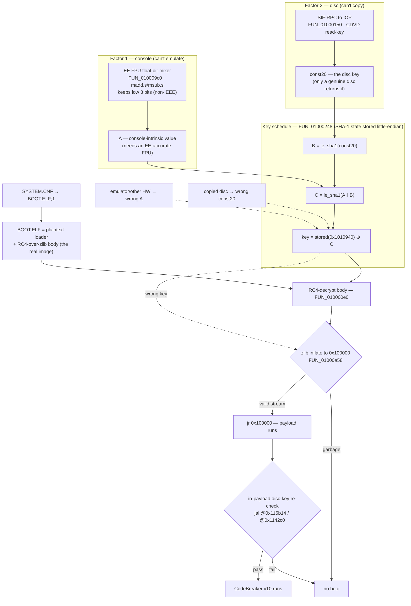

# Reversing CodeBreaker v9.2 against the Rust implementation

Done 2026-10-26, prompted by question 3 of
[issue #11](https://github.com/mlafeldt/codebreaker-rs/issues/11): when a
beefcode (`BEEFC0DE`/`BEEFC0DF`) is decrypted while the list is already in V7
mode, is the key schedule applied once or twice?

The CB v9.2 code decryption was decompiled and compared function by function
with `src/`. Results:

| Area | Firmware vs `src/` |
|---|---|
| V1 decrypt, V7 decrypt, RSA, RC4, multiply, line counting, key/seed schedule, constant tables | **same** |
| Beefcode in V7 mode (`auto_decrypt`, `decrypt`, `encrypt`) | firmware rekeys **twice**. 0.4.0 (`7691577`) did it once; fixed in `75471b6`. |
| Line count of V1-encrypted codes (`auto_decrypt`) | firmware counts from the **encrypted** address, `src/` from the decrypted one since `bb95630` (0.4.0). Fixed in `fadd9d9`. |
| Raw beefcode during auto-detection | firmware passes the next two lines through raw, `src/` re-detected the next line. Fixed in `d9bab13`. |
| `FFFFFFFF` encryption options | firmware switches V7 off and on, counts lines and can take the key from the next line; `src/` ignored them. Bit 16 and the line count since `16299e0`. Bit 17 (key from the next line) is left out on purpose; a full implementation is on `ffffffff-encryption-options` (`fd0e355`). Spec, vectors and decision in §9.5. |
| RSA step of V7 decrypt | firmware's bignum reduction is buggy near the modulus, `src/` computes exact `x^11 mod n` (§9.4). Kept on purpose, documented at `rsa_crypt` in `105d376`. |
| Encrypting a beefcode as `BEEFC0DF`'s extra seed line | `Cb7::encrypt_code_mut` wasn't the inverse of the firmware's decrypt (§9.3). Fixed in `23739ac`. |

§9 adds a second pass that emulates the firmware in Ghidra and diffs it
against `src/` on about 10,600 lines.

Binaries and raw tool output are in `elf/` (gitignored, copyrighted). Scripts
are in `tools/` and `compare/`.

**Branches.** `research/` lives only on the `research` branch. `main` never
sees it; instead `main` is merged into `research` when it advances (never the
other way, and `research` is never rebased), so every hash on both branches is
stable and citable:

* Fixes to `src/` that come out of this research go on `main` as normal
  commits, with their own tests, firmware-verified vectors, and commit
  messages that cite CodeBreaker v9.2 but not `research/`.
* This document cites those fixes by their `main` hash; it may also cite
  `research` commits, since merging (unlike rebasing) leaves them untouched.
* `compare/` (`head = ../..`) builds the crate from the `research` tip, i.e.
  `main` plus this branch, so rerun the checks there to confirm a fix.
* Verified work that stays off `main` gets its own branch, e.g.
  `ffffffff-encryption-options` (§9.5). Cite it by hash too.


## 1. The ELF

| | |
|---|---|
| File | `elf/CBv92.ELF` (user-supplied copy, 3,292,756 bytes) |
| SHA-256 | `d51a90c0d86fb33de52d80c5e1d7a372dc17c1e3d2a52645fff4922a573e4c83` |
| Format | ELF32 LE MIPS, header says MIPS-I, no section headers |
| Segment | one RWX `PT_LOAD`: file `0x60`, vaddr `0x019dc3a0`, filesz `0x323df4`, memsz `0x323ee0` |
| Entry | `0x01d00008` (unpacker stub) |
| Packer | ps2-packer N2E (UCL NRV2E, 8-bit bit buffer), magic `N2E1` at `0x01d00000` |

It is **not a pristine Pelican build**. Strings in the unpacked image (vaddr
`0x369498`):

> HDLoader modded version based on patch by ffgriever... CodeBreaker V9.2 no
> Anti-Modchip Version. Cracked By PS2TG's Lonwern on 2006/01/20. ... RSA Patch
> added by bfoos 2008/04/04, All credits go to misfire. Day1 server mod added by
> bfoos 2008/30/09 ...

`VERSION Code Breaker PS2 V9.2` is at `0x354bcc`. Without a clean image the
patched bytes can't be diffed out. The code-encryption path studied here shows
no sign of patching, and all constants match `src/` (§5). One mod has since
been located: the "RSA Patch" in the string above neuters the signature
verdict (§8, §9.9), so the signature path can't be read as stock.


## 2. Unpacking

The stub at the entry reads a pointer at `0x01d00004` to a 16-byte header (here
at `0x019dc3a0`):

| Offset | Value | Meaning |
|---|---|---|
| `+0x0` | `0x00100008` | original entry point (jumped to via `jr`) |
| `+0x4` | `0x01140000` | image size |
| `+0x8` | `0x00000a86` | stub zero-fills this + 1 bytes at load + size |
| `+0xc` | `0x00100000` | load address |
| `+0x10` | | NRV2E stream |

The decompressor at `0x01d00044` is standard UCL `nrv2e_d8`: `sltiu t1, t3,
0x501` is the `m_off > 0x500` length bump, and `andi t4, t1, 1` the low-bit
length encoding that distinguishes 2E from 2B. It stops at
`m_off == 0xffffffff`.

`tools/unn2e.py` reimplements it and wraps the output in a minimal ELF (one
`PT_LOAD` at `0x100000`, file offset `0x1000`, entry `0x100008`):

```
python3 -I tools/unn2e.py elf/CBv92.ELF elf/CBv92.unpacked.elf
# oep=0x100008 dest=0x100000 hdr_size=0x1140000 bss=0xa86 out=0x113f57a consumed=0x323cb8/0x323e54
```

Unpacked SHA-256: `91c04ee76b1126b2b060298fe6c2d434740d2b1923f7e282bc154153c1b79edb`.
vaddr = file offset + `0xff000`.


## 3. Tooling

* **rizin 0.9.1** for byte searches. Beefcode compares are `lui rX, 0xbeef` +
  `ori rX, rX, 0xc0de`/`0xc0df`:
  `rizin -e search.in=io.maps -qc '/x efbe003c:ffffe0ff' elf/CBv92.unpacked.elf`
  finds five sites: `0x102f14`, `0x102f2c` (exact compares in the list
  converter), `0x1041f0`, `0x104350`, `0x10448c` (masked `& 0xfffffffe`).
  rizin's R5900 mode shows several delay-slot instructions as `invalid`, e.g.
  `0x0000202d` (`daddu a0, zero, zero`), so don't read data flow from it.
* **Ghidra 12.1.4 headless** for decompiling and listings. Import with
  `-processor MIPS:LE:64:64-32addr`: the EE uses 64-bit `daddu`/`ld`/`sd`
  everywhere, and the 32-bit language truncates control flow on them.
  Ghidra doesn't know the R5900 three-operand `mult rd, rs, rt`. At `0x103598`
  (`0x02021018`, rd = `v0`) the product goes to `v0`, which the decompiler
  drops, so check listings where `mult` matters. The remaining Pcode errors
  (e.g. `0x12f82c`, `0x14877c`) are MMI ops outside the code studied here.
  Scripts: `tools/ghidra/DecompAt.java` (decompile containing functions +
  callers), `tools/ghidra/ListRange.java` (instruction listing). Full output:
  `elf/ghidra-decomp.txt`.
* **REA can't analyze this target.** Its Ghidra lane pins
  `MIPS:LE:32:default` for MIPS-I headers, which gives `halt_baddata()` on
  `daddu`. It refuses the image with the header patched to MIPS III
  ("requires EF_MIPS_ARCH_32R2, or ... MIPS-I or EF_MIPS_ARCH_32") or R5900
  ("Machine-specific MIPS variants ... need a separately supported processor
  profile"). Hopper, IDA and Kuna adapters admit no MIPS. It also only takes
  Ghidra 12.1.x. The v10 retail `BOOT.ELF` has a MIPS **III** header, so
  `open_binary` accepts the file — but every provider then rejects the EE
  target anyway, with the same "Machine-specific MIPS variants ... need a
  separately supported processor profile" (Hopper/IDA/Kuna still no MIPS). A
  valid ELF arch clears REA's loader check but not its adapter, so EE work
  still goes through `analyzeHeadless` directly (§10).

```
analyzeHeadless <proj> cb92 -import elf/CBv92.unpacked.elf -processor MIPS:LE:64:64-32addr \
  -scriptPath tools/ghidra \
  -postScript DecompAt.java 0x101b58 0x102e38 0x1033c0 0x103410 0x103580 0x1035b0 \
                            0x103f60 0x1042b0 0x104548 0x132c98 0x132d30 0x134020 \
  -postScript ListRange.java 0x103f60 0x104290 0x1042b0 0x104520
```

Analysis takes about 20 s on an M-series Mac.


## 4. Map

| Firmware | Role | `src/` |
|---|---|---|
| `0x101988` | calls the list processor at `0x101b58`; called from `0x1062d0` (role not traced) | |
| `0x102e38` | code-list processor: reset, `0x1042b0` on every line, then convert to engine format at `0x80a28` | (out of scope) |
| `0x104548` | clears the mode word and `code_lines` | `Codebreaker::new` |
| `0x1042b0` | per-line auto decrypt | `Codebreaker::auto_decrypt_code_mut` |
| `0x1033c0` | lines per code | `num_code_lines` |
| `0x103410` | V1 decrypt | `cb1::decrypt_code` |
| `0x103f60` | V7 decrypt | `Cb7::decrypt_code_mut` |
| `0x1035b0` | `rekey(init, val)` | `Cb7::beefcode` |
| `0x103580` | `a * inverse(b \| 1)` | `mul_decrypt` |
| `0x1034e0` | inverse mod 2^32 | `mod_inverse` |
| `0x134020` | RSA modpow wrapper (→ `0x133dd0`) | `rsa_crypt` / `mod_pow` |
| `0x132c98` / `0x132d30` | RC4 init `(ctx, key, len)` / crypt `(ctx, buf, len)` | `Rc4::new` / `Rc4::crypt` |

The firmware has no counterpart of the plain (non-auto)
`Codebreaker::decrypt_code_mut` or of any encryption. The device only decrypts,
and always through `0x1042b0`.

| Global | Meaning | `src/` |
|---|---|---|
| `0x289ac8` | mode word: bit 16 = V7; low 16 bits a line counter and top byte a saved mode (options, §6.6) | `Codebreaker::scheme` |
| `0x289acc` | remaining lines of current code | `Codebreaker::code_lines` |
| `0x289ad0` | current block is V1-encrypted (vs raw) | `Scheme::V1` / `Scheme::Raw` |
| `0x289ad8`, `0x289b18`, `0x289b58` | V1 seed tables | `cb1::SEEDS` |
| `0x289b98` | default V7 seeds, 5×256 | `cb7::SEEDS` |
| `0x28a098` | default RC4 key, 5 words | `cb7::RC4_KEY` |
| `0x369000` | RSA modulus low word; high word is an immediate `0xffffffff` | `RSA_MODULUS` |
| `0x36dcc8` | current seeds, 5×256 | `Cb7::seeds` |
| `0x36e1c8` | key copy used for the multiplications | none (§6.5) |
| `0x36e1e0` | RC4 context (256 + 2 bytes) | `Rc4` |
| `0x36e2e8` | current key, 5 words | `Cb7::key` |
| `0x36e2fc` | `beefcodf` | `Cb7::beefcodf` |
| `0x36e300` | encryption-option state | none |
| `0x36e308` | `BEEFC0DF` extra seed (8 bytes) | local in `decrypt_code_mut` |


## 5. Identical parts

**Constants.** `python3 -I tools/cmptables.py elf/CBv92.unpacked.elf ../src`
reads `cb1::SEEDS`, `cb7::SEEDS`, `cb7::RC4_KEY` and `RSA_MODULUS` out of the
Rust sources and compares them with the image. All match. The V7 decrypt
passes exponent `0xb`, which is `RSA_DEC_KEY`.

**V1 decrypt (`0x103410` vs `cb1::decrypt_code`).** With `cmd = addr >> 28`:
`if cmd > 2 { val = (val ^ addr) - SEEDS[2][cmd] }`, then
`tmp = addr ^ SEEDS[0][cmd]` and `t = tmp - SEEDS[1][cmd]`. The result
`(t & 0xffffff) >> 16 | tmp & 0xff000000 | (t & 0xff) << 8 | (t >> 8 & 0xff) << 16`
is the same byte placement as the Rust
`(tmp & 0xff00_0000) | ((t & 0xffff) << 8) | ((t >> 16) & 0xff)`.

**Lines per code (`0x1033c0` vs `num_code_lines`).** Cmd 3 is 2 lines if bit
22 is set, cmds 4–6 are 2, everything else 1.

**V7 decrypt (`0x103f60` vs `Cb7::decrypt_code_mut`).** Same steps in the same
order:

1. 64 rounds, `i = 63..0`: `val = ((val - (addr ^ s4[i])) ^ s1[i]) + s3[i]`,
   then `addr = ((addr + (val ^ s4[i])) ^ s0[i]) - s2[i]`.
2. RSA only if `addr:val < 0xFFFFFFFFFFFFFFF5`.
3. RC4 over `[addr, val]` keyed with the 20-byte key.
4. `addr = mul_decrypt(addr, k0 - k1)`, `val = mul_decrypt(val, k2 + k3)`. The
   firmware takes `k` from the copy at `0x36e1c8`, which equals the key unless
   options are used (§6.5).
5. If `beefcodf` is set, RC4 the seeds with `addr:val` as key, clear the flag
   and return. Otherwise, on a beefcode, `rekey(0, val)`.

The only difference is step 5: the firmware sets `beefcodf = 1` for any
beefcode, while `Cb7::beefcode` sets `addr & 1`. The firmware's only caller
overwrites it with `addr & 1` straight away (§6.1), so the net state is the
same.

**Multiply (`0x103580` vs `mul_decrypt`).** `a * inverse(b | 1)`. The
firmware gets the inverse from an extended-Euclid loop (`0x1034e0`, `divu`
based), `src/` from Newton iteration. Both give the unique inverse of an odd
number mod 2^32.

**RC4 (`0x132c98`/`0x132d30` vs `rc4.rs`).** Textbook KSA/PRGA. The context is
256 state bytes followed by `i` and `j`.

**Key/seed schedule (`0x1035b0` vs `Cb7::beefcode`).**

* `init != 0`: key = default key, then seeds = default seeds if `val != 0`,
  else zero.
* `init == 0, val == 0`: zero seeds and `k0..k3` (the firmware derives `k0..k3`
  from the zeroed seeds, which is 0).
* `val != 0`: `k[i]` byte `j` = `seeds[(i + j) % 4][val byte j]`, exactly the
  Rust `from_fn` expression.
* Then 5 rounds: RC4-init with the 20-byte key, crypt `seeds[i]`, crypt the
  key.

The differences don't change any output:

* The firmware's `init` comes from the caller (V7 bit of the mode word). `src/`
  uses `Cb7::initialized`. Both are fresh per list. Options can switch V7 off,
  so since `16299e0`, `Codebreaker::enter_v7` starts from a fresh `Cb7` when
  V7 is off, which keeps the decision the same.
* On init the firmware clears `beefcodf` and the option state. `src/` sets
  `beefcodf = addr & 1` at the end.
* The firmware ends by copying key → key copy (§6.5).


## 6. Auto decrypt (`0x1042b0` vs `Codebreaker::auto_decrypt_code_mut`)

Decompiled, with names:

```c
v7 = mode & 0x10000;  if (opt == 2) v7 = 0x10000;
if (!v7) {
    if (code_lines == 0) {
        code_lines = num_code_lines(*addr);                // ENCRYPTED addr (§6.2)
        if ((*addr >> 24 & 0xe) == 0) { code_lines--; v1 = 0; return; }   // raw
        if ((*addr & ~1) == 0xbeefc0de) { code_lines++; v1 = 0; return; } // §6.3
        v1 = 1;
    } else if (!v1) { code_lines--; return; }              // raw continuation
    cb1_decrypt(addr, val);
    code_lines--;
} else {
    cb7_decrypt(addr, val);                                // may rekey (§6.1)
    if (code_lines == 0) {
        code_lines = num_code_lines(*addr);                // decrypted addr
        if (code_lines == 1 && *addr == 0xffffffff) { /* options §6.6 */ return; }
    }
    code_lines--;
    if (opt == 2) { opt = 0; return; }
}
/* option line counter (§6.6) */
if ((*addr & ~1) == 0xbeefc0de) {
    if (!(mode & 0x10000)) { mode |= 0x10000; rekey(1, *val); }
    else                   { rekey(0, *val); }             // second rekey (§6.1)
    beefcodf = *addr & 1;
    code_lines = 1;
}
```

### 6.1 Beefcode in V7 mode: two rekeys (matches since `75471b6`)

Inner call, `0x103f60` (`a1` = decrypted value stored at `0x10413c`, untouched
on the way):

```
00104138  daddu a1,v0,zero          ; a1 = mul_decrypt(val)
0010413c  sw a1,0x0(s0)             ; *val = a1
00104140  lw v0,-0x1d04(s4)         ; beefcodf (0x36e2fc)
00104144  beq v0,zero,0x001041e4
...
001041f0  lui v0,0xbeef             ; (*addr & ~1) == 0xbeefc0de ?
001041fc  bne v1,v0,0x00104218
00104204  jal 0x001035b0            ; rekey(0, *val)   <-- first
00104208  _clear a0
0010420c  li v0,0x1
00104214  _sw v0,-0x1d04(s4)        ; beefcodf = 1
```

Outer tail, `0x1042b0`, reached after the V7 branch:

```
001043c0  jal 0x00103f60            ; V7 decrypt
...
0010448c  lui a0,0xbeef             ; (*addr & ~1) == 0xbeefc0de ?
00104498  bne v0,a0,0x00104520
001044a4  _lw v1,-0x6538(s3)        ; mode word (0x289ac8)
001044ac  and v0,v1,a0              ; & 0x10000 (V7)
001044b0  beq v0,zero,0x001044cc    ; not V7 yet -> rekey(1, *val), set V7
001044b8  lw a1,0x0(s2)
001044bc  jal 0x001035b0            ; rekey(0, *val)   <-- second
001044c0  _clear a0
...
00104514  sw v1,-0x6534(a0)         ; code_lines = 1
00104518  sw v0,-0x1d04(a1)         ; beefcodf = addr & 1
```

The second rekey starts from the seeds and key that the first produced, so it
changes the outcome. `src/` does the same: `auto_decrypt_v7` lets
`Cb7::decrypt_code_mut` rekey, then calls `enter_v7`. `decrypt_code_mut` and
`encrypt_code_mut` mirror it.

| Plain text after the common key | firmware / `src/` | 0.4.0 (one rekey) |
|---|---|---|
| `BEEFC0DE 00000000` | `8787C575 1AC4C1B4` | same |
| `9029BEAC 0C0A9225` | `02210430 184C16E8` | `E8C99F89 14B426D6` |
| `BEEFC0DF B16B00B5` | `FE8B8601 C7C6F6CE` | same |
| `01234567 89ABCDEF` | `2195D855 63FA11A7` | `8DB9F946 530C6B98` |
| `9029BEAC 0C0A9225` | `0CA31760 A6F7E88A` | `760B3F60 AECF1D18` |

Both cases are in `src/lib.rs` tests. Regenerate them with
`cargo run --example vectors` in `compare/`.

### 6.2 V1 line count uses the encrypted address (fixed in `fadd9d9`)

```
00104328  jal 0x001033c0            ; num_code_lines(
0010432c  _lw a0,0x0(s1)            ;   *addr) -- still encrypted
...
001043a4  jal 0x00103410            ; V1 decrypt happens afterwards
```

V1 encryption shuffles the low 24 bits, so cmd 3's bit 22 can differ between
cipher text and plain text. `bb95630` (first released in 0.4.0) moved
`num_code_lines` after decryption, and the device doesn't do that. Example
from the `bit22` auto test in `src/lib.rs`:

| Input | firmware / 0.3.2 | `src/` (`bb95630`) |
|---|---|---|
| `3A550D56 9267D8DE` | `30000035 12345678` (2 lines: encrypted bit 22 = 1) | same, 1 line |
| `0029BEAC 0C0A9225` | `0AADA1F9 0C0A9225` (V1-decrypted continuation) | `0029BEAC 0C0A9225` (raw) |

`fadd9d9` reverted `bb95630` and changed that test.

### 6.3 Raw beefcode during detection (fixed in `d9bab13`)

```
00104350  lui v1,0xbeef             ; raw (unencrypted) beefcode?
00104360  bne v0,v1,0x0010437c
00104368  addiu v0,a0,0x1           ; code_lines = num_code_lines + 1 = 2
00104370  sw v0,-0x6534(s0)
00104378  _sw zero,-0x6530(v1)      ; v1 = 0 (raw), return
```

The firmware ignores the line and passes the next two lines through raw
(continuation path). `auto_decrypt_v1_or_raw` returns with `code_lines == 0`,
so the next line is detected afresh. Neither path rekeys.

### 6.4 Line counting otherwise

Raw first lines (`code_lines = n - 1`), raw continuations, V1 continuations
(decrypt, then decrement), and the V7 branch (count from the decrypted address
when `code_lines == 0`, then decrement) all match `src/`.

### 6.5 Key copy

`rekey` ends by copying the key to `0x36e1c8`, and the V7 multiplications use
that copy. `src/` has only `Cb7::key`. They differ only once the option path
(§6.6) changes the key.

### 6.6 `FFFFFFFF` encryption options (bit 16 and count in `src/` since `16299e0`, §9.5)

A one-line V7 `FFFFFFFF vvvvvvvv` sets
`mode = (mode >> 16) << 24 | v & 0xffffff` and
`opt = (v & 0x20000) >> 16`, then returns before the beefcode check (`src/`
also returns, but otherwise ignores it). The low 16 bits of the mode word count
down once per line, and at zero the saved mode comes back from the top byte.
`opt == 2` forces V7 decryption of the next line and is then cleared. With
`opt != 0`, the inner decrypt derives a new key from each non-beefcode line:
`key = {addr ^ k0, val ^ k1, addr - k2, val + k3, (addr - val) ^ k4}`, `k` = the
copy. §9.5 has the full spec (`opt` is only ever 0 or 2).

### 6.7 List converter

After decrypting, `0x102e38` drops lines with top nibble `0xB`: exactly
`BEEFC0DE` skips 2 words and `BEEFC0DF` 4 (exact, not masked compares).
`FFFFFFFF` skips 2 words, or 4 if `val & 0x20000`. That's engine-side; `src/`
returns beefcodes to the caller.


## 7. History

Only for context. The firmware is the reference.

* misfire's original C (2006, cb2util v1.0 `c0c1bd0`, 2007) already has the
  double rekey and the commented-out `//beefcodf = 1;`, which is exactly the
  firmware's inner assignment (§6.1). Omniconvert (`20f7674`) and codebreaker
  ≤0.3.2 inherit both.
* cb2util `57f12cb` dropped the separate `oldkey` as "always the same as key".
  That's true until the option path runs (§6.5). `fd0e355` on
  `ffffffff-encryption-options` brings it back as `Cb7::mul_key`.
* `compare/` auto-decrypts cb2util's test fixtures with 0.3.2, 0.4.0 and the
  local crate (`cargo run -- ../../cb2util/test/*/*.{enc,txt}`). At cb2util
  `593ea25`: 53 games, 6,234 lines. Head matches 0.3.2 everywhere, and 0.4.0
  differs on 4 lines (`beef.enc` test 8, the only V7-mode beefcode). No CBC
  fixture (official code downloads) contains one.


## 8. Caveats

* Primary image v9.2, cracked and modded (§1). A stock-payload v10 loader was
  added later (§10); it shows the per-line code crypto changed between versions
  (§11), so v9.2 behaviour does not carry over unchanged, and v7/v8 are unknown.
  One mod is located: the "RSA Patch ... credits go to
  misfire" named in the §1 string is the signature verdict in `FUN_00132ed8`
  (the verifier behind `0x133180`, §9.9). It computes the padded-block compare
  at `0x14611c` and then throws the result away, forcing the return to 1
  (`0x132fec`: `addiu v0, zero, 1`). So the signature checks in the §9.9
  loaders always pass on this image — the PCB firmware-upgrade path would
  execute any payload. That is the crack, not stock behaviour, so the verify
  path here says nothing about the real firmware. A genuine forgery question
  (is the RC4-masked padding scheme sound against `e = 0x10001`?) needs a clean
  image to study. The retail v10 image now settles what stock does: the same
  verdict there is `sltiu v0, v0, 1`, so the patch swapped `sltiu`→`addiu`
  (`2c`→`24`) to force a pass (§10.9).
* Nothing run on hardware or in PCSX2. §9 emulates the unpacked image in
  Ghidra, with the R5900-specific instructions hooked.
* Encryption in `src/` has no firmware counterpart and is only checked as the
  inverse of decryption.
* The callers of `0x101988` (`0x1062d0`, presumably game start) were not traced.


## 9. Second pass: emulation (2026-10-26)

Same image as §1. (A second version, v10, was added later; §11 diffs the two
and finds the code crypto changed.) This pass ran the firmware's per-line
decrypt in Ghidra's emulator and diffed it against `src/` at `d9bab13`.

### 9.1 Method

| Tool | Does |
|---|---|
| `tools/ghidra/CallTree.java` | call tree of `0x1042b0`/`0x104548` with blocks and listings, flags EE-only instructions (`elf/calltree.txt`) |
| `tools/ghidra/Emu.java` | `EmulatorHelper` harness: per list, a fresh image, reset (`0x104548`), then `0x1042b0` per line; prints each output with the globals, and the first list/line to reach each instruction. `!inv`/`!mul`/`!rsa` call the primitives directly. |
| `tools/fwmodel.py` | Python model of `0x1042b0` and callees, including options and the bignum quirk. It can encrypt. `run` writes `Emu.java`'s output format, so `emudiff.py` also works without Ghidra. |
| `tools/gen.py` | input lists: `random`, `targeted`, `plain` (for the encryption check), `report` (§9.3–9.5 vectors), `optfuzz` (random lists, a quarter option lines) |
| `compare/examples/emucmp.rs` | runs the crate (`auto`, `decrypt`, `encrypt`) on the same lists, reading the state from `Debug` |
| `tools/emudiff.py` | firmware vs crate per list (first differing output, else the first state difference; the raw/V1 flag only where it's read), model vs emulation on every line and global, primitives vs exact math, optional round trip against the plain text |
| `tools/coverage.py` | block coverage from the `Emu.java` coverage files |
| `tools/luirefs.py` | finds `lui`+offset accesses to globals, which Ghidra mostly doesn't resolve |

```
G=/opt/homebrew/Cellar/ghidra/12.1.4/libexec/support/analyzeHeadless
python3 -I tools/gen.py elf/CBv92.unpacked.elf targeted /tmp/t.txt 2
$G <proj> cb92 -process CBv92.unpacked.elf -noanalysis -readOnly -scriptPath tools/ghidra \
   -postScript Emu.java /tmp/t.txt /tmp/t.out /tmp/t.cov
(cd compare && cargo run -q --release --example emucmp -- auto /tmp/t.txt) > /tmp/t.crate
python3 -I tools/emudiff.py elf/CBv92.unpacked.elf /tmp/t.out /tmp/t.crate
python3 -I tools/coverage.py elf/calltree.txt /tmp/t.cov
```

Inputs, outputs and coverage of every run are in `elf/emu/`. The
`src/cb7.rs` change that replicates the RSA bug (§9.4, not recommended) is in
`elf/emu/proposed-fixes.patch`, against `105d376`.

| Run | Lists | Lines | Firmware vs `src/` |
|---|---|---|---|
| `random` (random words, V1 beefcodes, then random V7 cipher text) | 120 | 2,786 | identical, outputs and state |
| `targeted`: every command nibble × bit 22 × raw/V1/V7 × raw/V1 follow-up | 192 | 832 | identical |
| `targeted`: V1 cmd 3 whose bit 22 flips under encryption | 8 | 32 | identical |
| `targeted`: beefcodes in every mode/encoding/position, `BEEFC0DF` extra-line variants, repeated beefcodes | 76 | 474 | identical |
| `targeted`: `FFFFFFFF` options (every bit 16/17 combination, counts 0–3 and `ffff`, mixed) | 106 | 1,853 | 52 lists differ, all options (§9.5). With `16299e0`, 38, all after a bit 17 line. Identical with `fd0e355`. |
| `targeted`: RSA inputs 0, 1, 2, 2³²−1, 2³², n−2, n−1, n, n+1, 2⁶⁴−1 | 10 | 30 | n−2, n−1 differ (§9.4) |
| `targeted`: 129 primitive calls (`inv`, `mul` on 31 edge/random values, `rsa` on 36) | | | `inv`, `mul` exact; 2 `rsa` differ (§9.4) |
| `plain`: plain text encrypted by `src/`, decrypted by the firmware | 120 | 2,270 | 12 don't round-trip (§9.3) |
| same with the §9.3 fix (now `23739ac`) | 120 | 2,270 | all round-trip |
| `rsa`: 41 calls (n−2^31..n, values whose square lands there, just below) | | | 30 differ from exact math (§9.4) |
| `report` (§9.3–9.5 vectors, with `opt-key-beef`, `opt-key-2-lines` and `opt-count-beef`), against `1670607` | 13 | 82 | the 8 option lists and `rsa-wrong` differ. With `16299e0`, the 4 bit 17 lists and `rsa-wrong`. With `fd0e355`, only `rsa-wrong`. |
| `cb2crypt`: CB2crypt's readme example (§9.5) | 1 | 6 | the raw code after `FFFFFFFF 00000000` differs before `16299e0`, identical since |
| `optfuzz` (seed 1): a quarter option lines, in every encoding, among codes of every command, beefcodes and random words, against `1670607` | 100 | 3,378 | 84 lists differ, all options. With `16299e0`, 68, all after a bit 17 line. Identical with `fd0e355`. |
| `optfuzz16` (seed 1): the same without bit 17, against `16299e0` | 100 | 3,378 | identical, outputs and state |
| `optfuzz` seeds 1–20 with `fd0e355`, and `optfuzz16` seeds 1–20 with `16299e0`, `fwmodel.py run` instead of the emulator (seed 1 gives the same output as emulated) | 2,000 each | 65,546 each | identical, outputs and state |

`fwmodel.py` matches the emulation on every line and every global (mode,
`code_lines`, V1 flag, `beefcodf`, `opt`, key, key copy, CRC of the seeds) in
all of these. At `16299e0`, the only remaining differences are RSA (§9.4)
and lists after an option line with bit 17: 38 of `targeted`, as above in
`report` and `optfuzz`. With the §9.4 patch and `fd0e355`, there are none.
The `optfuzz` runs reach every option path: option lines (310 emulated), V7
switched off and back on by the counter, forced lines that become the key
(141), a beefcode (14) or another option line (42), and forced 2-line codes
with V7 off (9). Coverage (§9.8) doesn't change.

### 9.2 Verdict per Rust function

| `src/` | Firmware | Verdict |
|---|---|---|
| `cb1::decrypt_code` | `0x103410` | identical (every cmd nibble, emulated) |
| `cb1::encrypt_code` | (inverse of `0x103410`) | exact inverse (every round trip in `plain`) |
| `num_code_lines` | `0x1033c0` | identical |
| `cb7::is_beefcode` | masked compares at `0x104350`, `0x1041f0`, `0x10448c` | identical |
| `Cb7::beefcode` | `0x1035b0` | identical given the same init decision (§9.6) |
| `Cb7::decrypt_code_mut` | `0x103f60` | identical except the RSA step (§9.4) and the option paths (key copy, key from line, §9.5), both left out on purpose |
| `Cb7::encrypt_code_mut` | (inverse of `0x103f60`) | was **not the inverse** when `BEEFC0DF`'s extra line is a beefcode (§9.3, fixed in `23739ac`). In ~2⁻³¹ of codes no inverse exists (§9.4). |
| `mul_decrypt`, `mod_inverse` | `0x103580`, `0x1034e0` | identical on 0, 1, 2, 3, 5, `7fffffff`, `80000000`, `80000001`, `fffffffd`–`ffffffff` and 20 random values (the firmware uses extended Euclid, `src/` Newton) |
| `rsa_crypt`/`mod_pow` (decrypt) | `0x134020` → `0x133dd0` | **differs**, on purpose (§9.4) |
| `Rc4` | `0x132c98`/`0x132d30` | identical (context is re-initialized on every use, no carry-over) |
| `Codebreaker::auto_decrypt_code_mut` | `0x1042b0` | identical except option bit 17 (§9.5) and RSA (§9.4), both left out on purpose. Bit 16 and the line count since `16299e0`. |
| `Codebreaker::decrypt_code_mut` | none | equals the firmware on lists without raw codes or options (all of `plain`). It differs on 100 of 120 `random` lists, as expected for a non-detecting API. |
| `Codebreaker::encrypt_code_mut` | none | inverse except §9.4 (and §9.3 before `23739ac`) |
| `Codebreaker::new` | reset `0x104548` | identical |
| `Codebreaker::new_v7`, `Cb7::default` | state after `B4336FA9 4DFEFB79` | same key and seeds. `code_lines` was 0 instead of 1 until `16299e0`, which only matters with options (§9.6). |

### 9.3 Difference: encrypting a beefcode as `BEEFC0DF`'s extra seed line (fixed in `23739ac`)

The firmware's `0x103f60` checks `beefcodf` first. If it's set, the line is
the extra seed: it RC4s the seeds and returns, without the inner rekey. Then
`0x1042b0` rekeys once for the beefcode. `Cb7::decrypt_code_mut` does the
same. `Cb7::encrypt_code_mut` checks `is_beefcode` first and returns before
using the extra seed, so `Codebreaker::encrypt_code_mut` rekeys twice and never
RC4s the seeds. Every later line then gets the wrong cipher text, and not even
`src/`'s own decrypt reads it back.

Plain text `BEEFC0DE 00000000`, `BEEFC0DF 00000000`, `BEEFC0DE 12345678`,
`01234567 89ABCDEF`, `9029BEAC 0C0A9225` with `Codebreaker::new()`:

| Line | `src/` cipher text | Cipher text the firmware decrypts correctly (emulated) |
|---|---|---|
| 1–3 | `B4336FA9 4DFEFB79`, `EF3A41A5 8F460BA4`, `3B070C70 52BA8DBD` | same |
| 4 | `9E3F1DB6 875CADA1` (decrypts to `ED2187E3 1FCEDA9B`) | `00DDD0A3 3EE4EC6F` |
| 5 | `A669604B 2DA9FAD5` | `3B91B1FA 3D12C0B1` |

With `BEEFC0DF B16B00B5`, `BEEFC0DF 12345678`, `01234567 89ABCDEF`,
`9029BEAC 0C0A9225`, `201F6024 00000000` after the default `BEEFC0DE 0`, the
expected cipher text is `FE8B8601 C7C6F6CE`, `E8FF75C2 70A8D7EF`,
`E632FC5D 087A0038`, `3D945215 5E6BE61F`, `8BAECCD7 54ACADA4`. `src/` gets the
first two right, then gives `F46A5E09 83F24AEA`.

Fix (`23739ac` on `main`): `Cb7::encrypt_code_mut` handles `beefcodf` first
(RC4 the seeds, clear it, return), then `is_beefcode`, which is the order
`decrypt_code_mut` uses. The first list above became tests in `src/lib.rs`
and `src/cb7.rs`; they fail without the change. With it, all 120 `plain`
lists round-trip through the emulated firmware, and so do both lists above.
`emucmp encrypt` at `23739ac` gives the same cipher text as the emulated
patch.

### 9.4 Difference: the firmware's RSA is wrong near the modulus (kept, `105d376`)

`0x133dd0` is a generic bignum `modexp` (32-bit limbs) with Karatsuba multiply
(`0x133670` → `0x133428`) and a Knuth-D style reduction (`0x133948`). The
quotient digit estimate at `0x133bb0` is

```
00133ba4  lwu a0,0x4(v0)       ; window high word
00133ba8  lwu v1,0x0(v0)       ; window low word
00133bb0  jal 0x0014cbd8       ; __udivdi3(window, v1)
00133bbc  dsll32 a2,v0,0x0
00133bc0  dsra32 a2,a2,0x0     ; q = low word of the 64-bit quotient
```

It isn't clamped to 2³²−1 (Knuth step D3). Here the divisor's top word v1 is
`0xffffffff` (n = `0xfffffffffffffff5`). Whenever the window's top word is also
`0xffffffff`, q wraps to a small number. The step barely subtracts, the loop
moves on, and the uncleared top word is dropped when the caller copies back
2 words. The result is deterministic but wrong.

* Every x in `ffffffff80000000..fffffffffffffff5` is affected: its first
  squaring has a top product word of `0xffffffff`. In general, a modular
  multiplication goes wrong when the 128-bit product's top word is
  `0xffffffff`, and occasionally otherwise. So an x below that range fails
  too when some intermediate power lands in it (e.g. x = `1bfcd151a41d1904`,
  whose square does).
* No difference in 300,000 random x. Besides the range (2⁻³³ of all x),
  each of the 5 multiplications fails with about 2⁻³² for random operands,
  when the last quotient step's window has a top word of `0xffffffff`.
  For example, `2³² · b` is wrong for every b in
  `ffffffff00000000..n` in the model. In total that's roughly 1 in 10⁹
  V7-decrypted lines.

`fwmodel.cb_rsa` models it. It matches the emulator on all 77 RSA calls,
including the 32 that differ from exact math. Vectors after the default key
(`B4336FA9 4DFEFB79`), emulated:

| Cipher text | Value after the 64 rounds | Firmware | `src/` |
|---|---|---|---|
| `4A2AF1C7 2DF772C5` | n−1 | `F2222B68 F4C6BE86` | `3C875748 89294DDF` |
| `0B431DEB 948937C5` | `ffffffff80000000` | `71664B9E 1189C338` | `68171B47 7B1EC390` |
| `413F8599 D7785BE7` | `1bfcd151a41d1904` | `B8D7A9CE BB4CF58D` | `9ADA878D 4C69EFB4` |
| `D06EBC3C 965E0DD9` | `ffffffff7fffffff` (just below) | `90A93F06 178678AF` | same |

Primitive level: `!rsa fffffffffffffff4` gives `04f363dfecae2b57` (exact:
`fffffffffffffff4`), and `!rsa fffffffffffffff3` gives `24ded67f71ac6020`
(exact: `fffffffffffff7f5`).

The cause is certain from the code (the truncation at `0x133bbc`), and two
independent derivations agree on it: `fwmodel.py`, written from the listing,
and the emulator. The limits from §8 apply: nothing run on hardware, one
image only. The rate is the model's estimate, not a measurement.

Decision: `src/` keeps exact math. `105d376` documents the divergence at
`rsa_crypt`. Replicating the bug would:

* treat the symptom, not the cause. The cause is in the firmware, and only
  decryption can copy it. For plain text whose exact cipher value falls in the
  bad set (about 2⁻³¹ of codes), the firmware decrypts something else, and
  there may be no cipher text at all that decrypts to it.
* break `decrypt(encrypt(x)) == x`, which holds in `src/` for every x below n.
* swap a correct answer for the firmware's garbage. A code that hits the bug
  already misbehaves on a real CodeBreaker. The exact result is what exact
  encryption (like `src/`'s) started from.
* cost about 50 lines of subtle bignum code for about 1 in 10⁹ lines.

Unlike §6.1–6.3 and §9.3, which are state machine differences that ordinary
lists trigger, this is an arithmetic defect at the edges.

Not recommended, but available: `elf/emu/proposed-fixes.patch` replicates the
bug in decryption with `cb_mod_pow`/`cb_mul_mod`/`cb_mod`: square-and-multiply,
and a 5-word reduction that truncates q, subtracts `q·n` from 3 words, adds n
back once or twice, then does the window and final `> n` corrections.
Encryption keeps the exact `mod_pow`. It matches `cb_rsa` on 172,140 values
(random, the whole bad range, n−1..n−2000, the sporadic ones) and fixes both
`targeted` RSA lists.

Not a signature-forgery vector. The same reduction runs in the 2048-bit
signature check (§9.9), so the defect is reachable there too (the partial
remainder's top word == the modulus's top limb, ~2⁻³² per step). It buys
nothing: the signature key at `0x2949b8` is e = `0x10001` over a modulus whose
top limb is `0x90116783`, so the bug only perturbs the modexp into another
full-width residue — no algebraic lever, no search-space reduction — and e ≠ 3
rules out low-exponent forgery. Forging still needs the private key or a
firmware patch.

### 9.5 `FFFFFFFF` encryption options (bit 16 and count since `16299e0`, bit 17 left out)

Only `0x1042b0` writes `opt` (`0x36e300`) to non-zero (`luirefs.py`: every
access to `0x289ac8..0x28a0ac`, `0x369000` and `0x36dcc8..0x36e310` is in
`0x1033c0..0x104560`), so `opt` ∈ {0, 2}.

State beyond `src/`:

* mode word (`0x289ac8`): bit 16 V7, bits 0–15 a line counter, bits 16–23
  (V7 + 7 stored bits) are saved in bits 24–31
* `opt`: 2 = force V7 on the next line and take the key from it
* key copy `kc` (`0x36e1c8`): the key as of the end of the last rekey

Per line, the firmware decrypts as V7 if mode bit 16 is set or `opt == 2`
(`movz` at `0x1042fc`), otherwise as `src/` does with raw/V1 (unchanged).

V7 decrypt (`0x103f60`):
1. The rounds, RSA (§9.4) and RC4 use `key`. The two multiplications use
   `kc[0] - kc[1]` and `kc[2] + kc[3]` (`0x104108`–`0x104134`).
2. If `beefcodf`: RC4 the seeds keyed with the line, clear `beefcodf` and
   `opt`.
3. Else on a beefcode: `rekey(0, val)`, `beefcodf = 1`.
4. Else if `opt != 0` (`0x104224`): `key = [a ^ kc0, v ^ kc1, a - kc2, v + kc3,
   (a - v) ^ kc4]` from the decrypted line `a v`. `kc` stays as it was, so
   RC4 and the multiplications now use different keys.

Then in `0x1042b0`:
1. If `code_lines == 0`: `code_lines = num_code_lines(a)`, and if
   `a == FFFFFFFF` (`0x104400`):
   `mode = (mode >> 16 & 0xff) << 24 | v & 0xffffff`,
   `opt = v & 0x20000 ? 2 : 0`, `code_lines = 0`, return.
2. `code_lines -= 1`. If `opt == 2`: `opt = 0` and return, skipping the
   counter and the outer beefcode check (`0x104440`).
3. Counter, for V1- and V7-decrypted lines only, since raw lines return
   earlier (`0x104458`): if `mode & 0xffff != 0`, decrement it, and on
   reaching 0 restore `mode = (mode >> 24) << 16`.
4. Beefcode (`0x104480`): if mode bit 16 is clear, set it and
   `rekey(init = 1)`, which also clears `opt` and `beefcodf` and restarts from
   the default key and seeds. Otherwise `rekey(0)`. Then
   `beefcodf = a & 1`, `code_lines = 1`.

So `FFFFFFFF 000Xnnnn` at a code start in V7 mode means:
* bit 16 clear: V1/raw auto-detection for the next `nnnn` V1/V7-decrypted
  lines, then V7 again with the same key. With `nnnn = 0`, for the rest of the
  list, and the next beefcode then reinitializes with the default key.
* bit 16 set: stay V7. `nnnn` only restores the saved mode later.
* bit 17 set: the next line is V7-decrypted whatever the mode, isn't counted,
  and becomes the key unless it's a beefcode or an extra seed line.
* bits 18–23: stored in the mode word but never read.

These lines are never option lines: the line right after any beefcode
(`code_lines = 1`, the slot for `BEEFC0DF`'s extra seed), the second line of a
2-line code, and V1-decrypted `FFFFFFFF`.

Edge cases from the listing, all reproduced by the model:
* If the forced line decrypts to a beefcode, only the inner `rekey(0)` runs.
  `beefcodf` becomes 1 even for `BEEFC0DE`, and `code_lines` and V7 aren't set.
* An `FFFFFFFF` forced line is itself an option line.
* `rekey(0, v)` after a key change keeps the new `key[4]`.
* If the nnnn-th counted line is a beefcode, counting turns V7 back on
  first, so the beefcode only does `rekey(0)` and keeps the key
  (`opt-count-beef`).
* If the forced line starts a 2-line code while V7 is off, its 2nd line goes
  through the raw/V1 path as a continuation, with the V1 flag from before.
  That flag is always 1 there: V7 mode and forced lines are only reachable
  through V1-decrypted lines, and the flag only changes at code starts
  outside V7.
* The extra seed line clearing `opt` is unreachable. `opt` is only set on the
  line after an option line, and `beefcodf` is always 0 there: an option line
  isn't a beefcode, and if `beefcodf` was set, the option line itself was the
  extra seed line.

Vectors, emulated: cipher text → firmware output, with the output of `src/`
before `16299e0` where it differs. Since then, only the bit 17 lists differ.
Each list starts with `B4336FA9 4DFEFB79` → `BEEFC0DE 00000000` and
`D08F3A49 00078A53` → `9029BEAC 0C0A9225`, since the line after a beefcode
can't be an option.

V7 off for 2 counted lines; the raw line in between doesn't count:

| In | Firmware | `src/` |
|---|---|---|
| `5B5DF76F E5E4BDCE` | `FFFFFFFF 00000002` | same |
| `2AFF014C 2411FFFF` | `2043AFCC 2411FFFF` (V1) | `6234497B B50CFAA5` |
| `0031789A 00000063` | `0031789A 00000063` (raw) | `C1F7E144 57A4926F` |
| `2A973DBD 00000000` | `201F6024 00000000` (V1, counter hits 0) | `52C9647A 97439DDF` |
| `973E0B2A A7D4AF10` | `2096F5B8 000000BE` (V7 again) | same |

Key from the next line (`FFFFFFFF 00030000`):

| In | Firmware | `src/` |
|---|---|---|
| `4B985E41 9DCCE1A9` | `FFFFFFFF 00030000` | same |
| `F968CE47 D8CA4DAA` | `12345678 9ABCDEF0` (new key) | same |
| `14EE53A7 F77E00B2` | `2043AFCC 2411FFFF` | `3D1506F6 CE9A21C5` |
| `F7EB2E0B 21498771` | `201F6024 00000000` | `A42D511E 98062A36` |
| `41AF4716 599689E5` | `BEEFC0DE 00000000` (rekey keeps new `key[4]`) | `D967D1E4 98062A36` |
| `06491293 1A477240` | `2096F5B8 000000BE` | `BE663E59 9159AFBE` |

Bit 17 with V7 off for 1 line (`FFFFFFFF 00020001`): `85B57D54 CA8164F2` →
option, `F968CE47 D8CA4DAA` → `12345678 9ABCDEF0` (forced V7, new key, not
counted), `2AFF014C 2411FFFF` → `2043AFCC 2411FFFF` (V1, counter hits 0),
`F7EB2E0B 21498771` → `201F6024 00000000`, `5AB278AC D4FA03C1` →
`2096F5B8 000000BE` (V7 with the new key).

V7 off for good, then a beefcode reinitializes. After `B4336FA9 4DFEFB79`:
`FE8B8601 C7C6F6CE` → `BEEFC0DF B16B00B5`, `2195D855 63FA11A7` →
`01234567 89ABCDEF`, `70B21EC6 D6A6D277` → `FFFFFFFF 00000000`,
`2AFF014C 2411FFFF` → `2043AFCC 2411FFFF` (V1), `B4336FA9 4DFEFB79` →
`BEEFC0DE 00000000` (default key again), `973E0B2A A7D4AF10` →
`2096F5B8 000000BE`. From the V1 line on, `src/` output `FEE3FFBF 9ECF1A1D`,
`B1C7CC7B 02E7432D`, `D7D25E1C 97530D59`.

Not option lines, so firmware = `src/`:
* `B4336FA9 4DFEFB79`, `1C65C412 26F27361` (`FFFFFFFF 00000001` right after the
  beefcode), `397951B0 41569FE0` → `2043AFCC 2411FFFF`
* `FFFFFFFF 00000001` as the 2nd line of `4043AFCC 00020001`

Line after a beefcode: in `B4336FA9 4DFEFB79`, `460BA690 21E337B9`
(`4043AFCC 00020001`), `1C65C412 26F27361` (`FFFFFFFF 00000001`), the cmd 4
line is consumed as the beefcode's continuation. So its 2nd line is a code
start, here an option line: `2AFF014C 2411FFFF` → `2043AFCC 2411FFFF` (V1),
while `src/` gave `6234497B B50CFAA5`.

Decision: `16299e0` supports bit 16 and the line count, and leaves out
bit 17. `1670607` had first left out all options, since cb2util's fixtures
(53 games, 6,234 lines) have no option line. But CB2crypt's readme (2006,
"Use of unofficial codes along with official codes") tells users to append
`FFFFFFFF 00000000` to official V7 lists so raw codes can follow, with this
example (emulated):

| In | Firmware | before `16299e0` |
|---|---|---|
| `B4336FA9 4DFEFB79` | `BEEFC0DE 00000000` | same |
| `410C34B6 663C5B57` | `000FFFFE 0000015A` | same |
| `1C4D0A53 7FE27DE4` | `000FFFFF 0000015A` | same |
| `C81AC878 32FCD351` | `903DD9F8 00832021` | same |
| `0CF49BDF A4E29C32` | `FFFFFFFF 00000000` | same |
| `204D98B0 3F800000` | `204D98B0 3F800000` (raw) | `F7733C5A 6107ACC8` |

So such lists may exist. The same readme lists options 2 and 3 as "?", and
no list is known to use bit 17. Supporting it would add a few dozen more
lines of state machine: a key copy and an option flag shared with `Cb7`, the
saved mode, and quirks like a key line that turns out to be a beefcode.
Without bit 17, an option line only occurs in V7 mode, so the saved mode is
always V7 and only the counter (`Codebreaker::lines_until_v7`) is needed.
Tests in `src/lib.rs`: `opt-v7-off-2`, `opt-v7-off-beef`, `ffff-after-beef`,
`ffff-2nd-line`, `beef-phase`, this example and `opt-count-beef` (added in
`0b8a6ce`), all emulated, and `new_v7` against `new` plus
`B4336FA9 4DFEFB79`. Since `0b8a6ce`, `new_v7` is `new` plus that beefcode,
and the counter and beefcode check run once after either branch, as in the
firmware.

Encryption ignores options on purpose (documented at `encrypt_code` in
`6931e92`). `encrypt_code` doesn't track lines, so it encrypts `FFFFFFFF`
like any other code and stays in V7. Since `16299e0`, auto-decrypt then reads
such a list differently: `BEEFC0DE 00000000`, `9029BEAC 0C0A9225`,
`FFFFFFFF 00000000`, `2043AFCC 2411FFFF` encrypts to `B4336FA9 4DFEFB79`,
`D08F3A49 00078A53`, `0CF49BDF A4E29C32`, `397951B0 41569FE0`, and the last
line auto-decrypts to `33CCA260 E2314F40`, on the firmware too. Tracking
lines in encryption and encoding V7-off lines as V1 would fix that, but:

* `encrypt_code` is the inverse of `decrypt_code`, which still holds.
  Encrypt, then auto-decrypt was never a round trip. `2A000000 00000001`
  encrypts with V1 to `20CCDD1D 00000001`, which auto-decrypt reads as raw,
  in 0.3.2 too. That affects 14% of random V1 code starts (2,772 of
  20,000).
* The device reads such lists the same way, so nothing that worked before
  breaks. Only auto-decrypt agrees with the device now.
* CB2crypt's recipe works as is: encrypt up to `FFFFFFFF 00000000` and
  append the raw codes unencrypted.
* It would turn a plain inverse into a stateful API.

Bit 17 too: `ffffffff-encryption-options` (`fd0e355`, on top of `105d376`)
implements all options in auto-decrypt. It matches every run in §9.1 except
RSA:
* `Codebreaker::v7` and `v1` replace `scheme`, since the firmware keeps mode
  bit 16 and the V1 flag apart. `v7_lines` and `v7_restore` are the counter
  and the saved bit 16. Saved bits 17–23 are never read, so they're not kept.
* `Cb7::key_from_code` is `opt != 0`, `Cb7::mul_key` the key copy, set at
  the end of `beefcode`. `Cb7::decrypt_code_mut` takes the key from the line,
  or sets `beefcodf` after a forced beefcode.
* `Codebreaker::enter_v7` starts from a fresh `Cb7` when V7 is off. That's
  `rekey(init = 1)`, which also clears `opt` and `beefcodf`.
* `new_v7` starts with `code_lines = 1` (§9.6).
* Tests: the lists above, `opt-key-beef` (forced beefcode) and
  `opt-key-2-lines` (forced 2-line code with V7 off) from `gen.py report`,
  all emulated, and `new_v7` against `new` plus `B4336FA9 4DFEFB79`.

### 9.6 State map

| `src/` | Firmware | Set / reset |
|---|---|---|
| `Codebreaker::scheme == V7` | mode bit 16 (`0x289ac8`) | cleared per list by `0x104548`; set on the first beefcode; options can clear it |
| `Codebreaker::scheme` Raw/V1 | V1 flag `0x289ad0` | set at every code start outside V7; not reset per list, but never read before it is set |
| `Codebreaker::code_lines` | `0x289acc` | cleared per list; 1 after every beefcode; 0 after an option line |
| `Cb7::seeds` | `0x36dcc8` (5×256) | `rekey`; extra seed line |
| `Cb7::key` | `0x36e2e8` | `rekey`; option key line |
| none | key copy `0x36e1c8` | end of `rekey` only |
| `Cb7::beefcodf` | `0x36e2fc` | `rekey(1)` clears; inner beefcode sets 1; outer sets `a & 1`; extra seed line clears |
| `Cb7::initialized` | none: `rekey`'s `init` is "mode bit 16 clear" | same, since `enter_v7` starts from a fresh `Cb7` when V7 is off (`16299e0`) |
| none | `opt` `0x36e300` | option line sets; forced line, extra seed line and `rekey(1)` clear |
| `Codebreaker::lines_until_v7` (since `16299e0`) | mode bits 0–15 (24–31: saved mode, always V7 without bit 17) | option line; counter |
| local `Rc4` | context `0x36e1e0` | re-keyed on every use |
| local extra seed | `0x36e308` | written and used once |

Only the mode word and `code_lines` are reset per list. Seeds, key,
`beefcodf` and `opt` survive into the next list, but `0x102e38` runs once per
game boot, and every list's first beefcode in non-V7 mode reinitializes them.
`new_v7()` had `code_lines = 0` until `16299e0`, while the firmware has 1 after
`B4336FA9 4DFEFB79`. Without options that's invisible, because `src/`'s V7
path only uses `code_lines` for `FFFFFFFF`.

### 9.7 Features (binary → `src/`)

| Feature | Address | Status |
|---|---|---|
| raw pass-through and line counting | `0x1042b0`, `0x1033c0` | implemented |
| V1 detection (`top byte & 0x0e`) | `0x104340` | implemented |
| V1 line count from the cipher text | `0x104328` | implemented (`fadd9d9`) |
| raw beefcode → 2 raw lines | `0x104350` | implemented (`d9bab13`) |
| V1 decrypt | `0x103410` | implemented |
| V7 rounds, RC4, multiply/inverse | `0x103f60`, `0x103580`, `0x1034e0` | implemented |
| V7 RSA | `0x134020` → `0x133dd0`, `0x133948` | differs (§9.4) |
| rekey: init, `val == 0`, key derivation, 5 RC4 rounds | `0x1035b0` | implemented |
| double rekey in V7 | `0x104204` + `0x1044bc` | implemented (`75471b6`) |
| `BEEFC0DF` extra seed line | `0x104144`–`0x1041e0` | implemented (encryption: §9.3) |
| `code_lines = 1` after a beefcode | `0x104514` | implemented |
| option line, mode switch, counter, saved mode | `0x104400`, `0x104458` | implemented (`16299e0`); the saved mode is always V7 without bit 17 |
| forced V7 line, key from line | `0x1042fc`, `0x104224`, `0x104440` | left out (bit 17, §9.5) |
| key copy for the multiplications | `0x103f44`, `0x104108` | left out (only differs with bit 17) |
| beefcode after V7 was switched off → default key | `0x1044cc` | implemented (`16299e0`) |
| `val == NULL` beefcode path | `0x1044e4` | dead: the only caller passes a buffer |
| list conversion to engine format (drops beefcodes, options) | `0x102e38` | out of scope (§6.7) |
| CBC ("Day1") and loader file crypto | §9.9 | out of scope |

### 9.8 Coverage

Union of all runs (`elf/emu/coverage.txt`, blocks from `CallTree.java`):

| Function | Blocks | Unreached |
|---|---|---|
| `0x1033c0`, `0x103410`, `0x103580`, `0x103f60`, `0x104548`, RC4 | all | none |
| `0x1034e0` inverse | 9/9 | `x == 1` early return only via `!inv 1`. In a list it needs `kc0 − kc1 ∈ {0, 1}` or `kc2 + kc3 ∈ {0, 1}`, about 2⁻³⁰ per rekey. |
| `0x1035b0` rekey | 24/35 | 11 blocks at `0x1036c4`–`0x103a1f`: `ldl`/`ldr` copies for unaligned seed tables. Dead: the tables at `0x289b98` and `0x36dcc8` are 8-aligned. |
| `0x1042b0` | 32/34 | `0x104310` (`b 0x104460` when the V7 test is neither 0 nor `0x10000`, impossible after `movz`); `0x1044e4` (`val == NULL`) |
| `0x133948` reduction | 25/39 | Paths for 1-word divisors, non-normalized divisors and other sizes (dead for n). Also the window `> n` subtraction (`0x133b84`), the second add-back (`0x133c1c`) and the final subtraction (`0x133c58`). The second add-back would need q̂ − q = 2, which can't happen with n's low word `0xfffffff5`. The other two need a wrapped step and then a ~2⁻⁶⁴ coincidence. The model follows the listing for all three. |
| `0x133dd0`, `0x133320`, `0x133670`, `0x133828`, `0x133870`, `0x1333d0`, `0x1338c0`, `0x14cbd8`, `0x14d1a8` | partial | Paths for other operand sizes, zero or multi-word exponents, non-power-of-2 lengths, and `__umoddi3`/`__udivdi3` with large divisors. All dead for the fixed 2-word call from `0x1040a0`, live for the RSA-2048 signature check (§9.9). |
| memset `0x146358`, memcpy `0x1461b0` | entry | replaced by Java (EE `lq`/`sq`/MMI) |

Nothing reachable is missing from `src/` except option bit 17 (§9.5), and
nothing else differs except RSA (§9.4). Both are left out on purpose.

### 9.9 Other users of RC4 and the bignum code

| Caller | Protects | Scope |
|---|---|---|
| `0x10ab80` (Day1 import UI) | CBC code files. Verifies the RSA signature (`0x133180` → `0x132ed8`, key at `0x2949b8`: e = `0x10001`, 2048-bit n) for v8+ files only, identified by `fileid` `0x01554643` ("CFU", 1) or `cbvers` `0x800` at `+0x104` (both fields of the same `cbc_hdr_t`). Then RC4-decrypts with the 1024-byte key at `0x314090`, from `+0x158` (v8+) or `+0x40` (v7). | cb2util (`cbc.c`, `cb2_crypto.c:597` has the same key) |
| `0x1186d8`, `0x11aff8` | downloaded/HDD archives at `0xf00000`: 0x128-byte header, then RC4 (same key) and decompress (`0x12e910`, "Uncompress Data Error") | out of scope |
| `0x114ea0`, `0x114ff0` | `pelican.bin`/`upgrade.bin` (`PCB_*` over the network): signature check (`0x133180`), RC4 (same key) at `0x1000100`, then jump to `0x1000008`/`0x1000000` | out of scope |
| `0x132e38` | RC4 keystream as a padding/mask generator inside the signature check | out of scope |

The CBC signature only guards v8+ files. A file that is neither (no "CFU"
magic, no `0x800` `cbvers`) is a v7 CBC file, which has no signature field at
all — cb2util's `cbc7_hdr_t` is `0x40` bytes of title then data, against
`cbc_hdr_t`'s `0x158` with its 256-byte `rsasig`. v7 code files were always
unsigned, so the v8+ signature is authenticity, not a capability gate, and the
real signed execution boundary is PCB (`pcb.c`: 256-byte `rsasig` then an ELF
loaded at `0x1000000` and jumped to), the `pelican.bin`/`upgrade.bin` path at
`0x114ea0`/`0x114ff0`.

The *default verdict* for such a v7 file, though, is not stock on this image.
v9.2 defaults it to 1 — accept — at `DAT_00296080`; stock v10 defaults the same
global to 0 — reject — at `0x772c80` (both are read-only, never stored). So
"accept any unsigned v7 CBC" is a v9.2 change, most likely the "Day1 server mod
... by bfoos" named in §1, not legacy handling. The 1-vs-0 values are verified
by reading both images; the mod attribution is the 2026-10-29 re-review's.

The V1 and V7 routines (`0x103410`, `0x103f60`, `0x1035b0`) have no callers
besides `0x1042b0`, and `0x1042b0` has none besides the list processor
`0x102e38`.

### 9.10 Tooling notes

* **Emulating EE code in Ghidra** (MIPS:LE:64:64-32addr):
  * Three-operand `mult`/`multu` (rd = LO). Ghidra drops rd at `0x103564`
    and `0x103598`, and can't decode it at all in libgcc's `__udivdi3`
    (`0x14cbd8`) and `__umoddi3` (`0x14d1a8`). Analysis stops there and those
    functions' bodies are cut short. `Emu.java` executes every `mult`/`multu`
    with rd ≠ 0 itself.
  * `lq`/`sq` and MMI (`pcpyld`, `pcpyud`) in memset `0x146358` and memcpy
    `0x1461b0`: replaced by Java.
  * `jr`/`jalr` emit a `setISAMode` pcodeop the emulator lacks. Register a
    no-op `BreakCallBack`.
  * Unmapped stack: a `MemoryFaultHandler` that accepts uninitialized reads,
    plus zeroed pages.
  * Speed: about 330k instructions/s single-stepped with coverage. A V7 line
    averages about 26k instructions including rekeys (`plain`: 58.6M for
    2,270 lines), so a run of 3,000 lines takes about 3 minutes.
* **Ghidra's script bundle cache is shared per script directory**
  (`~/Library/ghidra/<ver>/osgi/compiled-bundles/<hash>`). Another Ghidra
  process with a newer JDK recompiled `tools/ghidra` and broke this one
  ("class file version 69.0"). Run from a private copy of the scripts if
  sessions overlap.
* `EmulatorHelper` is deprecated in 12.1 but works. Give parallel headless
  runs separate project copies.
* Ghidra doesn't link most `lui`/offset pairs to globals. `Xrefs.java` finds
  3 accesses to `0x289ac8..0x289ad8`, `tools/luirefs.py` finds 19.
* GNU sed is first in `PATH` here, so `sed -i ''` fails.
* An `FFFFFFFF` test line right after a beefcode is never an option line.
  Two first-draft vectors were wrong because of that.

## 10. CodeBreaker v10 loader (2026-10-28, corrected 2026-10-29)

A second image, to compare against the cracked v9.2. It is a self-decrypting
loader, not a quick string check: the body is RC4-encrypted over zlib, behind a
key schedule that binds the key to the disc and the console (§10.8). The
**decrypted payload is stock retail** (`VERSION CodeBreaker PS2 V10.0`, Pelican,
unpatched signature path; §10.6, §10.9) — but the **loader itself is cracked**:
a stub hardcodes the disc/console key inputs and a RAM patcher skips a later
disc-key check (§10.8), so it boots without the original disc and unpacks fully
offline. `tools/cbv10_unpack.py` reproduces the key and the decrypt.

> **Correction (2026-10-29).** §10.5/§10.6/§10.8 first read the key schedule as
> "anti-analysis decoys" around an intact retail loader. A re-review against the
> image (every claim below re-verified by disassembly) showed the opposite: the
> FPU mixer and the SIF-RPC are the *real* anti-copy inputs, and this loader is
> cracked to bypass them. The derived key, the decrypt and §10.9 are unaffected;
> the mechanism is re-described below. v10 also shows the per-line code crypto
> changed between versions (§11).

### 10.1 Provenance and image

| | |
|---|---|
| Disc | `Code Breaker Version 10.iso`, UDF 1.5 volume `SMS25R4`, 2,122,383,360 bytes |
| `SYSTEM.CNF` | `BOOT2 = cdrom0:\BOOT.ELF;1`, `VER = 1.00`, `VMODE = PAL/NTSC` (plus a 2 GB `DUMMY.BIN` pad) |
| `BOOT.ELF` | 3,688,628 bytes, SHA-256 `aafabd9b9ef8b74349ee6aa4272e4efa3fc1fd9838ceed78a23afff2521f3f04` |
| Format | ELF32 LE MIPS-III (R5900 `e_flags 0x20924001`), one flat `PT_LOAD` at vaddr `0x1000000` (file `0x1000`), entry `0x1000008`, 9 section headers, no ps2-packer/N2E magic |
| Layout | plaintext loader `0x1000000`–`0x1012ab0` (entropy ≈5.5); RC4+zlib body after (≈8.0), no readable strings |

Corpus (gitignored): `elf/CBv10.BOOT.ELF`, `elf/CBv10.SYSTEM.CNF`, the decrypted
image `elf/CBv10.unpacked.bin` (9,370,970 bytes, SHA-256 `9cb83c7f…`), and loader
decompilation `elf/cbv10-loader-decomp.txt`. The `va→file` map is
`off = 0x1000 + (vaddr - 0x1000000)`.

### 10.2 Tooling

REA opens the file but can't analyze it (§3), so this used `analyzeHeadless`
12.1.4 `-processor MIPS:LE:64:64-32addr` with `DecompAt.java`, plus rizin for
instruction-level checks where Ghidra's lifter failed.

### 10.3 Unpack flow (`entry` → `FUN_010003a8`)

`entry` (`0x1000008`) is ordinary crt0: clear BSS `0x1383680..0x1385710`,
SetupThread/SetupHeap syscalls, then the unpack driver `FUN_010003a8`:

1. `FUN_01000248()` — derive the RC4 key (§10.5).
2. `FUN_010000e0(0x1012ab0, *0x1383580)` — RC4-decrypt the body in place,
   length `0xe9754`.
3. `FUN_01008f2c(0x80000, 0, 0x1c00)` — memset the zlib window.
4. `FUN_01000a58(0x100000, ..., 0x1012ab8, *0x1012ab4)` — zlib-inflate the
   decrypted body (input at `0x1012ab8`, length at `0x1012ab4`) to `0x100000`.
5. `FUN_01008e80(dst, src, len)` ×5 — memcpy inflated slices to their runtime
   addresses `0x1d00000`, `0x1d64000`, `0x1d7d000`, `0x1de1000`, `0x1500010`.

So the body is zlib-compressed, then RC4-encrypted; recovery is RC4-decrypt
then inflate — once the key is known.

### 10.4 Primitives

| Role | Function(s) | Notes |
|---|---|---|
| RC4 KSA | `FUN_01003dc0` | S-box + two index bytes at `+0x100/+0x101` |
| RC4 PRGA | `FUN_01003e58` | keystream `S[(S[i]+S[j])&0xff]`, XORed into data |
| RC4 wrapper | `FUN_010000e0(data,len)` | S-box `0x1012980`, key `0x1010940` len `0x14` |
| zlib inflate | `FUN_01000a58` | `inflateInit_(strm,"1.1.4",0x48)` `FUN_01000d40`, `inflate(strm,4)` `FUN_01000d68`, `inflateEnd` `FUN_01000b88` — zlib 1.1.4 |
| SHA-1 | init `FUN_01003ff0` / update `FUN_01004038` / final `FUN_010040f8` | IV `67452301 efcdab89 98badcfe 10325476 c3d2e1f0`, 20-byte digest |
| memcpy / memset | `FUN_01008e80` / `FUN_01008f2c` | 16-byte-aligned fast path + byte tail |
| cache flush | `FUN_010009b0` | `syscall` |

Stored RC4 key bytes at `0x1010940`:
`ce67d054 669226d4 65cadff9 d9c3245c 18ffdde8` — but this is not the key used;
it is XORed with a runtime value (§10.5).

### 10.5 Key schedule (`FUN_01000248`): solved

The RC4 key is `stored(0x1010940) ⊕ C`, where `C` is the last of three chained
SHA-1 hashes. Stock, the schedule binds the key to the disc and the console:

* Four `FUN_010009c0(constA, constB)` calls build a 32-byte seed at `0x1010980`
  with a 10-round EE single-precision float bit-mixer (`madd.s`/`msub.s`, EE
  COP1 extensions, keeping the low 3 bits of each result — where the EE FPU
  diverges from IEEE). The first `SHA1` hashes that seed to `A` at `0x1012a88`.
  The mixer is console-intrinsic: the same `A` on any PS2, but reproducing it
  off-hardware needs an EE-accurate FPU.
* `FUN_01000150` does a SIF-RPC to the IOP (`0x8000059x`) and lands the reply —
  the **disc key** — as `const20` at `0x1010980` (a CDVD read-key call).
* The one non-obvious schedule detail is **byte order**: the firmware's SHA-1
  writes its five state words EE-native little-endian, not as the standard
  big-endian digest, so every hash is byte-swapped per word.

**This image is cracked** (§10.8): a stub at `0x10060f8` hardcodes *both*
runtime inputs. It writes `const20` and `A` as literal immediates, so the
disc-key RPC and the FPU mixer are bypassed and the key is fully static. With
`le_sha1(x)` = per-word byte-swap of a standard SHA-1 digest, and the stub's two
blocks (verified in §10.8):

```
const20 = {1, 0x39956993, 0x55, 0, 0x05bc0000}            @ 0x1010980
A       = {938ca6bf,e620cc81,137a84c2,78ae9796,889dca10}  @ 0x1012a88
B       = le_sha1(const20)                                # 2nd SHA1 -> 0x1010980
C       = le_sha1(A ‖ B)                                  # 3rd SHA1 -> 0x1010980
key     = stored(0x1010940) ⊕ C
        = 29f32f09 0c66b07d c5b12c51 695e432e b1d8ea10
```

In the file both `0x1010980` and `0x1012a88` are zero-filled buffers; the stub
supplies the constants at runtime. The SHA-1 endianness was the wall.
`tools/cbv10_unpack.py` derives this key, RC4-decrypts the body and inflates it
to `elf/CBv10.unpacked.bin` (9,370,970 bytes, SHA-256 `9cb83c7f…`), which is
full of plaintext CodeBreaker UI strings — decrypted entirely offline, no
hardware or PCSX2 run.

### 10.6 Cracked loader, stock payload

The decrypted image says `VERSION CodeBreaker PS2 V10.0`, credits Pelican
Accessories and `www.codebreaker.com`, and loads `pelican.bin`, with no
`PS2TG`/`misfire`/`RSA Patch`/`Anti-Modchip` markers. The **payload** is stock
retail: its signature path is unmodified (§10.9), and the three words the RAM
patcher (§10.8) changes are intact on disk — `0x115b14` is `jal 0x1310f8` and
`0x1142c0` is `jal 0x130e18` (verified). So the decrypted image is a faithful
stock-v10 reference.

The **loader** that wraps it is cracked: it bypasses the disc/console key
binding (§10.8). So v10 is the mirror image of v9.2 — there the payload is
patched (misfire's RSA patch, §8) in the clear; here the payload is stock and
the crack is in the anti-copy loader around it.

### 10.7 Cross-check on hardware

The static key can be confirmed dynamically: in PCSX2's R5900 debugger, set an
EE execution breakpoint at `0x010000E0` (`FUN_010000e0`, the RC4 wrapper, run
just after key derivation) and read `0x14` bytes at `0x01010940` — it should be
`29f32f09…b1d8ea10`. Or breakpoint after the inflate and dump EE RAM from
`0x00100000` for the inflated length to get the image directly, with the §10.3
memcpy targets (`0x1d00000`, …) holding the runtime layout. Not run here; the
offline unpack already produced the image.

### 10.8 The anti-copy key schedule and the crack

The v10 loader binds its RC4 key to the disc and the console; this image cracks
that binding. Stock (§10.5): the EE-FPU bit-mixer (`FUN_010009c0`) produces a
console-intrinsic `A`, a SIF-RPC (`FUN_01000150`) fetches the disc key
`const20`, and `key = stored ⊕ le_sha1(A ‖ le_sha1(const20))` with the SHA-1
state written little-endian. Reproducing it legitimately needs the right disc
(for `const20`) and an EE-accurate FPU (for `A`).

The crack removes both dependencies. All of this is verified against
`BOOT.ELF` (loader `va→file = 0x1000 + (va − 0x1000000)`):

1. **`sceSifCallRpc` is stubbed.** `0x10060f0` is `jr ra; nop` — the RPC returns
   at once. The stub right after (`0x10060f8`) hardcodes the two inputs the RPC
   and the mixer would have produced, writing them as literal immediates
   (`lui`/`ori`/`sw`, base `0x1010000`):
   * `const20` → `0x1010980`: `{1, 0x39956993, 0x55, 0, 0x05bc0000}`
   * `A` → `0x1012a88`: `{938ca6bf, e620cc81, 137a84c2, 78ae9796, 889dca10}`

   Both buffers are zero in the file, so these constants are the entire key
   input. That is why the key is static and the unpack runs offline — no disc,
   no FPU fidelity needed.
2. **A RAM patcher skips a later disc-key check.** The unpack driver exits via
   `0x10004c0` (`lui at,0x10; j 0x1006168`) into a patcher at `0x1006168`. It
   overwrites three words of the just-inflated main image —
   `0x115b14 ← sw zero,-0x5e98(s0)` and `0x115b18 ← b 0x115b34`
   (was `jal 0x1310f8; nop`), and `0x1142c0 ← nop` (was `jal 0x130e18`) — then
   `jr 0x100000` into the patched image. The patches pre-clear the flag the
   check reads and branch past it. They apply in RAM only: the on-disk decrypted
   image still holds the original `jal`s (§10.6), and all three words sit outside
   the code-crypto and signature paths, so §10.9 and §11 read stock behaviour.

The little-endian SHA-1 (§10.5) is a genuine schedule detail, not part of the
crack — it is just what made an offline reconstruction silently wrong until
noticed. The tooling gap sharpened the misdirection: Ghidra, rizin and llvm
can't decode the EE COP1/MMI ops, so the FPU mixer reads as an opaque wall.

> The 2026-10-28 first pass mis-read the mixer and the RPC as decoys whose
> outputs are discarded. They are the real anti-copy inputs; the crack *freezes*
> their outputs, which looks the same statically — a constant lands in the key
> slot — but means the opposite.

### 10.9 Spot check: v10's signature verdict is intact

With v10 decrypted, one comparison is worth making now (the full v9.2 ↔ v10
diff is for later): does stock v10 enforce the RSA signature that v9.2's crack
neutered (§8)? Yes. v10's `memcmp` is at `0x144740`, byte-identical to v9.2's
`FUN_0014611c`, and its RSA verify — the v10 analog of `FUN_00132ed8`, same
stack frame — ends (base `0x100000`):

```
0x1316a8  jal   0x144740         ; memcmp(expected, recovered)
0x1316ac  addiu a2, zero, 0x100  ; 256 bytes
0x1316b0  ld    ra, 0x340(sp)
0x1316b4  sltiu v0, v0, 1         ; v0 = (memcmp == 0): 1 iff the blocks match
0x1316c8  jr    ra
```

The verdict is the compare result, and all three `memcmp` callers in v10 consume
it (the other two branch on it). v9.2's crack is this same instruction,
lobotomised:

| | address | instruction | word |
|---|---|---|---|
| v10 retail | `0x1316b4` | `sltiu v0, v0, 1` | `2c420001` |
| v9.2 PS2TG | `0x132fec` | `addiu v0, zero, 1` | `24020001` |

A one-word patch (`sltiu`→`addiu`, `2c`→`24`) turns "pass iff the signature
matches" into "always pass". This confirms the v10 decrypt is faithful and pins
exactly what misfire's 2008 patch changed. Anchors for the full comparison:
v10 base `0x100000`, `memcmp` `0x144740`, verify tail `0x1316a8`.

### 10.10 The whole protection at a glance

How the stock (uncracked) anti-copy chain is meant to boot. It is a two-factor
lock: the RC4 key that decrypts the real program is *derived* at boot, never
stored, and binds to both the genuine disc and the console hardware. A visual
version of this is `docs/disc-lock.html` (published privately as
`https://claude.ai/artifact/Hht3YyqSzyNPXyXtbgSuZS`).



**Why it defeats a copy.** The payload is *encrypted*, and the only key is a
function of `A` (console) and `const20` (disc). A plain data copy of the disc
can't reproduce the authentication disc key, so `const20` is wrong → `C` wrong →
key wrong → the RC4 output isn't a valid zlib stream → inflate yields garbage →
nothing to jump to. Same if `A` is wrong (ran without an EE-accurate FPU). Even
past that, the inflated payload re-checks the disc key at runtime (gate 2).

**Three walls for a static attacker**, all needed at once: no `A` (needs real
FPU), no `const20` (needs the disc), and the `le_sha1` little-endian-state twist
silently breaks a naïve SHA-1 reconstruction even with both inputs guessed.

**How this image defeats it** (the crack cuts every wire above, §10.8) — which
is why `tools/cbv10_unpack.py` runs fully offline:

```diff
  Factor 1 (console): FPU mixer → A
- A computed from the live EE FPU
+ stub @0x10060f8 writes A = {938ca6bf,e620cc81,137a84c2,78ae9796,889dca10} as literal immediates

  Factor 2 (disc): SIF-RPC → const20
- sceSifCallRpc fetches the disc key
+ 0x10060f0 = `jr ra; nop` (RPC stubbed); stub hardcodes const20 = {1,0x39956993,0x55,0,0x05bc0000}

  Gate 2 (in-payload re-check): jal @0x115b14 / @0x1142c0
+ RAM patcher @0x1006168 pre-clears the flag and branches past both checks, then jr 0x100000
```

Net: the key collapses to the constant `29f32f09 0c66b07d c5b12c51 695e432e
b1d8ea10`, so the body decrypts and inflates with no disc and no hardware. This
is the mirror of v9.2: there the payload is patched in the clear and the loader
is stock; here the loader is cracked and the payload is stock retail (its RSA
signature check still intact, §10.9).


## 11. v10 vs v9.2: the full code-crypto diff (2026-10-29)

§8 assumed one version's code crypto carried to the others. The stock v10
payload (§10) lets us check: every function in the per-line decrypt call tree
was diffed against v9.2, relocation-normalized, and verified against both
images. The result — the crypto primitives are byte-identical; only four V7
state-machine functions changed, all pushing the same way.

### 11.1 Method

`tools/cbcrypt_diff.py` decodes each function in both images and compares them
after removing relocations: call targets map to role names; `lui` high halves
and global addresses are masked, but a struct resolves to the *same* name in
both images, so a different offset (e.g. `key+0x10` vs `key+0x14`) still shows
as a diff; registers, constants, branch displacements and pointer-struct
offsets stay literal. Where two functions normalize equal it also checks that
every position differs at the raw-word level only in a relocation field, so
masking cannot hide a change. v9.2 maps `va→file = va−0x100000+0x1000`; v10 is
raw at base `0x100000`.

```
cd research && python3 -I tools/cbcrypt_diff.py
```

The static diff is cross-checked by emulation. `tools/ghidra/EmuP.java` is
`Emu.java` with a per-image address table (`v92`/`v10` argument), so the real
v10 functions run on real inputs; `tools/fwmodel10.py` is an executable v10
model, written as a diff-subclass of `fwmodel.py` (the four §11.3 changes as
code). `tools/emudiff10.py` compares the v10 emulation with the crate and the
model; `tools/cmpout.py` compares the two images' emulations line by line; and
`tools/attrib.py` puts each change behind a flag and confirms all flags off
reproduces the v9.2 emulation and all on reproduces v10 (so the four changes
are jointly sufficient and each is necessary). `tools/runemu.sh` drives the
headless runs, `tools/wrap.py` makes the Ghidra-loadable v10 ELF from the raw
`.bin`.

### 11.2 Verdict

| Function | v9.2 | v10 | insns | Verdict |
|---|---|---|---|---|
| `num_code_lines` | `0x1033c0` | `0x104470` | 20 | identical (reloc) |
| V1 decrypt | `0x103410` | `0x1044c0` | 52 | identical |
| `mod_inverse` | `0x1034e0` | `0x104590` | 40 | identical |
| `mul_decrypt` | `0x103580` | `0x104630` | 12 | identical |
| RC4 init / crypt | `0x132c98` / `0x132d30` | `0x131360` / `0x1313f8` | 37 / 33 | identical |
| bignum / RSA core | `0x133220`–`0x134020` | `0x1318e8`–`0x1326e8` | 896 | identical |
| RSA modpow wrapper | `0x134020` | `0x1326e8` | 9 | identical |
| memcpy / memset | `0x1461b0` / `0x146358` | `0x1447d4` / `0x14497c` | 43 / 43 | identical |
| `__udivdi3` / `__umoddi3` | `0x14cbd8` / `0x14d1a8` | `0x14b230` / `0x14b800` | 372 / 336 | identical |
| **reset** | `0x104548` | `0x1052a8` | 5 → 36 | **changed** |
| **rekey** | `0x1035b0` | `0x104660` | 620 → 440 | **changed** |
| **V7 decrypt** | `0x103f60` | `0x104d40` | 212 | **changed (1 insn)** |
| **auto decrypt** | `0x1042b0` | `0x105090` | 166 → 134 | **changed** |

The whole crypto primitive layer — V1, RC4, the bignum/RSA core (including the
§9.4 reduction bug, byte-identical, so **v10 has the same RSA bug**),
inverse/multiply, memcpy/memset and the libgcc division — is identical modulo
relocation. Only the four V7 state functions changed.

### 11.3 The four changes

**V7 decrypt (`0x104d40`): one instruction.** The 212-instruction body is
identical except the key-from-line store: v9.2 `sw v0,0x10(s3)` (`0x10427c`,
`key[4]`) vs v10 `sw v0,0x14(s3)` (`0x10505c`, `beefcodf`), both after the same
`(a−v)^kc4`. (The diff also flags the `opt` read at `0x104218`/`0x104ff8`, but
both reach `opt`; that one is a relocation, not a change.) So a bit-17 key line
sets `beefcodf` in v10, and the next V7 line becomes a `BEEFC0DF` extra-seed
line.

**reset (`0x1052a8`): zeroes the default seeds.** v9.2 clears the mode word and
`code_lines` in 5 instructions. v10 adds a stack frame and five
`memset(defV7seeds + 0x100·i, 0, 256)` calls (i=0..4), zeroing the default V7
seed table on every list.

**rekey (`0x104660`): init ignores `val`.** Recompiled (620 → 440 insns: v9.2
emits per-table aligned+unaligned `ldl/ldr/swl/swr` seed copies — the dead
unaligned paths of §9.8 — where v10 uses tighter `ld/sd` loops). The behaviour
change: v10's `init≠0` path overwrites `a1` (the `val` argument) with the
default-seed pointer at `0x104698` and copies from there, equal to v9.2's
`rekey(1, 0)` for any `val`. With reset zeroing those defaults, a fresh beefcode
starts from zeroed seeds.

**auto decrypt (`0x105090`): no options, always rekey(1).** 166 → 134 insns (the
option handling is gone). The V7 test is mode-bit-16 only — no `opt==2` force
(`movz`), no `if (opt==2) { opt=0; return; }` — and the outer beefcode always
does `mode|=V7; rekey(1,val)` (`li a0,1` at `0x105254`), where v9.2 does
`rekey(0,val)` when V7 is already on.

### 11.4 Net effect and consequence

* Every beefcode reinitialises to the default state (zeroed seeds, default key,
  5 RC4 rounds, `opt=0`, `code_lines=1`). `BEEFC0DE vvvvvvvv` behaves like
  `BEEFC0DE 00000000` — the value is ignored — and a second beefcode resets
  rather than rekeying twice.
* The line-derived word from a bit-17 key line lands in `beefcodf`, not
  `key[4]`; the next V7 line is then taken as a `BEEFC0DF` extra-seed line.
* V1 decrypt, line counting, `BEEFC0DF`'s extra line and the RSA bug (§9.4) are
  unchanged.

So `main` (which matches v9.2, §9.2) decrypts and encrypts differently from v10
for any list with a beefcode carrying a non-zero value, a second beefcode, a
code count reaching zero on a beefcode, or bit-17 options. Lists with a single
default `BEEFC0DE 00000000` are identical on both — which covers the official
cb2util fixtures, where `main` already matches the device. An emulation sweep
over both images (the 2026-10-29 re-review, a per-image address table over
`Emu.java`) quantified it: of 120 plain lists re-encrypted for v10, 87 fail to
round-trip under the v9.2-shaped `main`, while the cb2util game fixtures (50 of
53; the 3 are synthetic `beef.enc` tests) are unaffected. Those counts are the
re-review's emulation; the per-function diff above is verified here with
`tools/cbcrypt_diff.py`.

The list→engine converter (`0x102e38` / `0x1034c8`) also changed, but it is
engine-side formatting, not crypto, and `src/` returns beefcodes to the caller
instead (§6.7). `src/` targets v9.2 and the device as decompiled; no v10 support
is proposed. This is recorded so a future "support v10" task starts from the
right diff.

### 11.5 Compatibility: why no shipped code breaks

If v9.2 and v10 decrypt the same list differently, how did every v7+ device run
the same published codes? Because the divergence is gated to beefcode shapes
that distributed codes never used. A list with a single default
`BEEFC0DE 00000000` at the top (or no beefcode) takes the identical path on both
images: the value is 0, so v9.2's `rekey(0/1, 0)` and v10's "ignore val, copy
zeroed defaults" land on the same key schedule, and every following line
decrypts bit-for-bit the same. That is what CMGSCCC and the scene shipped. The
divergence needs one of: a beefcode carrying a **non-zero value**, a **second**
beefcode in the list, a code count reaching **zero on a beefcode**, or **bit-17**
options — all engine features nobody authored codes for. v10 did not add
behaviour; it *removed* the value handling (every beefcode hard-resets to the
default state), which was safe precisely because that path was dead.

Reproduce with the committed tools (`tools/compat_demo.py`, run from
`research/`): a plain `BEEFC0DE 00000000` list decrypts identically on both
models, while `BEEFC0DE 0000002A` and a repeated `BEEFC0DE 0` diverge from the
first code line after the offending beefcode:

```
plain   BEEFC0DE 00000000: v9.2==v10 ? True
value   BEEFC0DE 0000002A: v9.2==v10 ? False   (line 1 on: 01234567 -> 2E432A2B ...)
second  BEEFC0DE 0 .. BEEFC0DE 0: v9.2==v10 ? False  (lines after the 2nd beefcode)
```

`tools/fixdiff.py <cb2util code lists>` runs both models over a real code corpus
and reports the games that differ plus how often a non-zero/repeated beefcode or
a bit-17 line even occurs; on the cb2util game fixtures it finds none (the only
`beef.enc` differences are the 3 synthetic tests, §11.4). `tools/attrib.py`
attributes each divergent fuzz list to the specific change. So `src/`, which
matches v9.2 (§9.2), also matches v10 on every list a published code can be —
the incompatibility is real but confined to the subset no one used.
