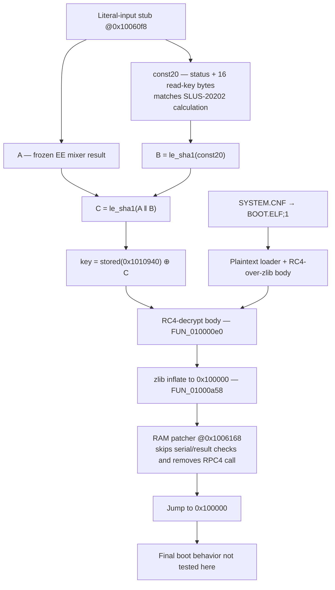

# Reversing CodeBreaker v9.2 against the Rust implementation

> **Review and follow-up (2026-10-30):** §12 preserves the audit of the
> earlier findings. The affected sections below have been corrected; §12.5
> records the resolution status and the remaining evidence boundaries.

Done 2026-10-26, prompted by question 3 of
[issue #11](https://github.com/mlafeldt/codebreaker-rs/issues/11): when a
beefcode (`BEEFC0DE`/`BEEFC0DF`) is decrypted while the list is already in V7
mode, is the key schedule applied once or twice?

The CB v9.2 code decryption was decompiled and compared function by function
with `src/`. Results:

| Area | Firmware vs `src/` |
|---|---|
| V1 decrypt, V7 rounds, RC4, multiply, line counting, key/seed schedule, constant tables | **same**, subject to the state-machine fixes and intentional omissions below |
| Beefcode in V7 mode (`auto_decrypt`, `decrypt`, `encrypt`) | firmware rekeys **twice**. 0.4.0 (`7691577`) did it once; fixed in `75471b6`. |
| Line count of V1-encrypted codes (`auto_decrypt`) | firmware counts from the **encrypted** address, `src/` from the decrypted one since `bb95630` (0.4.0). Fixed in `fadd9d9`. |
| Raw beefcode during auto-detection | firmware passes the next two lines through raw, `src/` re-detected the next line. Fixed in `d9bab13`. |
| `FFFFFFFF` encryption options | firmware switches V7 off and on, counts lines and can take the key from the next line; `src/` ignored them. Bit 16 and the line count since `16299e0`. Bit 17 (key from the next line) is left out on purpose; a full implementation is on `ffffffff-encryption-options` (`fd0e355`). Spec, vectors and decision in §9.5. |
| RSA step of V7 decrypt | firmware's bignum reduction is buggy near the modulus, `src/` computes exact `x^11 mod n` (§9.4). Kept on purpose, documented at `rsa_crypt` in `105d376`. |
| Encrypting a beefcode as `BEEFC0DF`'s extra seed line | `Cb7::encrypt_code_mut` wasn't the inverse of the firmware's decrypt (§9.3). Fixed in `23739ac`. |

§9 adds a second pass that emulates the firmware in Ghidra and diffs it
against `src/` on about 10,600 lines.

Firmware images and raw tool output are in `elf/`. ELF/BIN images are
gitignored; supporting text evidence can be committed. Scripts are in `tools/`
and `compare/`.

**Branches.** `research/` lives only on the `research` branch. `main` never
sees it; instead `main` is merged into `research` when it advances (never the
other way, and `research` is never rebased), so every hash on both branches is
stable and citable:

* Fixes to `src/` that come out of this research go on `main` as normal
  commits, with their own tests, firmware-verified vectors, and commit
  messages that cite CodeBreaker v9.2 but not `research/`.
* This document cites those fixes by their `main` hash; it may also cite
  `research` commits, since merging (unlike rebasing) leaves them untouched.
* `compare/` (`head = ../..`) builds the crate from the `research` tip, i.e.
  `main` plus this branch, so rerun the checks there to confirm a fix.
* Verified work that stays off `main` gets its own branch, e.g.
  `ffffffff-encryption-options` (§9.5). Cite it by hash too.


## Methodology for further comparisons

Use the identified binary as the reference for that build. Read the existing
findings, evidence, and fix history first; other implementations provide
context, not proof of firmware behavior. Keep implementation changes separate
from a review unless they are part of the requested work. Follow the branch
policy above so cited hashes stay stable.

1. **Identify the artifact.** Record its hash, version, provenance, packer,
   unpacking procedure, and signs of modification. Distinguish inspected paths
   from whole-image authenticity. Keep ELF/BIN images untracked and preserve
   supporting text evidence with its source identity.
2. **Locate and verify the crypto.** Find routines by beefcode immediates,
   seed tables, RC4 keys, and the RSA modulus rather than assuming another
   version's addresses. Compare every constant table with `src/`.
3. **Compare in both directions.** Match each Rust function and branch to
   firmware instructions, then sweep the firmware's branches, callees, and
   globals for missing behavior. Check signedness, shifts, masks, byte order,
   overflow, loop bounds, early returns, and state-update order. Map each state
   field and its initialization/reset rules. Use listings where EE instructions
   make decompilation unreliable.
4. **Differentially exercise the firmware.** Run reset and per-line decrypt on
   random lists and targeted command/line-count cases, beefcodes in each mode,
   extra seed lines, options, and arithmetic boundaries. Validate emulator
   hooks. Compare complete list lengths and outputs; state exactly which state
   fields were compared. Inspect diagnostics rather than trusting exit status
   or normalized equality alone (§12, F2/F3).
5. **Explain coverage gaps.** Record reached blocks and construct inputs for
   unreached paths. Classify each gap as proven unreachable, reachable but
   untested, or unresolved; failure to reach a block does not prove dead code.
   State which paths were modeled, hooked, or actually emulated.
6. **Check encryption and version differences.** Check encryption as an inverse
   of explicit decryption, separating intentional firmware divergences from
   defects. Do not assume auto-detection is an inverse. Compare other versions
   with verified function boundaries and relocation mappings. Trace other
   crypto callers to identify file, loader, or network behavior outside the
   code-line API.
7. **Report reproducible conclusions.** Give a verdict per function, addresses
   and listing evidence, feature status (implemented, intentionally omitted,
   missing, or out of scope), and concrete input/firmware/crate output vectors
   for differences. Include coverage, version changes, tooling limitations,
   and remaining unknowns. Keep observations, model results, and inferences
   distinct; bound compatibility claims to the paths or corpus checked.


## 1. The ELF

| | |
|---|---|
| File | `elf/CBv92.ELF` (user-supplied copy, 3,292,756 bytes) |
| SHA-256 | `d51a90c0d86fb33de52d80c5e1d7a372dc17c1e3d2a52645fff4922a573e4c83` |
| Format | ELF32 LE MIPS, header says MIPS-I, no section headers |
| Segment | one RWX `PT_LOAD`: file `0x60`, vaddr `0x019dc3a0`, filesz `0x323df4`, memsz `0x323ee0` |
| Entry | `0x01d00008` (unpacker stub) |
| Packer | ps2-packer N2E (UCL NRV2E, 8-bit bit buffer), magic `N2E1` at `0x01d00000` |

It is **not a pristine Pelican build**. Strings in the unpacked image (vaddr
`0x369498`):

> HDLoader modded version based on patch by ffgriever... CodeBreaker V9.2 no
> Anti-Modchip Version. Cracked By PS2TG's Lonwern on 2006/01/20. ... RSA Patch
> added by bfoos 2008/04/04, All credits go to misfire. Day1 server mod added by
> bfoos 2008/30/09 ...

`VERSION Code Breaker PS2 V9.2` is at `0x354bcc`. Without a clean image the
patched bytes can't be diffed out. The code-encryption path studied here shows
no sign of patching, and all constants match `src/` (§5). One mod has since
been located: the "RSA Patch" in the string above neuters the signature
verdict (§8, §9.9), so the signature path can't be read as stock.


## 2. Unpacking

The stub at the entry reads a pointer at `0x01d00004` to a 16-byte header (here
at `0x019dc3a0`):

| Offset | Value | Meaning |
|---|---|---|
| `+0x0` | `0x00100008` | original entry point (jumped to via `jr`) |
| `+0x4` | `0x01140000` | image size |
| `+0x8` | `0x00000a86` | stub zero-fills this + 1 bytes at load + size |
| `+0xc` | `0x00100000` | load address |
| `+0x10` | | NRV2E stream |

The decompressor at `0x01d00044` is standard UCL `nrv2e_d8`: `sltiu t1, t3,
0x501` is the `m_off > 0x500` length bump, and `andi t4, t1, 1` the low-bit
length encoding that distinguishes 2E from 2B. It stops at
`m_off == 0xffffffff`.

`tools/unn2e.py` reimplements it and wraps the output in a minimal ELF (one
`PT_LOAD` at `0x100000`, file offset `0x1000`, entry `0x100008`):

```
python3 -I tools/unn2e.py elf/CBv92.ELF elf/CBv92.unpacked.elf
# oep=0x100008 dest=0x100000 hdr_size=0x1140000 bss=0xa86 out=0x113f57a consumed=0x323cb8/0x323e54
```

Unpacked SHA-256: `91c04ee76b1126b2b060298fe6c2d434740d2b1923f7e282bc154153c1b79edb`.
vaddr = file offset + `0xff000`.


## 3. Tooling

* **rizin 0.9.1** for byte searches. Beefcode compares are `lui rX, 0xbeef` +
  `ori rX, rX, 0xc0de`/`0xc0df`:
  `rizin -e search.in=io.maps -qc '/x efbe003c:ffffe0ff' elf/CBv92.unpacked.elf`
  finds five sites: `0x102f14`, `0x102f2c` (exact compares in the list
  converter), `0x1041f0`, `0x104350`, `0x10448c` (masked `& 0xfffffffe`).
  rizin's R5900 mode shows several delay-slot instructions as `invalid`, e.g.
  `0x0000202d` (`daddu a0, zero, zero`), so don't read data flow from it.
* **Ghidra 12.1.4 headless** for decompiling and listings. Import with
  `-processor MIPS:LE:64:64-32addr`: the EE uses 64-bit `daddu`/`ld`/`sd`
  everywhere, and the 32-bit language truncates control flow on them.
  Ghidra doesn't know the R5900 three-operand `mult rd, rs, rt`. At `0x103598`
  (`0x02021018`, rd = `v0`) the product goes to `v0`, which the decompiler
  drops, so check listings where `mult` matters. The remaining Pcode errors
  (e.g. `0x12f82c`, `0x14877c`) are MMI ops outside the code studied here.
  Scripts: `tools/ghidra/DecompAt.java` (decompile containing functions +
  callers), `tools/ghidra/ListRange.java` (instruction listing). Full output:
  `elf/ghidra-decomp.txt`.
* **REA can't analyze this target.** Its Ghidra lane pins
  `MIPS:LE:32:default` for MIPS-I headers, which gives `halt_baddata()` on
  `daddu`. It refuses the image with the header patched to MIPS III
  ("requires EF_MIPS_ARCH_32R2, or ... MIPS-I or EF_MIPS_ARCH_32") or R5900
  ("Machine-specific MIPS variants ... need a separately supported processor
  profile"). Hopper, IDA and Kuna adapters admit no MIPS. It also only takes
  Ghidra 12.1.x. The supplied v10 `BOOT.ELF` has a MIPS **III** header, so
  `open_binary` accepts the file — but every provider then rejects the EE
  target anyway, with the same "Machine-specific MIPS variants ... need a
  separately supported processor profile" (Hopper/IDA/Kuna still no MIPS). A
  valid ELF arch clears REA's loader check but not its adapter, so EE work
  still goes through `analyzeHeadless` directly (§10).

```
analyzeHeadless <proj> cb92 -import elf/CBv92.unpacked.elf -processor MIPS:LE:64:64-32addr \
  -scriptPath tools/ghidra \
  -postScript DecompAt.java 0x101b58 0x102e38 0x1033c0 0x103410 0x103580 0x1035b0 \
                            0x103f60 0x1042b0 0x104548 0x132c98 0x132d30 0x134020 \
  -postScript ListRange.java 0x103f60 0x104290 0x1042b0 0x104520
```

Analysis takes about 20 s on an M-series Mac.


## 4. Map

| Firmware | Role | `src/` |
|---|---|---|
| `0x101988` | calls the list processor at `0x101b58`; called from `0x1062d0` (role not traced) | |
| `0x102e38` | code-list processor: reset, `0x1042b0` on every line, then convert to engine format at `0x80a28` | (out of scope) |
| `0x104548` | clears the mode word and `code_lines` | `Codebreaker::new` |
| `0x1042b0` | per-line auto decrypt | `Codebreaker::auto_decrypt_code_mut` |
| `0x1033c0` | lines per code | `num_code_lines` |
| `0x103410` | V1 decrypt | `cb1::decrypt_code` |
| `0x103f60` | V7 decrypt | `Cb7::decrypt_code_mut` |
| `0x1035b0` | `rekey(init, val)` | `Cb7::beefcode` |
| `0x103580` | `a * inverse(b \| 1)` | `mul_decrypt` |
| `0x1034e0` | inverse mod 2^32 | `mod_inverse` |
| `0x134020` | RSA modpow wrapper (→ `0x133dd0`) | `rsa_crypt` / `mod_pow` |
| `0x132c98` / `0x132d30` | RC4 init `(ctx, key, len)` / crypt `(ctx, buf, len)` | `Rc4::new` / `Rc4::crypt` |

The firmware has no counterpart of the plain (non-auto)
`Codebreaker::decrypt_code_mut` or of any encryption. The device only decrypts,
and always through `0x1042b0`.

| Global | Meaning | `src/` |
|---|---|---|
| `0x289ac8` | mode word: bit 16 = V7; low 16 bits a line counter and top byte a saved mode (options, §6.6) | `Codebreaker::scheme` |
| `0x289acc` | remaining lines of current code | `Codebreaker::code_lines` |
| `0x289ad0` | current block is V1-encrypted (vs raw) | `Scheme::V1` / `Scheme::Raw` |
| `0x289ad8`, `0x289b18`, `0x289b58` | V1 seed tables | `cb1::SEEDS` |
| `0x289b98` | default V7 seeds, 5×256 | `cb7::SEEDS` |
| `0x28a098` | default RC4 key, 5 words | `cb7::RC4_KEY` |
| `0x369000` | RSA modulus low word; high word is an immediate `0xffffffff` | `RSA_MODULUS` |
| `0x36dcc8` | current seeds, 5×256 | `Cb7::seeds` |
| `0x36e1c8` | key copy used for the multiplications | none (§6.5) |
| `0x36e1e0` | RC4 context (256 + 2 bytes) | `Rc4` |
| `0x36e2e8` | current key, 5 words | `Cb7::key` |
| `0x36e2fc` | `beefcodf` | `Cb7::beefcodf` |
| `0x36e300` | encryption-option state | none |
| `0x36e308` | `BEEFC0DF` extra seed (8 bytes) | local in `decrypt_code_mut` |


## 5. Matched primitives and schedule

**Constants.** `python3 -I tools/cmptables.py elf/CBv92.unpacked.elf ../src`
reads `cb1::SEEDS`, `cb7::SEEDS`, `cb7::RC4_KEY` and `RSA_MODULUS` out of the
Rust sources and compares them with the image. All match. The V7 decrypt
passes exponent `0xb`, which is `RSA_DEC_KEY`.

**V1 decrypt (`0x103410` vs `cb1::decrypt_code`).** With `cmd = addr >> 28`:
`if cmd > 2 { val = (val ^ addr) - SEEDS[2][cmd] }`, then
`tmp = addr ^ SEEDS[0][cmd]` and `t = tmp - SEEDS[1][cmd]`. The result
`(t & 0xffffff) >> 16 | tmp & 0xff000000 | (t & 0xff) << 8 | (t >> 8 & 0xff) << 16`
is the same byte placement as the Rust
`(tmp & 0xff00_0000) | ((t & 0xffff) << 8) | ((t >> 16) & 0xff)`.

**Lines per code (`0x1033c0` vs `num_code_lines`).** Cmd 3 is 2 lines if bit
22 is set, cmds 4–6 are 2, everything else 1.

**V7 decrypt (`0x103f60` vs `Cb7::decrypt_code_mut`).** The common path uses
the same steps in the same order; the RSA defect and omitted option path are
described in §§9.4–9.5:

1. 64 rounds, `i = 63..0`: `val = ((val - (addr ^ s4[i])) ^ s1[i]) + s3[i]`,
   then `addr = ((addr + (val ^ s4[i])) ^ s0[i]) - s2[i]`.
2. RSA only if `addr:val < 0xFFFFFFFFFFFFFFF5`.
3. RC4 over `[addr, val]` keyed with the 20-byte key.
4. `addr = mul_decrypt(addr, k0 - k1)`, `val = mul_decrypt(val, k2 + k3)`. The
   firmware takes `k` from the copy at `0x36e1c8`, which equals the key unless
   options are used (§6.5).
5. If `beefcodf` is set, RC4 the seeds with `addr:val` as key, clear the flag
   and return. Otherwise, on a beefcode, `rekey(0, val)`.

There is also an intermediate flag difference in step 5: the firmware sets
`beefcodf = 1` for any beefcode, while `Cb7::beefcode` sets `addr & 1`.
The firmware's caller overwrites it with `addr & 1` on the common path
(§6.1), so the final flag agrees there. Forced option lines need the separate
handling in §9.5.

**Multiply (`0x103580` vs `mul_decrypt`).** `a * inverse(b | 1)`. The
firmware gets the inverse from an extended-Euclid loop (`0x1034e0`, `divu`
based), `src/` from Newton iteration. Both give the unique inverse of an odd
number mod 2^32.

**RC4 (`0x132c98`/`0x132d30` vs `rc4.rs`).** Textbook KSA/PRGA. The context is
256 state bytes followed by `i` and `j`.

**Key/seed schedule (`0x1035b0` vs `Cb7::beefcode`).**

* `init != 0`: key = default key, then seeds = default seeds if `val != 0`,
  else zero.
* `init == 0, val == 0`: zero seeds and `k0..k3` (the firmware derives `k0..k3`
  from the zeroed seeds, which is 0).
* `val != 0`: `k[i]` byte `j` = `seeds[(i + j) % 4][val byte j]`, exactly the
  Rust `from_fn` expression.
* Then 5 rounds: RC4-init with the 20-byte key, crypt `seeds[i]`, crypt the
  key.

The differences don't change any output:

* The firmware's `init` comes from the caller (V7 bit of the mode word). `src/`
  uses `Cb7::initialized`. Both are fresh per list. Options can switch V7 off,
  so since `16299e0`, `Codebreaker::enter_v7` starts from a fresh `Cb7` when
  V7 is off, which keeps the decision the same.
* On init the firmware clears `beefcodf` and the option state. `src/` sets
  `beefcodf = addr & 1` at the end.
* The firmware ends by copying key → key copy (§6.5).


## 6. Auto decrypt (`0x1042b0` vs `Codebreaker::auto_decrypt_code_mut`)

Decompiled, with names:

```c
v7 = mode & 0x10000;  if (opt == 2) v7 = 0x10000;
if (!v7) {
    if (code_lines == 0) {
        code_lines = num_code_lines(*addr);                // ENCRYPTED addr (§6.2)
        if ((*addr >> 24 & 0xe) == 0) { code_lines--; v1 = 0; return; }   // raw
        if ((*addr & ~1) == 0xbeefc0de) { code_lines++; v1 = 0; return; } // §6.3
        v1 = 1;
    } else if (!v1) { code_lines--; return; }              // raw continuation
    cb1_decrypt(addr, val);
    code_lines--;
} else {
    cb7_decrypt(addr, val);                                // may rekey (§6.1)
    if (code_lines == 0) {
        code_lines = num_code_lines(*addr);                // decrypted addr
        if (code_lines == 1 && *addr == 0xffffffff) { /* options §6.6 */ return; }
    }
    code_lines--;
    if (opt == 2) { opt = 0; return; }
}
/* option line counter (§6.6) */
if ((*addr & ~1) == 0xbeefc0de) {
    if (!(mode & 0x10000)) { mode |= 0x10000; rekey(1, *val); }
    else                   { rekey(0, *val); }             // second rekey (§6.1)
    beefcodf = *addr & 1;
    code_lines = 1;
}
```

### 6.1 Beefcode in V7 mode: two rekeys (matches since `75471b6`)

Inner call, `0x103f60` (`a1` = decrypted value stored at `0x10413c`, untouched
on the way):

```
00104138  daddu a1,v0,zero          ; a1 = mul_decrypt(val)
0010413c  sw a1,0x0(s0)             ; *val = a1
00104140  lw v0,-0x1d04(s4)         ; beefcodf (0x36e2fc)
00104144  beq v0,zero,0x001041e4
...
001041f0  lui v0,0xbeef             ; (*addr & ~1) == 0xbeefc0de ?
001041fc  bne v1,v0,0x00104218
00104204  jal 0x001035b0            ; rekey(0, *val)   <-- first
00104208  _clear a0
0010420c  li v0,0x1
00104214  _sw v0,-0x1d04(s4)        ; beefcodf = 1
```

Outer tail, `0x1042b0`, reached after the V7 branch:

```
001043c0  jal 0x00103f60            ; V7 decrypt
...
0010448c  lui a0,0xbeef             ; (*addr & ~1) == 0xbeefc0de ?
00104498  bne v0,a0,0x00104520
001044a4  _lw v1,-0x6538(s3)        ; mode word (0x289ac8)
001044ac  and v0,v1,a0              ; & 0x10000 (V7)
001044b0  beq v0,zero,0x001044cc    ; not V7 yet -> rekey(1, *val), set V7
001044b8  lw a1,0x0(s2)
001044bc  jal 0x001035b0            ; rekey(0, *val)   <-- second
001044c0  _clear a0
...
00104514  sw v1,-0x6534(a0)         ; code_lines = 1
00104518  sw v0,-0x1d04(a1)         ; beefcodf = addr & 1
```

The second rekey starts from the seeds and key that the first produced, so it
changes the outcome. `src/` does the same: `auto_decrypt_v7` lets
`Cb7::decrypt_code_mut` rekey, then calls `enter_v7`. `decrypt_code_mut` and
`encrypt_code_mut` mirror it.

| Plain text after the common key | firmware / `src/` | 0.4.0 (one rekey) |
|---|---|---|
| `BEEFC0DE 00000000` | `8787C575 1AC4C1B4` | same |
| `9029BEAC 0C0A9225` | `02210430 184C16E8` | `E8C99F89 14B426D6` |
| `BEEFC0DF B16B00B5` | `FE8B8601 C7C6F6CE` | same |
| `01234567 89ABCDEF` | `2195D855 63FA11A7` | `8DB9F946 530C6B98` |
| `9029BEAC 0C0A9225` | `0CA31760 A6F7E88A` | `760B3F60 AECF1D18` |

Both cases are in `src/lib.rs` tests. Regenerate them with
`cargo run --example vectors` in `compare/`.

### 6.2 V1 line count uses the encrypted address (fixed in `fadd9d9`)

```
00104328  jal 0x001033c0            ; num_code_lines(
0010432c  _lw a0,0x0(s1)            ;   *addr) -- still encrypted
...
001043a4  jal 0x00103410            ; V1 decrypt happens afterwards
```

V1 encryption shuffles the low 24 bits, so cmd 3's bit 22 can differ between
cipher text and plain text. `bb95630` (first released in 0.4.0) moved
`num_code_lines` after decryption, and the device doesn't do that. Example
from the `bit22` auto test in `src/lib.rs`:

| Input | firmware / 0.3.2 | `src/` (`bb95630`) |
|---|---|---|
| `3A550D56 9267D8DE` | `30000035 12345678` (2 lines: encrypted bit 22 = 1) | same, 1 line |
| `0029BEAC 0C0A9225` | `0AADA1F9 0C0A9225` (V1-decrypted continuation) | `0029BEAC 0C0A9225` (raw) |

`fadd9d9` reverted `bb95630` and changed that test.

### 6.3 Raw beefcode during detection (fixed in `d9bab13`)

```
00104350  lui v1,0xbeef             ; raw (unencrypted) beefcode?
00104360  bne v0,v1,0x0010437c
00104368  addiu v0,a0,0x1           ; code_lines = num_code_lines + 1 = 2
00104370  sw v0,-0x6534(s0)
00104378  _sw zero,-0x6530(v1)      ; v1 = 0 (raw), return
```

The firmware ignores the line and passes the next two lines through raw
(continuation path). Before `d9bab13`, `auto_decrypt_v1_or_raw` returned with
`code_lines == 0`, so the next line was detected afresh. Since that fix it
keeps two raw continuation lines, matching the firmware. Neither path rekeys.

### 6.4 Line counting otherwise

Raw first lines (`code_lines = n - 1`), raw continuations, V1 continuations
(decrypt, then decrement), and the V7 branch (count from the decrypted address
when `code_lines == 0`, then decrement) all match `src/`.

### 6.5 Key copy

`rekey` ends by copying the key to `0x36e1c8`, and the V7 multiplications use
that copy. `src/` has only `Cb7::key`. They differ only once the option path
(§6.6) changes the key.

### 6.6 `FFFFFFFF` encryption options (bit 16 and count in `src/` since `16299e0`, §9.5)

A one-line V7 `FFFFFFFF vvvvvvvv` sets
`mode = (mode >> 16) << 24 | v & 0xffffff` and
`opt = (v & 0x20000) >> 16`, then returns before the beefcode check. Since
`16299e0`, `src/` follows bit 16 and the line count, but leaves bit 17 out
(§9.5). The low 16 bits of the mode word count
down once per line, and at zero the saved mode comes back from the top byte.
`opt == 2` forces V7 decryption of the next line and is then cleared. With
`opt != 0`, the inner decrypt derives a new key from each non-beefcode line:
`key = {addr ^ k0, val ^ k1, addr - k2, val + k3, (addr - val) ^ k4}`, `k` = the
copy. §9.5 has the full spec (`opt` is only ever 0 or 2).

### 6.7 List converter

After decrypting, `0x102e38` drops lines with top nibble `0xB`: exactly
`BEEFC0DE` skips 2 words and `BEEFC0DF` 4 (exact, not masked compares).
`FFFFFFFF` skips 2 words, or 4 if `val & 0x20000`. That's engine-side; `src/`
returns beefcodes to the caller.


## 7. History

Only for context. The firmware is the reference.

* misfire's original C (2006, cb2util v1.0 `c0c1bd0`, 2007) already has the
  double rekey and the commented-out `//beefcodf = 1;`, which is exactly the
  firmware's inner assignment (§6.1). Omniconvert (`20f7674`) and codebreaker
  ≤0.3.2 inherit both.
* cb2util `57f12cb` dropped the separate `oldkey` as "always the same as key".
  That's true until the option path runs (§6.5). `fd0e355` on
  `ffffffff-encryption-options` brings it back as `Cb7::mul_key`.
* `compare/` auto-decrypts cb2util's test fixtures with 0.3.2, 0.4.0 and the
  local crate (`cargo run -- ../../cb2util/test/*/*.{enc,txt}`). At cb2util
  `593ea25`: 53 games, 6,234 lines. Head matches 0.3.2 everywhere, and 0.4.0
  differs on 4 lines (`beef.enc` test 8, the only V7-mode beefcode). No CBC
  fixture (official code downloads) contains one.


## 8. Caveats

* Primary image v9.2, cracked and modded (§1). A v10 payload extracted from
  a modified loader was added later (§10). Its per-line code crypto differs
  (§11), so v9.2 behavior does not carry over unchanged; v7/v8 images have not
  been verified. The v9.2 signature verdict at `0x132fec` forces success after
  computing the padded-block compare (`0x14611c`), using
  `addiu v0,zero,1` (`0x24020001`). That makes the inspected signature check
  ineffective. The v10 tail instead consumes the compare result with
  `sltiu v0,v0,1` (`0x2c420001`, §10.9). This locates a behavioral difference
  consistent with the named RSA patch, but neither image was checked against
  an authenticated retail reference. It does not establish the full scope or
  exact original bytes of a historical author's patch. The signature scheme's
  resistance to forgery remains unresolved (§9.4).
* Nothing run on hardware or in PCSX2. §9 emulates the unpacked image in
  Ghidra, with the R5900-specific instructions hooked.
* Encryption in `src/` has no firmware counterpart and is only checked as the
  inverse of decryption.
* The callers of `0x101988` (`0x1062d0`, presumably game start) were not traced.


## 9. Second pass: emulation (2026-10-26)

Same image as §1. (A second version, v10, was added later; §11 diffs the two
and finds the code crypto changed.) This pass ran the firmware's per-line
decrypt in Ghidra's emulator and diffed it against `src/` at `d9bab13`.

### 9.1 Method

| Tool | Does |
|---|---|
| `tools/ghidra/CallTree.java` | call tree of `0x1042b0`/`0x104548` with blocks and listings, flags EE-only instructions (`elf/calltree.txt`) |
| `tools/ghidra/Emu.java` | `EmulatorHelper` harness: per list, a fresh image, reset (`0x104548`), then `0x1042b0` per line; prints each output with the globals, and the first list/line to reach each instruction. `!inv`/`!mul`/`!rsa` call the primitives directly. |
| `tools/fwmodel.py` | Python model of `0x1042b0` and callees, including options and the bignum quirk. It can encrypt. `run` writes `Emu.java`'s output format, so `emudiff.py` also works without Ghidra. |
| `tools/gen.py` | input lists: `random`, `targeted`, `plain` (for the encryption check), `report` (§9.3–9.5 vectors), `optfuzz` (random lists, a quarter option lines) |
| `compare/examples/emucmp.rs` | runs the crate (`auto`, `decrypt`, `encrypt`) on the same lists, reading the state from `Debug` |
| `tools/emudiff.py` | firmware vs crate outputs and selected state on every line; summaries count lists with an output difference, else selected-state differences; model vs emulation on every output and logged global/seed CRC; primitives vs exact math; optional round trip against plain text |
| `tools/coverage.py` | block coverage from the `Emu.java` coverage files |
| `tools/luirefs.py` | finds `lui`+offset accesses to globals, which Ghidra mostly doesn't resolve |

The output comparison CLIs (`cmpout.py`, `emudiff.py`, `emudiff10.py`) use
status 0 for identical results or an exact declared baseline, 1 for differences,
and 2 for malformed or incomplete input. `--expected <json>` declares an exact
reviewed set of per-line differences bound to the input SHA-256s. Unexpected
or missing differences still fail. `--write-differences <json>` records
observations but does not turn a failing comparison into a pass.
Model-versus-firmware and plaintext round-trip failures cannot be waived by
an expected-difference file. The commands below therefore report status 1 for
corpora containing known RSA or bit-17 departures unless an appropriate
baseline is supplied.

```
G=/opt/homebrew/Cellar/ghidra/12.1.4/libexec/support/analyzeHeadless
python3 -I tools/gen.py elf/CBv92.unpacked.elf targeted /tmp/t.txt 2
$G <proj> cb92 -process CBv92.unpacked.elf -noanalysis -readOnly -scriptPath tools/ghidra \
   -postScript Emu.java /tmp/t.txt /tmp/t.out /tmp/t.cov
(cd compare && cargo run -q --release --example emucmp -- auto /tmp/t.txt) > /tmp/t.crate
python3 -I tools/emudiff.py elf/CBv92.unpacked.elf /tmp/t.out /tmp/t.crate
python3 -I tools/coverage.py elf/calltree.txt /tmp/t.cov
```

Inputs, outputs and coverage of the original runs are in `elf/emu/`. In
the table below, crate “state” means the fields emitted by `emucmp`: line count,
effective scheme, and conditionally key and `beefcodf`. Crate seeds,
`initialized`, and `lines_until_v7` are not directly compared. Model checks
cover all logged globals and the seed CRC, not every byte of firmware memory.

The
`src/cb7.rs` change that replicates the RSA bug (§9.4, not recommended) is in
`elf/emu/proposed-fixes.patch`, against `105d376`.

| Run | Lists | Lines | Firmware vs `src/` |
|---|---|---|---|
| `random` (random words, V1 beefcodes, then random V7 cipher text) | 120 | 2,786 | identical, outputs and state |
| `targeted`: every command nibble × bit 22 × raw/V1/V7 × raw/V1 follow-up | 192 | 832 | identical |
| `targeted`: V1 cmd 3 whose bit 22 flips under encryption | 8 | 32 | identical |
| `targeted`: beefcodes in every mode/encoding/position, `BEEFC0DF` extra-line variants, repeated beefcodes | 76 | 474 | identical |
| `targeted`: `FFFFFFFF` options (every bit 16/17 combination, counts 0–3 and `ffff`, mixed) | 106 | 1,853 | 52 lists differ, all options (§9.5). With `16299e0`, 38, all after a bit 17 line. Identical with `fd0e355`. |
| `targeted`: RSA inputs 0, 1, 2, 2³²−1, 2³², n−2, n−1, n, n+1, 2⁶⁴−1 | 10 | 30 | n−2, n−1 differ (§9.4) |
| `targeted`: 129 primitive calls (`inv`, `mul` on 31 edge/random values, `rsa` on 36) | | | `inv`, `mul` exact; 2 `rsa` differ (§9.4) |
| `plain`: plain text encrypted by `src/`, decrypted by the firmware | 120 | 2,270 | 12 don't round-trip (§9.3) |
| same with the §9.3 fix (now `23739ac`) | 120 | 2,270 | all round-trip |
| `rsa`: 41 calls (n−2^31..n, values whose square lands there, just below) | | | 30 differ from exact math (§9.4) |
| `report` (§9.3–9.5 vectors, with `opt-key-beef`, `opt-key-2-lines` and `opt-count-beef`), against `1670607` | 13 | 82 | the 8 option lists and `rsa-wrong` differ. With `16299e0`, the 4 bit 17 lists and `rsa-wrong`. With `fd0e355`, only `rsa-wrong`. |
| `cb2crypt`: CB2crypt's readme example (§9.5) | 1 | 6 | the raw code after `FFFFFFFF 00000000` differs before `16299e0`, identical since |
| `optfuzz` (seed 1): a quarter option lines, in every encoding, among codes of every command, beefcodes and random words, against `1670607` | 100 | 3,378 | 84 lists differ, all options. With `16299e0`, 68, all after a bit 17 line. Identical with `fd0e355`. |
| `optfuzz16` (seed 1): the same without bit 17, against `16299e0` | 100 | 3,378 | identical, outputs and state |
| `optfuzz` seeds 1–20 with `fd0e355`, and `optfuzz16` seeds 1–20 with `16299e0`, `fwmodel.py run` instead of the emulator (seed 1 gives the same output as emulated) | 2,000 each | 65,546 each | identical, outputs and state |

`fwmodel.py` matches the emulation on every output and logged state field
(mode, `code_lines`, V1 flag, `beefcodf`, `opt`, key, key copy, seed CRC) in
all of these. At `16299e0`, the only remaining differences are RSA (§9.4)
and lists after an option line with bit 17: 38 of `targeted`, as above in
`report` and `optfuzz`. With the §9.4 patch and `fd0e355`, there are none.
The `optfuzz` runs reach every option path: option lines (310 emulated), V7
switched off and back on by the counter, forced lines that become the key
(141), a beefcode (14) or another option line (42), and forced 2-line codes
with V7 off (9). Coverage (§9.8) doesn't change.

### 9.2 Verdict per Rust function

| `src/` | Firmware | Verdict |
|---|---|---|
| `cb1::decrypt_code` | `0x103410` | identical (every cmd nibble, emulated) |
| `cb1::encrypt_code` | (inverse of `0x103410`) | exact inverse (every round trip in `plain`) |
| `num_code_lines` | `0x1033c0` | identical |
| `cb7::is_beefcode` | masked compares at `0x104350`, `0x1041f0`, `0x10448c` | identical |
| `Cb7::beefcode` | `0x1035b0` | identical given the same init decision (§9.6) |
| `Cb7::decrypt_code_mut` | `0x103f60` | identical except the RSA step (§9.4) and the option paths (key copy, key from line, §9.5), both left out on purpose |
| `Cb7::encrypt_code_mut` | (inverse of `0x103f60`) | was **not the inverse** when `BEEFC0DF`'s extra line is a beefcode (§9.3, fixed in `23739ac`). The firmware RSA defect prevents some firmware round trips; the crate deliberately uses exact RSA (§9.4). |
| `mul_decrypt`, `mod_inverse` | `0x103580`, `0x1034e0` | identical on 0, 1, 2, 3, 5, `7fffffff`, `80000000`, `80000001`, `fffffffd`–`ffffffff` and 20 random values (the firmware uses extended Euclid, `src/` Newton) |
| `rsa_crypt`/`mod_pow` (decrypt) | `0x134020` → `0x133dd0` | **differs**, on purpose (§9.4) |
| `Rc4` | `0x132c98`/`0x132d30` | identical (context is re-initialized on every use, no carry-over) |
| `Codebreaker::auto_decrypt_code_mut` | `0x1042b0` | identical except option bit 17 (§9.5) and RSA (§9.4), both left out on purpose. Bit 16 and the line count since `16299e0`. |
| `Codebreaker::decrypt_code_mut` | none | equals the firmware on lists without raw codes or options (all of `plain`). It differs on 100 of 120 `random` lists, as expected for a non-detecting API. |
| `Codebreaker::encrypt_code_mut` | none | inverse except §9.4 (and §9.3 before `23739ac`) |
| `Codebreaker::new` | reset `0x104548` | identical |
| `Codebreaker::new_v7`, `Cb7::default` | state after `B4336FA9 4DFEFB79` | same key and seeds. `code_lines` was 0 instead of 1 until `16299e0`, which only matters with options (§9.6). |

### 9.3 Difference: encrypting a beefcode as `BEEFC0DF`'s extra seed line (fixed in `23739ac`)

The firmware's `0x103f60` checks `beefcodf` first. If it's set, the line is
the extra seed: it RC4s the seeds and returns, without the inner rekey. Then
`0x1042b0` rekeys once for the beefcode. `Cb7::decrypt_code_mut` does the
same. `Cb7::encrypt_code_mut` checks `is_beefcode` first and returns before
using the extra seed, so `Codebreaker::encrypt_code_mut` rekeys twice and never
RC4s the seeds. Every later line then gets the wrong cipher text, and not even
`src/`'s own decrypt reads it back.

Plain text `BEEFC0DE 00000000`, `BEEFC0DF 00000000`, `BEEFC0DE 12345678`,
`01234567 89ABCDEF`, `9029BEAC 0C0A9225` with `Codebreaker::new()`:

| Line | `src/` cipher text | Cipher text the firmware decrypts correctly (emulated) |
|---|---|---|
| 1–3 | `B4336FA9 4DFEFB79`, `EF3A41A5 8F460BA4`, `3B070C70 52BA8DBD` | same |
| 4 | `9E3F1DB6 875CADA1` (decrypts to `ED2187E3 1FCEDA9B`) | `00DDD0A3 3EE4EC6F` |
| 5 | `A669604B 2DA9FAD5` | `3B91B1FA 3D12C0B1` |

With `BEEFC0DF B16B00B5`, `BEEFC0DF 12345678`, `01234567 89ABCDEF`,
`9029BEAC 0C0A9225`, `201F6024 00000000` after the default `BEEFC0DE 0`, the
expected cipher text is `FE8B8601 C7C6F6CE`, `E8FF75C2 70A8D7EF`,
`E632FC5D 087A0038`, `3D945215 5E6BE61F`, `8BAECCD7 54ACADA4`. `src/` gets the
first two right, then gives `F46A5E09 83F24AEA`.

Fix (`23739ac` on `main`): `Cb7::encrypt_code_mut` handles `beefcodf` first
(RC4 the seeds, clear it, return), then `is_beefcode`, which is the order
`decrypt_code_mut` uses. The first list above became tests in `src/lib.rs`
and `src/cb7.rs`; they fail without the change. With it, all 120 `plain`
lists round-trip through the emulated firmware, and so do both lists above.
`emucmp encrypt` at `23739ac` gives the same cipher text as the emulated
patch.

### 9.4 Difference: the firmware's RSA is wrong near the modulus (kept, `105d376`)

`0x133dd0` is a generic bignum `modexp` (32-bit limbs) with Karatsuba multiply
(`0x133670` → `0x133428`) and a Knuth-D style reduction (`0x133948`). The
quotient digit estimate at `0x133bb0` is

```
00133ba4  lwu a0,0x4(v0)       ; window high word
00133ba8  lwu v1,0x0(v0)       ; window low word
00133bb0  jal 0x0014cbd8       ; __udivdi3(window, v1)
00133bbc  dsll32 a2,v0,0x0
00133bc0  dsra32 a2,a2,0x0     ; q = low word of the 64-bit quotient
```

It isn't clamped to 2³²−1 (Knuth step D3). Here the divisor's top word v1 is
`0xffffffff` (n = `0xfffffffffffffff5`). Whenever the window's top word is also
`0xffffffff`, q wraps to a small number. The step barely subtracts, the loop
moves on, and the uncleared top word is dropped when the caller copies back
2 words. The result is deterministic but wrong.

* Every x in `ffffffff80000000..fffffffffffffff5` is affected: its first
  squaring has a top product word of `0xffffffff`. In general, a modular
  multiplication goes wrong when the 128-bit product's top word is
  `0xffffffff`, and occasionally otherwise. So an x below that range fails
  too when some intermediate power lands in it (e.g. x = `1bfcd151a41d1904`,
  whose square does).
* No difference in 300,000 random x. Besides the range (2⁻³³ of all x),
  each of the 5 multiplications fails with about 2⁻³² for random operands,
  when the last quotient step's window has a top word of `0xffffffff`.
  For example, `2³² · b` is wrong for every b in
  `ffffffff00000000..n` in the model. In total that's roughly 1 in 10⁹
  V7-decrypted lines.

`fwmodel.cb_rsa` models it. It matches the emulator on all 77 RSA calls,
including the 32 that differ from exact math. Vectors after the default key
(`B4336FA9 4DFEFB79`), emulated:

| Cipher text | Value after the 64 rounds | Firmware | `src/` |
|---|---|---|---|
| `4A2AF1C7 2DF772C5` | n−1 | `F2222B68 F4C6BE86` | `3C875748 89294DDF` |
| `0B431DEB 948937C5` | `ffffffff80000000` | `71664B9E 1189C338` | `68171B47 7B1EC390` |
| `413F8599 D7785BE7` | `1bfcd151a41d1904` | `B8D7A9CE BB4CF58D` | `9ADA878D 4C69EFB4` |
| `D06EBC3C 965E0DD9` | `ffffffff7fffffff` (just below) | `90A93F06 178678AF` | same |

Primitive level: `!rsa fffffffffffffff4` gives `04f363dfecae2b57` (exact:
`fffffffffffffff4`), and `!rsa fffffffffffffff3` gives `24ded67f71ac6020`
(exact: `fffffffffffff7f5`).

The cause is certain from the code (the truncation at `0x133bbc`), and two
independent derivations agree on it: `fwmodel.py`, written from the listing,
and the emulator. These vectors were emulated from v9.2; §11 verifies the
same bignum core in the inspected v10 payload. Nothing was run on hardware.
The frequency is an estimate from the model under its input assumptions, not
a measured rate on real code lists.

Decision: `src/` keeps exact math. `105d376` documents the divergence at
`rsa_crypt`. Replicating the bug would:

* treat the symptom, not the cause. The cause is in the firmware, and only
  decryption can copy it. For plain text whose exact cipher value falls in the
  bad set (whose size is estimated by the model), the firmware decrypts
  something else, and there may be no cipher text at all that decrypts to it.
* break `decrypt(encrypt(x)) == x`, which holds in `src/` for every x below n.
* swap a correct answer for the firmware's garbage. A code that hits the bug
  already misbehaves on a real CodeBreaker. The exact result is what exact
  encryption (like `src/`'s) started from.
* cost about 50 lines of subtle bignum code for about 1 in 10⁹ lines.

Unlike §6.1–6.3 and §9.3, which are state machine differences that ordinary
lists trigger, this is an arithmetic defect at the edges.

Not recommended, but available: `elf/emu/proposed-fixes.patch` replicates the
bug in decryption with `cb_mod_pow`/`cb_mul_mod`/`cb_mod`: square-and-multiply,
and a 5-word reduction that truncates q, subtracts `q·n` from 3 words, adds n
back once or twice, then does the window and final `> n` corrections.
Encryption keeps the exact `mod_pow`. The recorded check covered 172,140
values: random inputs, samples within the bad range, `n−1..n−2000`, and inputs
selected for intermediate-power failures. The roughly `2^31`-value bad range
was not exhaustively checked. The patch fixes both `targeted` RSA lists.

No signature forgery was demonstrated. The same generic reduction routine is
used by the 2048-bit signature checker (§9.9), but the two-limb, exponent-11
investigation above does not establish exploitability or unforgeability for
that different modulus, exponent, and padding scheme. The signature key at
`0x2949b8` has e = `0x10001` and a modulus whose top limb is `0x90116783`.
Those facts do not prove that the arithmetic defect provides no leverage;
the full verifier would need a separate security analysis.

### 9.5 `FFFFFFFF` encryption options (bit 16 and count since `16299e0`, bit 17 left out)

Only `0x1042b0` writes `opt` (`0x36e300`) to non-zero (`luirefs.py`: every
access to `0x289ac8..0x28a0ac`, `0x369000` and `0x36dcc8..0x36e310` is in
`0x1033c0..0x104560`), so `opt` ∈ {0, 2}.

State beyond `src/`:

* mode word (`0x289ac8`): bit 16 V7, bits 0–15 a line counter, bits 16–23
  (V7 + 7 stored bits) are saved in bits 24–31
* `opt`: 2 = force V7 on the next line and take the key from it
* key copy `kc` (`0x36e1c8`): the key as of the end of the last rekey

Per line, the firmware decrypts as V7 if mode bit 16 is set or `opt == 2`
(`movz` at `0x1042fc`), otherwise as `src/` does with raw/V1 (unchanged).

V7 decrypt (`0x103f60`):
1. The rounds, RSA (§9.4) and RC4 use `key`. The two multiplications use
   `kc[0] - kc[1]` and `kc[2] + kc[3]` (`0x104108`–`0x104134`).
2. If `beefcodf`: RC4 the seeds keyed with the line, clear `beefcodf` and
   `opt`.
3. Else on a beefcode: `rekey(0, val)`, `beefcodf = 1`.
4. Else if `opt != 0` (`0x104224`): `key = [a ^ kc0, v ^ kc1, a - kc2, v + kc3,
   (a - v) ^ kc4]` from the decrypted line `a v`. `kc` stays as it was, so
   RC4 and the multiplications now use different keys.

Then in `0x1042b0`:
1. If `code_lines == 0`: `code_lines = num_code_lines(a)`, and if
   `a == FFFFFFFF` (`0x104400`):
   `mode = (mode >> 16 & 0xff) << 24 | v & 0xffffff`,
   `opt = v & 0x20000 ? 2 : 0`, `code_lines = 0`, return.
2. `code_lines -= 1`. If `opt == 2`: `opt = 0` and return, skipping the
   counter and the outer beefcode check (`0x104440`).
3. Counter, for V1- and V7-decrypted lines only, since raw lines return
   earlier (`0x104458`): if `mode & 0xffff != 0`, decrement it, and on
   reaching 0 restore `mode = (mode >> 24) << 16`.
4. Beefcode (`0x104480`): if mode bit 16 is clear, set it and
   `rekey(init = 1)`, which also clears `opt` and `beefcodf` and restarts from
   the default key and seeds. Otherwise `rekey(0)`. Then
   `beefcodf = a & 1`, `code_lines = 1`.

So `FFFFFFFF 000Xnnnn` at a code start in V7 mode means:
* bit 16 clear: V1/raw auto-detection for the next `nnnn` V1/V7-decrypted
  lines, then V7 again with the same key. With `nnnn = 0`, for the rest of the
  list, and the next beefcode then reinitializes with the default key.
* bit 16 set: stay V7. `nnnn` only restores the saved mode later.
* bit 17 set: the next line is V7-decrypted whatever the mode, isn't counted,
  and becomes the key unless it's a beefcode or an extra seed line.
* bits 18–23: stored in the mode word but never read.

These lines are never option lines: the line right after any beefcode
(`code_lines = 1`, the slot for `BEEFC0DF`'s extra seed), the second line of a
2-line code, and V1-decrypted `FFFFFFFF`.

Edge cases from the listing, all reproduced by the model:
* If the forced line decrypts to a beefcode, only the inner `rekey(0)` runs.
  `beefcodf` becomes 1 even for `BEEFC0DE`, and `code_lines` and V7 aren't set.
* An `FFFFFFFF` forced line is itself an option line.
* `rekey(0, v)` after a key change keeps the new `key[4]`.
* If the nnnn-th counted line is a beefcode, counting turns V7 back on
  first, so the beefcode only does `rekey(0)` and keeps the key
  (`opt-count-beef`).
* If the forced line starts a 2-line code while V7 is off, its 2nd line goes
  through the raw/V1 path as a continuation, with the V1 flag from before.
  That flag is always 1 there: V7 mode and forced lines are only reachable
  through V1-decrypted lines, and the flag only changes at code starts
  outside V7.
* The extra seed line clearing `opt` is unreachable. `opt` is only set on the
  line after an option line, and `beefcodf` is always 0 there: an option line
  isn't a beefcode, and if `beefcodf` was set, the option line itself was the
  extra seed line.

Vectors, emulated: cipher text → firmware output, with the output of `src/`
before `16299e0` where it differs. Since then, only the bit 17 lists differ.
Each list starts with `B4336FA9 4DFEFB79` → `BEEFC0DE 00000000` and
`D08F3A49 00078A53` → `9029BEAC 0C0A9225`, since the line after a beefcode
can't be an option.

V7 off for 2 counted lines; the raw line in between doesn't count:

| In | Firmware | `src/` |
|---|---|---|
| `5B5DF76F E5E4BDCE` | `FFFFFFFF 00000002` | same |
| `2AFF014C 2411FFFF` | `2043AFCC 2411FFFF` (V1) | `6234497B B50CFAA5` |
| `0031789A 00000063` | `0031789A 00000063` (raw) | `C1F7E144 57A4926F` |
| `2A973DBD 00000000` | `201F6024 00000000` (V1, counter hits 0) | `52C9647A 97439DDF` |
| `973E0B2A A7D4AF10` | `2096F5B8 000000BE` (V7 again) | same |

Key from the next line (`FFFFFFFF 00030000`):

| In | Firmware | `src/` |
|---|---|---|
| `4B985E41 9DCCE1A9` | `FFFFFFFF 00030000` | same |
| `F968CE47 D8CA4DAA` | `12345678 9ABCDEF0` (new key) | same |
| `14EE53A7 F77E00B2` | `2043AFCC 2411FFFF` | `3D1506F6 CE9A21C5` |
| `F7EB2E0B 21498771` | `201F6024 00000000` | `A42D511E 98062A36` |
| `41AF4716 599689E5` | `BEEFC0DE 00000000` (rekey keeps new `key[4]`) | `D967D1E4 98062A36` |
| `06491293 1A477240` | `2096F5B8 000000BE` | `BE663E59 9159AFBE` |

Bit 17 with V7 off for 1 line (`FFFFFFFF 00020001`): `85B57D54 CA8164F2` →
option, `F968CE47 D8CA4DAA` → `12345678 9ABCDEF0` (forced V7, new key, not
counted), `2AFF014C 2411FFFF` → `2043AFCC 2411FFFF` (V1, counter hits 0),
`F7EB2E0B 21498771` → `201F6024 00000000`, `5AB278AC D4FA03C1` →
`2096F5B8 000000BE` (V7 with the new key).

V7 off for good, then a beefcode reinitializes. After `B4336FA9 4DFEFB79`:
`FE8B8601 C7C6F6CE` → `BEEFC0DF B16B00B5`, `2195D855 63FA11A7` →
`01234567 89ABCDEF`, `70B21EC6 D6A6D277` → `FFFFFFFF 00000000`,
`2AFF014C 2411FFFF` → `2043AFCC 2411FFFF` (V1), `B4336FA9 4DFEFB79` →
`BEEFC0DE 00000000` (default key again), `973E0B2A A7D4AF10` →
`2096F5B8 000000BE`. From the V1 line on, `src/` output `FEE3FFBF 9ECF1A1D`,
`B1C7CC7B 02E7432D`, `D7D25E1C 97530D59`.

Not option lines, so firmware = `src/`:
* `B4336FA9 4DFEFB79`, `1C65C412 26F27361` (`FFFFFFFF 00000001` right after the
  beefcode), `397951B0 41569FE0` → `2043AFCC 2411FFFF`
* `FFFFFFFF 00000001` as the 2nd line of `4043AFCC 00020001`

Line after a beefcode: in `B4336FA9 4DFEFB79`, `460BA690 21E337B9`
(`4043AFCC 00020001`), `1C65C412 26F27361` (`FFFFFFFF 00000001`), the cmd 4
line is consumed as the beefcode's continuation. So its 2nd line is a code
start, here an option line: `2AFF014C 2411FFFF` → `2043AFCC 2411FFFF` (V1),
while `src/` gave `6234497B B50CFAA5`.

Decision: `16299e0` supports bit 16 and the line count, and leaves out
bit 17. `1670607` had first left out all options, since cb2util's fixtures
(53 games, 6,234 lines) have no option line. But CB2crypt's readme (2006,
"Use of unofficial codes along with official codes") tells users to append
`FFFFFFFF 00000000` to official V7 lists so raw codes can follow, with this
example (emulated):

| In | Firmware | before `16299e0` |
|---|---|---|
| `B4336FA9 4DFEFB79` | `BEEFC0DE 00000000` | same |
| `410C34B6 663C5B57` | `000FFFFE 0000015A` | same |
| `1C4D0A53 7FE27DE4` | `000FFFFF 0000015A` | same |
| `C81AC878 32FCD351` | `903DD9F8 00832021` | same |
| `0CF49BDF A4E29C32` | `FFFFFFFF 00000000` | same |
| `204D98B0 3F800000` | `204D98B0 3F800000` (raw) | `F7733C5A 6107ACC8` |

So such lists may exist. The same readme lists options 2 and 3 as "?", and
no list is known to use bit 17. Supporting it would add a few dozen more
lines of state machine: a key copy and an option flag shared with `Cb7`, the
saved mode, and quirks like a key line that turns out to be a beefcode.
Without bit 17, an option line only occurs in V7 mode, so the saved mode is
always V7 and only the counter (`Codebreaker::lines_until_v7`) is needed.
Tests in `src/lib.rs`: `opt-v7-off-2`, `opt-v7-off-beef`, `ffff-after-beef`,
`ffff-2nd-line`, `beef-phase`, this example and `opt-count-beef` (added in
`0b8a6ce`), all emulated, and `new_v7` against `new` plus
`B4336FA9 4DFEFB79`. Since `0b8a6ce`, `new_v7` is `new` plus that beefcode,
and the counter and beefcode check run once after either branch, as in the
firmware.

Encryption ignores options on purpose (documented at `encrypt_code` in
`6931e92`). `encrypt_code` doesn't track lines, so it encrypts `FFFFFFFF`
like any other code and stays in V7. Since `16299e0`, auto-decrypt then reads
such a list differently: `BEEFC0DE 00000000`, `9029BEAC 0C0A9225`,
`FFFFFFFF 00000000`, `2043AFCC 2411FFFF` encrypts to `B4336FA9 4DFEFB79`,
`D08F3A49 00078A53`, `0CF49BDF A4E29C32`, `397951B0 41569FE0`, and the last
line auto-decrypts to `33CCA260 E2314F40`, on the firmware too. Tracking
lines in encryption and encoding V7-off lines as V1 would fix that, but:

* `encrypt_code` is the inverse of `decrypt_code`, which still holds.
  Encrypt, then auto-decrypt was never a round trip. `2A000000 00000001`
  encrypts with V1 to `20CCDD1D 00000001`, which auto-decrypt reads as raw,
  in 0.3.2 too. That affects 14% of random V1 code starts (2,772 of
  20,000).
* The device reads such lists the same way, so nothing that worked before
  breaks. Only auto-decrypt agrees with the device now.
* CB2crypt's recipe works as is: encrypt up to `FFFFFFFF 00000000` and
  append the raw codes unencrypted.
* It would turn a plain inverse into a stateful API.

Bit 17 too: `ffffffff-encryption-options` (`fd0e355`, on top of `105d376`)
implements all options in auto-decrypt. It matches every run in §9.1 except
RSA:
* `Codebreaker::v7` and `v1` replace `scheme`, since the firmware keeps mode
  bit 16 and the V1 flag apart. `v7_lines` and `v7_restore` are the counter
  and the saved bit 16. Saved bits 17–23 are never read, so they're not kept.
* `Cb7::key_from_code` is `opt != 0`, `Cb7::mul_key` the key copy, set at
  the end of `beefcode`. `Cb7::decrypt_code_mut` takes the key from the line,
  or sets `beefcodf` after a forced beefcode.
* `Codebreaker::enter_v7` starts from a fresh `Cb7` when V7 is off. That's
  `rekey(init = 1)`, which also clears `opt` and `beefcodf`.
* `new_v7` starts with `code_lines = 1` (§9.6).
* Tests: the lists above, `opt-key-beef` (forced beefcode) and
  `opt-key-2-lines` (forced 2-line code with V7 off) from `gen.py report`,
  all emulated, and `new_v7` against `new` plus `B4336FA9 4DFEFB79`.

### 9.6 State map

| `src/` | Firmware | Set / reset |
|---|---|---|
| `Codebreaker::scheme == V7` | mode bit 16 (`0x289ac8`) | cleared per list by `0x104548`; set on the first beefcode; options can clear it |
| `Codebreaker::scheme` Raw/V1 | V1 flag `0x289ad0` | set at every code start outside V7; not reset per list, but never read before it is set |
| `Codebreaker::code_lines` | `0x289acc` | cleared per list; 1 after every beefcode; 0 after an option line |
| `Cb7::seeds` | `0x36dcc8` (5×256) | `rekey`; extra seed line |
| `Cb7::key` | `0x36e2e8` | `rekey`; option key line |
| none | key copy `0x36e1c8` | end of `rekey` only |
| `Cb7::beefcodf` | `0x36e2fc` | `rekey(1)` clears; inner beefcode sets 1; outer sets `a & 1`; extra seed line clears |
| `Cb7::initialized` | none: `rekey`'s `init` is "mode bit 16 clear" | same, since `enter_v7` starts from a fresh `Cb7` when V7 is off (`16299e0`) |
| none | `opt` `0x36e300` | option line sets; forced line, extra seed line and `rekey(1)` clear |
| `Codebreaker::lines_until_v7` (since `16299e0`) | mode bits 0–15 (24–31: saved mode, always V7 without bit 17) | option line; counter |
| local `Rc4` | context `0x36e1e0` | re-keyed on every use |
| local extra seed | `0x36e308` | written and used once |

Only the mode word and `code_lines` are reset per list. Seeds, key,
`beefcodf` and `opt` survive into the next list, but `0x102e38` runs once per
game boot, and every list's first beefcode in non-V7 mode reinitializes them.
`new_v7()` had `code_lines = 0` until `16299e0`, while the firmware has 1 after
`B4336FA9 4DFEFB79`. Without options that's invisible, because `src/`'s V7
path only uses `code_lines` for `FFFFFFFF`.

### 9.7 Features (binary → `src/`)

| Feature | Address | Status |
|---|---|---|
| raw pass-through and line counting | `0x1042b0`, `0x1033c0` | implemented |
| V1 detection (`top byte & 0x0e`) | `0x104340` | implemented |
| V1 line count from the cipher text | `0x104328` | implemented (`fadd9d9`) |
| raw beefcode → 2 raw lines | `0x104350` | implemented (`d9bab13`) |
| V1 decrypt | `0x103410` | implemented |
| V7 rounds, RC4, multiply/inverse | `0x103f60`, `0x103580`, `0x1034e0` | implemented |
| V7 RSA | `0x134020` → `0x133dd0`, `0x133948` | differs (§9.4) |
| rekey: init, `val == 0`, key derivation, 5 RC4 rounds | `0x1035b0` | implemented |
| double rekey in V7 | `0x104204` + `0x1044bc` | implemented (`75471b6`) |
| `BEEFC0DF` extra seed line | `0x104144`–`0x1041e0` | implemented (encryption: §9.3) |
| `code_lines = 1` after a beefcode | `0x104514` | implemented |
| option line, mode switch, counter, saved mode | `0x104400`, `0x104458` | implemented (`16299e0`); the saved mode is always V7 without bit 17 |
| forced V7 line, key from line | `0x1042fc`, `0x104224`, `0x104440` | left out (bit 17, §9.5) |
| key copy for the multiplications | `0x103f44`, `0x104108` | left out (only differs with bit 17) |
| beefcode after V7 was switched off → default key | `0x1044cc` | implemented (`16299e0`) |
| `val == NULL` beefcode path | `0x1044e4` | dead: the only caller passes a buffer |
| list conversion to engine format (drops beefcodes, options) | `0x102e38` | out of scope (§6.7) |
| CBC ("Day1") and loader file crypto | §9.9 | out of scope |

### 9.8 Coverage

Union of all runs (`elf/emu/coverage.txt`, blocks from `CallTree.java`):

| Function | Blocks | Unreached |
|---|---|---|
| `0x1033c0`, `0x103410`, `0x103580`, `0x103f60`, `0x104548`, RC4 | all | none |
| `0x1034e0` inverse | 9/9 | `x == 1` early return only via `!inv 1`. In a list it needs `kc0 − kc1 ∈ {0, 1}` or `kc2 + kc3 ∈ {0, 1}`, about 2⁻³⁰ per rekey. |
| `0x1035b0` rekey | 24/35 | 11 blocks at `0x1036c4`–`0x103a1f`: `ldl`/`ldr` copies for unaligned seed tables. Dead: the tables at `0x289b98` and `0x36dcc8` are 8-aligned. |
| `0x1042b0` | 32/34 | `0x104310` (`b 0x104460` when the V7 test is neither 0 nor `0x10000`, impossible after `movz`); `0x1044e4` (`val == NULL`) |
| `0x133948` reduction | 25/39 | Paths for 1-word divisors, non-normalized divisors and other sizes (dead for n). Also the window `> n` subtraction (`0x133b84`), the second add-back (`0x133c1c`) and the final subtraction (`0x133c58`). The second add-back would need q̂ − q = 2, which can't happen with n's low word `0xfffffff5`. The other two need a wrapped step and then a ~2⁻⁶⁴ coincidence. The model follows the listing for all three. |
| `0x133dd0`, `0x133320`, `0x133670`, `0x133828`, `0x133870`, `0x1333d0`, `0x1338c0`, `0x14cbd8`, `0x14d1a8` | partial | Paths for other operand sizes, zero or multi-word exponents, non-power-of-2 lengths, and `__umoddi3`/`__udivdi3` with large divisors. All dead for the fixed 2-word call from `0x1040a0`, live for the RSA-2048 signature check (§9.9). |
| memset `0x146358`, memcpy `0x1461b0` | entry | replaced by Java (EE `lq`/`sq`/MMI) |

Within the inspected paths and compared corpus, no additional behavioral
difference was found beyond option bit 17 (§9.5) and RSA (§9.4), both left out
on purpose. The remaining coverage gaps above are not exhaustive proofs over
all inputs or state histories.

### 9.9 Other users of RC4 and the bignum code

| Caller | Protects | Scope |
|---|---|---|
| `0x10ab80` (Day1 import UI) | CBC code files. Verifies the RSA signature (`0x133180` → `0x132ed8`, key at `0x2949b8`: e = `0x10001`, 2048-bit n) for v8+ files only, identified by `fileid` `0x01554643` ("CFU", 1) or `cbvers` `0x800` at `+0x104` (both fields of the same `cbc_hdr_t`). Then RC4-decrypts with the 1024-byte key at `0x314090`, from `+0x158` (v8+) or `+0x40` (v7). | cb2util (`cbc.c`, `cb2_crypto.c:597` has the same key) |
| `0x1186d8`, `0x11aff8` | downloaded/HDD archives at `0xf00000`: 0x128-byte header, then RC4 (same key) and decompress (`0x12e910`, "Uncompress Data Error") | out of scope |
| `0x114ea0`, `0x114ff0` | `pelican.bin`/`upgrade.bin` (`PCB_*` over the network): signature check (`0x133180`), RC4 (same key) at `0x1000100`, then jump to `0x1000008`/`0x1000000` | out of scope |
| `0x132e38` | RC4 keystream as a padding/mask generator inside the signature check | out of scope |

The CBC signature only guards v8+ files. A file that is neither (no "CFU"
magic, no `0x800` `cbvers`) is a v7 CBC file, which has no signature field at
all — cb2util's `cbc7_hdr_t` is `0x40` bytes of title then data, against
`cbc_hdr_t`'s `0x158` with its 256-byte `rsasig`. v7 code files were always
unsigned, so the v8+ signature is authenticity, not a capability gate, and the
real signed execution boundary is PCB (`pcb.c`: 256-byte `rsasig` then an ELF
loaded at `0x1000000` and jumped to), the `pelican.bin`/`upgrade.bin` path at
`0x114ea0`/`0x114ff0`.

The default verdict for such a v7 file differs between the inspected images:
v9.2 has 1 — accept — at `DAT_00296080`, while v10 has 0 — reject — at
`0x772c80`. Static searches found no stores to either location. The values
are verified by reading both images. The v9.2 “Day1 server mod ... by bfoos”
named in §1 is one possible explanation, but a legitimate version change is
also possible without a clean v9.2 reference. The attribution remains a
hypothesis, not a located patch.

The V1 and V7 routines (`0x103410`, `0x103f60`, `0x1035b0`) have no callers
besides `0x1042b0`, and `0x1042b0` has none besides the list processor
`0x102e38`.

### 9.10 Tooling notes

* **Emulating EE code in Ghidra** (MIPS:LE:64:64-32addr):
  * Three-operand `mult`/`multu` (rd = LO). Ghidra drops rd at `0x103564`
    and `0x103598`, and can't decode it at all in libgcc's `__udivdi3`
    (`0x14cbd8`) and `__umoddi3` (`0x14d1a8`). Analysis stops there and those
    functions' bodies are cut short. `Emu.java` executes every `mult`/`multu`
    with rd ≠ 0 itself.
  * `lq`/`sq` and MMI (`pcpyld`, `pcpyud`) in memset `0x146358` and memcpy
    `0x1461b0`: replaced by Java.
  * `jr`/`jalr` emit a `setISAMode` pcodeop the emulator lacks. Register a
    no-op `BreakCallBack`.
  * Unmapped stack: a `MemoryFaultHandler` that accepts uninitialized reads,
    plus zeroed pages.
  * Speed: about 330k instructions/s single-stepped with coverage. A V7 line
    averages about 26k instructions including rekeys (`plain`: 58.6M for
    2,270 lines), so a run of 3,000 lines takes about 3 minutes.
* **Ghidra's script bundle cache is shared per script directory**
  (`~/Library/ghidra/<ver>/osgi/compiled-bundles/<hash>`). Another Ghidra
  process with a newer JDK recompiled `tools/ghidra` and broke this one
  ("class file version 69.0"). Run from a private copy of the scripts if
  sessions overlap.
* `EmulatorHelper` is deprecated in 12.1 but works. Give parallel headless
  runs separate project copies.
* Ghidra doesn't link most `lui`/offset pairs to globals. `Xrefs.java` finds
  3 accesses to `0x289ac8..0x289ad8`, `tools/luirefs.py` finds 19.
* GNU sed is first in `PATH` here, so `sed -i ''` fails.
* An `FFFFFFFF` test line right after a beefcode is never an option line.
  Two first-draft vectors were wrong because of that.

## 10. CodeBreaker v10 loader (2026-10-28, corrected 2026-10-30)

A second image, to compare against the modified v9.2. Its body is
RC4-encrypted over zlib, behind a schedule that mixes an EE floating-point
result and a read-key reply (§10.5). The supplied **loader is modified**: a
stub hardcodes both schedule inputs and a RAM patcher skips payload checks
and an RPC call (§10.8). `tools/cbv10_unpack.py` reconstructs the key and
unpacks this image fully offline. Boot behavior on an unmodified console or
in PCSX2 was not tested.

The extracted payload identifies itself as `VERSION CodeBreaker PS2 V10.0`.
Its inspected signature verdict consumes the comparison result (§10.9), and
the loader's three RAM-patch locations contain the original calls in the
extraction. Those local observations do not establish pristine retail
provenance for the whole payload (§10.6).

> **Correction history.** The 2026-10-28 first pass misread the mixer and RPC
> as decoys. The 2026-10-29 pass located the hardcoded-input stub and RAM
> patcher. The 2026-10-30 review further established that the read-key bytes
> match a serial-derived software calculation, narrowed the payload-check
> description, and withdrew whole-image retail and impossible-emulation
> claims. The recovered key and payload bytes are unchanged.

### 10.1 Provenance and image

| | |
|---|---|
| Disc | `Code Breaker Version 10.iso`, UDF 1.5 volume `SMS25R4`, 2,122,383,360 bytes |
| `SYSTEM.CNF` | `BOOT2 = cdrom0:\BOOT.ELF;1`, `VER = 1.00`, `VMODE = PAL/NTSC` (plus a 2 GB `DUMMY.BIN` pad) |
| `BOOT.ELF` | 3,688,628 bytes, SHA-256 `aafabd9b9ef8b74349ee6aa4272e4efa3fc1fd9838ceed78a23afff2521f3f04` |
| Format | ELF32 LE MIPS-III (R5900 `e_flags 0x20924001`), one flat `PT_LOAD` at vaddr `0x1000000` (file `0x1000`), entry `0x1000008`, 9 section headers, no ps2-packer/N2E magic |
| Layout | plaintext loader `0x1000000`–`0x1012ab0` (entropy ≈5.5); RC4+zlib body after (≈8.0), no readable strings |

Corpus: `elf/CBv10.BOOT.ELF` and the decrypted `elf/CBv10.unpacked.bin`
(9,370,970 bytes, SHA-256 `9cb83c7f…`) remain gitignored. The text files
`elf/CBv10.SYSTEM.CNF` and loader decompilation
`elf/cbv10-loader-decomp.txt` are tracked. The `va→file` map is
`off = 0x1000 + (vaddr - 0x1000000)`.

### 10.2 Tooling

REA opens the file but can't analyze it (§3), so this used `analyzeHeadless`
12.1.4 `-processor MIPS:LE:64:64-32addr` with `DecompAt.java`, plus rizin for
instruction-level checks where Ghidra's lifter failed.

### 10.3 Unpack flow (`entry` → `FUN_010003a8`)

`entry` (`0x1000008`) is ordinary crt0: clear BSS `0x1383680..0x1385710`,
SetupThread/SetupHeap syscalls, then the unpack driver `FUN_010003a8`:

1. `FUN_01000248()` — derive the RC4 key (§10.5).
2. `FUN_010000e0(0x1012ab0, *0x1383580)` — RC4-decrypt the body in place,
   length `0xe9754`.
3. `FUN_01008f2c(0x80000, 0, 0x1c00)` — memset the zlib window.
4. `FUN_01000a58(0x100000, ..., 0x1012ab8, *0x1012ab4)` — zlib-inflate the
   decrypted body (input at `0x1012ab8`, length at `0x1012ab4`) to `0x100000`.
5. `FUN_01008e80(dst, src, len)` ×5 — memcpy inflated slices to their runtime
   addresses `0x1d00000`, `0x1d64000`, `0x1d7d000`, `0x1de1000`, `0x1500010`.

So the body is zlib-compressed, then RC4-encrypted; recovery is RC4-decrypt
then inflate — once the key is known.

### 10.4 Primitives

| Role | Function(s) | Notes |
|---|---|---|
| RC4 KSA | `FUN_01003dc0` | S-box + two index bytes at `+0x100/+0x101` |
| RC4 PRGA | `FUN_01003e58` | keystream `S[(S[i]+S[j])&0xff]`, XORed into data |
| RC4 wrapper | `FUN_010000e0(data,len)` | S-box `0x1012980`, key `0x1010940` len `0x14` |
| zlib inflate | `FUN_01000a58` | `inflateInit_(strm,"1.1.4",0x48)` `FUN_01000d40`, `inflate(strm,4)` `FUN_01000d68`, `inflateEnd` `FUN_01000b88` — zlib 1.1.4 |
| SHA-1 | init `FUN_01003ff0` / update `FUN_01004038` / final `FUN_010040f8` | IV `67452301 efcdab89 98badcfe 10325476 c3d2e1f0`, 20-byte digest |
| memcpy / memset | `FUN_01008e80` / `FUN_01008f2c` | 16-byte-aligned fast path + byte tail |
| cache flush | `FUN_010009b0` | `syscall` |

Stored RC4 key bytes at `0x1010940`:
`ce67d054 669226d4 65cadff9 d9c3245c 18ffdde8` — but this is not the key used;
it is XORed with a runtime value (§10.5).

### 10.5 Key schedule (`FUN_01000248`): solved

The RC4 key is `stored(0x1010940) ⊕ C`, where `C` is the last of three chained
SHA-1 hashes. The retained key-derivation code supplies two inputs:

* Four `FUN_010009c0(constA, constB)` calls build a 32-byte seed at `0x1010980`
  with a 10-round EE single-precision float bit-mixer (`madd.s`/`msub.s`, keeping
  low result bits). The first SHA-1 hashes that seed to `A` at `0x1012a88`.
  Reproducing the unmodified mixer requires the relevant EE arithmetic
  results; it has not been independently reproduced here. No console-unique
  identity input or cycle-accuracy requirement was established.
* `FUN_01000150` performs a SIF-RPC to the IOP (`0x8000059x`) and supplies a
  20-byte reply as `const20` at `0x1010980`. In this image the frozen reply is
  a status word followed by 16 read-key bytes. Applying
  [PCSX2's `cdvdReadKey` calculation](https://github.com/PCSX2/pcsx2/blob/33127ad0df121e5b831494c389068ed9f9f3ad4b/pcsx2/CDVD/CDVD.cpp#L583-L620)
  to `SLUS-20202` gives `9369953955000000000000000000bc05`, exactly matching
  the stub's key bytes. With status 1, the full reply matches all five
  `const20` words. It is reproducible in software, not an inaccessible secret.
  Original-console optical authentication remains untested.
* The firmware's SHA-1 writes its five state words EE-native little-endian,
  rather than the standard big-endian digest, so every hash is byte-swapped
  per word.

**This image is cracked** (§10.8): a stub at `0x10060f8` hardcodes *both*
runtime inputs. It writes `const20` and `A` as literal immediates, so the
key no longer depends on the live RPC reply or mixer result and is fully
static. With `le_sha1(x)` = per-word byte-swap of a standard SHA-1 digest, and
the stub's two blocks (verified in §10.8):

```
const20 = {1, 0x39956993, 0x55, 0, 0x05bc0000}            @ 0x1010980
A       = {938ca6bf,e620cc81,137a84c2,78ae9796,889dca10}  @ 0x1012a88
B       = le_sha1(const20)                                # 2nd SHA1 -> 0x1010980
C       = le_sha1(A ‖ B)                                  # 3rd SHA1 -> 0x1010980
key     = stored(0x1010940) ⊕ C
        = 29f32f09 0c66b07d c5b12c51 695e432e b1d8ea10
```

In the file both `0x1010980` and `0x1012a88` are zero-filled buffers; the stub
supplies the constants at runtime. The SHA-1 endianness was the wall.
`tools/cbv10_unpack.py` derives this key, RC4-decrypts the body and inflates it
to `elf/CBv10.unpacked.bin` (9,370,970 bytes, SHA-256 `9cb83c7f…`), which is
full of plaintext CodeBreaker UI strings — decrypted entirely offline, no
hardware or PCSX2 run.

### 10.6 Modified loader, extracted v10 payload

The decrypted image says `VERSION CodeBreaker PS2 V10.0`, credits Pelican
Accessories and `www.codebreaker.com`, and loads `pelican.bin`, with no
`PS2TG`/`misfire`/`RSA Patch`/`Anti-Modchip` markers found. Its signature tail
uses the comparison result (§10.9). The three locations later changed by the
RAM patcher (§10.8) are intact in the extraction: `0x115b14` is
`jal 0x1310f8; nop`, and `0x1142c0` is `jal 0x130e18`.

These observations establish the inspected paths, not whole-image
unmodified status. No clean reference or authenticated vendor digest was
compared. Use this as the identified v10 artifact for comparison with v9.2,
without assuming every other byte or release is stock. The surrounding
loader's hardcoded inputs and RAM patcher are independently located changes.

### 10.7 Cross-check on hardware

The static key can be confirmed dynamically: in PCSX2's R5900 debugger, set an
EE execution breakpoint at `0x010000E0` (`FUN_010000e0`, the RC4 wrapper, run
just after key derivation) and read `0x14` bytes at `0x01010940` — it should be
`29f32f09…b1d8ea10`. Or breakpoint after the inflate and dump EE RAM from
`0x00100000` for the inflated length to get the image directly, with the §10.3
memcpy targets (`0x1d00000`, …) holding the runtime layout. Not run here; the
offline unpack already produced the image.

### 10.8 The key schedule and the located modifications

The retained schedule mixes the EE arithmetic result `A` and read-key reply
`const20` as `key = stored ⊕ le_sha1(A ‖ le_sha1(const20))` (§10.5). The supplied
loader freezes both inputs. The read-key bytes are serial-derived; the
unmodified FPU computation and original-console authentication behavior have
not been independently reproduced here.

The following modifications are verified against `BOOT.ELF` (loader
`va→file = 0x1000 + (va − 0x1000000)`):

1. **`sceSifCallRpc` is stubbed.** `0x10060f0` is `jr ra; nop`. The stub right
   after it (`0x10060f8`) writes the two schedule inputs as literal immediates
   (`lui`/`ori`/`sw`, base `0x1010000`):
   * `const20` → `0x1010980`: `{1, 0x39956993, 0x55, 0, 0x05bc0000}`
   * `A` → `0x1012a88`: `{938ca6bf, e620cc81, 137a84c2, 78ae9796, 889dca10}`

   Both buffers are zero in the file. The writes make the key independent of
   live results, which is why the unpack can run offline with the same key.
2. **A RAM patcher changes payload initialization.** The unpack driver exits
   through `0x10004c0` (`lui at,0x10; j 0x1006168`) into a patcher at
   `0x1006168`. It overwrites three words of the inflated payload:
   `0x115b14 ← sw zero,-0x5e98(s0)`, `0x115b18 ← b 0x115b34`
   (originally `jal 0x1310f8; nop`), and `0x1142c0 ← nop`
   (originally `jal 0x130e18`), then jumps to `0x100000`.

   The first two writes clear failure state `0x9ea168` and skip both the
   serial check at `0x1310f8` and a separate result check at `0x131050`, called
   at `0x115b30`. The former decodes a read-key reply and checks `SLUS` and
   decimal `20202`, then opens `SYSTEM.CNF`; the latter tests a byte of another
   RPC result against `0x20`. Failure handling at `0x114a50` marks error flags;
   it does not itself halt. The third write removes a function-4 call to
   custom RPC server `0xfa6a007e`. Its server-side meaning remains unresolved,
   and the caller at `0x1142c0` does not test its return value.

The writes apply in RAM only; the extraction still contains those original
calls (§10.6). All three sites lie outside the inspected code-crypto and
signature functions. This permits comparison of those functions, but does
not authenticate the whole payload or establish the final boot/failure
outcome. The little-endian SHA-1 is a schedule detail, not an extra secret.

The 2026-10-28 first pass mistook frozen results for discarded decoys. The
located modification freezes inputs that the retained schedule actually
hashes; it does not show those inputs are inherently impossible to emulate.

### 10.9 Spot check: v10's signature verdict is intact

The extracted v10 payload consumes the final signature comparison, unlike
the inspected v9.2 image (§8). This is a local verifier observation, not proof
of whole-image retail status or signature-scheme security. v10's `memcmp` is
at `0x144740`, byte-identical to v9.2's `FUN_0014611c`, and its RSA verify —
the v10 analog of `FUN_00132ed8`, same stack frame — ends (base `0x100000`):

```
0x1316a8  jal   0x144740         ; memcmp(expected, recovered)
0x1316ac  addiu a2, zero, 0x100  ; 256 bytes
0x1316b0  ld    ra, 0x340(sp)
0x1316b4  sltiu v0, v0, 1         ; v0 = (memcmp == 0): 1 iff the blocks match
0x1316c8  jr    ra
```

The verdict is the compare result, and all three `memcmp` callers in v10
consume it (the other two branch on it). The corresponding v9.2 location
returns constant success instead:

| | address | instruction | word |
|---|---|---|---|
| inspected v10 | `0x1316b4` | `sltiu v0, v0, 1` | `2c420001` |
| v9.2 PS2TG | `0x132fec` | `addiu v0, zero, 1` | `24020001` |

The full instruction words differ: `0x2c420001` is `sltiu v0,v0,1`, whereas
`0x24020001` is `addiu v0,zero,1`. Both the opcode and source-register field
change; changing only `2c` to `24` would give `addiu v0,v0,1`. Replacing the
whole word is a one-instruction way to turn the comparison verdict into
constant success. Comparison across these two releases locates that behavior
and agrees with the v9.2 patch marker, but does not identify the exact
pre-patch v9.2 word or every historical patch. Anchors: v10 base `0x100000`,
`memcmp` `0x144740`, verify tail `0x1316a8`.

### 10.10 Key reconstruction and RAM patches at a glance

The schedule combines two inputs, but this is not evidence of two inaccessible
secrets. The supplied image has literal values for both; the read-key bytes
also match the software calculation described in §10.5. The local visual
explainer is `docs/disc-lock.html`. The earlier privately published snapshot
(`https://claude.ai/artifact/Hht3YyqSzyNPXyXtbgSuZS`) may predate these corrections.



The recovered key is `29f32f09 0c66b07d c5b12c51 695e432e b1d8ea10`, and the
body decrypts and inflates offline. A wrong key normally produces unusable
compressed data, but that alone does not establish copy protection or a
particular failure path. The unmodified mixer, optical-media authentication,
IOP service semantics, and final boot behavior remain separate questions.

The RAM writes in §10.8 have three distinct effects: clear failure state and
branch past the serial/result checks, remove a separate custom RPC call, and
then enter the payload. The inspected v10 signature tail still uses its
comparison result; that limited observation should not be expanded into a
claim that the extracted payload is wholly untouched retail firmware.

## 11. v10 vs v9.2: the full code-crypto diff (2026-10-29)

The extracted v10 payload (§10) permits an artifact-to-artifact comparison
with the modified v9.2 image. The inspected code-crypto primitive layer
matches modulo verified relocations, while four V7 state-machine functions
differ. This result applies to these identified images; v7/v8 images and
whole-image retail provenance remain unverified.

### 11.1 Method

`tools/cbcrypt_diff.py` compares explicitly bounded function ranges and
normalizes call/data addresses only through verified mappings. Unknown
addresses retain their identity and unresolved mappings cannot justify an
“identical” verdict. Function ends are supplied from the inspected ranges,
not guessed from the first return instruction. The earlier implementation
could hide changed targets and truncate memcpy (§12, F2).

The script is a static comparison aid, not proof of behavioral equivalence.
For the complete 896-word bignum core, an independent raw-word check found
only call-target changes: internal targets move by `−0x1938`, and external
calls map to the identified primitive counterparts. The full 106-word memcpy
span is byte-identical. v9.2 uses `va→file = va−0x100000+0x1000`; v10 is raw at
base `0x100000`.

```
cd research && python3 -I tools/cbcrypt_diff.py
```

The default status is 1 when functions differ and 2 for invalid input.
`--allow-differences` permits a version survey containing changed functions,
but cannot turn an unresolved equality into success. It does not assert that
the changed functions are expected or behaviorally equivalent. The identified
images report 12 identical ranges, four changed functions, and no unresolved
equalities; the details remain in the printed listing.

The static diff is cross-checked by emulation. `tools/ghidra/EmuP.java` is
`Emu.java` with a per-image address table (`v92`/`v10` argument), so the real
v10 functions run on real inputs; `tools/fwmodel10.py` is an executable v10
model, written as a diff-subclass of `fwmodel.py` (the changed functions in
§11.3 as code). `tools/emudiff10.py` compares the v10 emulation with the crate
and model; `tools/cmpout.py` compares the two images' emulations line by line;
`tools/attrib.py` puts each change behind a flag and confirms all flags off
reproduces the v9.2 emulation and all on reproduces v10. Its five flags
separate reset/init behavior, non-init rekey derivation, outer reinitialization,
forced-line handling, and the misplaced key word. The attribution applies to
the checked corpora, not every possible state history. `tools/runemu.sh`
drives the headless runs, and `tools/wrap.py` makes the Ghidra-loadable v10
ELF from the raw `.bin`.

### 11.2 Verdict

| Function | v9.2 | v10 | insns | Verdict |
|---|---|---|---|---|
| `num_code_lines` | `0x1033c0` | `0x104470` | 20 | identical (reloc) |
| V1 decrypt | `0x103410` | `0x1044c0` | 51 | identical |
| `mod_inverse` | `0x1034e0` | `0x104590` | 39 | identical |
| `mul_decrypt` | `0x103580` | `0x104630` | 11 | identical |
| RC4 init / crypt | `0x132c98` / `0x132d30` | `0x131360` / `0x1313f8` | 37 / 33 | identical |
| bignum / RSA core | `0x133220`–`0x134020` | `0x1318e8`–`0x1326e8` | 896 | identical |
| RSA modpow wrapper | `0x134020` | `0x1326e8` | 9 | identical |
| memcpy / memset | `0x1461b0` / `0x146358` | `0x1447d4` / `0x14497c` | 106 / 43 | identical |
| `__udivdi3` / `__umoddi3` | `0x14cbd8` / `0x14d1a8` | `0x14b230` / `0x14b800` | 372 / 336 | identical |
| **reset** | `0x104548` | `0x1052a8` | 5 → 33 | **changed** |
| **rekey** | `0x1035b0` | `0x104660` | 620 → 439 | **changed** |
| **V7 decrypt** | `0x103f60` | `0x104d40` | 212 | **changed (1 insn)** |
| **auto decrypt** | `0x1042b0` | `0x105090` | 165 → 133 | **changed** |

Counts exclude alignment padding after the final return/tail-jump delay slot.
The bignum row is the complete aggregate code range, not a single function.

The whole crypto primitive layer — V1, RC4, the bignum/RSA core (including the
§9.4 reduction defect, so **v10 has the same RSA bug**),
inverse/multiply, memcpy/memset and the libgcc division — is identical modulo
relocation. Only the four V7 state functions changed.

### 11.3 The four changed functions

**V7 decrypt (`0x104d40`): one instruction.** The 212-instruction body is
identical except the key-from-line store: v9.2 `sw v0,0x10(s3)` (`0x10427c`,
`key[4]`) vs v10 `sw v0,0x14(s3)` (`0x10505c`, `beefcodf`), both after the same
`(a−v)^kc4`. (The diff also flags the `opt` read at `0x104218`/`0x104ff8`, but
both reach `opt`; that one is a relocation, not a change.) A bit-17 key line
stores the derived word into `beefcodf` in v10. If it is nonzero, the next V7
line is taken as a `BEEFC0DF` extra-seed line; zero leaves that behavior unarmed.

**reset (`0x1052a8`): zeroes the default seeds.** v9.2 clears the mode word and
`code_lines` in 5 instructions. v10 adds a stack frame and five
`memset(defV7seeds + 0x100·i, 0, 256)` calls (i=0..4), zeroing the default V7
seed table on every list.

**rekey (`0x104660`): init ignores `val`.** Recompiled (620 → 439 insns: v9.2
emits per-table aligned+unaligned `ldl/ldr/swl/swr` seed copies — the dead
unaligned paths of §9.8 — where v10 uses tighter `ld/sd` loops). The behaviour
change: v10's `init≠0` path overwrites `a1` (the `val` argument) with the
default-seed pointer at `0x104698` and copies from there. After reset zeroes
those defaults, the initialized state equals v9.2's `rekey(1, 0)` for any
`val`: a fresh beefcode starts from zeroed seeds.

The non-init path also changed: `rekey(0,val)` derives key byte `j` from seed
index `(val + j) & 255`, instead of byte `j` of `val`, and no longer clears
seeds for `val == 0`. This is visible at `0x104a98` onward and implemented in
`fwmodel10.py`. The outer reinitialization normally overwrites this
intermediate work, but it is a real function-level difference (direct-call
vectors are in §12, F4).

**auto decrypt (`0x105090`): no forced V7 line, always rekey(1).** The V7 test
uses mode bit 16 only: no `opt==2` force (`movz`) and no
`if (opt==2) { opt=0; return; }`. The outer beefcode always does
`mode|=V7; rekey(1,val)` (`li a0,1` at `0x105254`), where v9.2 uses
`rekey(0,val)` when V7 is already on.

The remaining option handling is retained: `FFFFFFFF` recognition, mode/count
storage, restoration of the saved mode, bit-17 state, and the key-from-line
path. See `0x1051a8–0x1051f4` and `0x105204–0x105228`. For example,
`FFFFFFFF 00000001` still turns V7 off until one counted decrypted line
restores it (§12, F4).

### 11.4 Net effect and consequence

* Every decrypted beefcode reaching the outer beefcode check reinitialises
  to the default state (zeroed seeds, default key, 5 RC4 rounds, `opt=0`,
  `code_lines=1`). `BEEFC0DE vvvvvvvv` behaves like
  `BEEFC0DE 00000000` — the value is ignored — and a second beefcode resets
  rather than rekeying twice.
* The line-derived word from a bit-17 key line lands in `beefcodf`, not
  `key[4]`; if nonzero, it makes the next V7 line an extra-seed line. Options
  remain recognized, but their forced-line behavior differs as described above.
* V1 decrypt, line counting, `BEEFC0DF`'s extra line and the RSA bug (§9.4) are
  unchanged.

The crate follows the v9.2 state machine, with its intentional RSA/bit-17
differences (§9.2). Sequences with nonzero or repeated beefcodes, counting that
reaches zero on a beefcode, or bit-17 options can therefore differ from v10.
A single default initial `BEEFC0DE 00000000`, followed by lines that do not
exercise differing transitions, reaches the same state on both images.

The 2026-10-29 emulation sweep reported that 87 of 120 plaintext lists
re-encrypted for v10 fail to round-trip under the v9.2-shaped crate. The
cb2util fixture sweep agrees on 50 of 53 lists; the remaining three are
synthetic `beef.enc` tests. These are corpus results, not a guarantee over all
published codes or firmware releases. §12 records the independent re-review
of the models, selected firmware vectors, and the raw primitive-core check.

The list→engine converter (`0x102e38` / `0x1034c8`) also changed, but it is
engine-side formatting, not crypto, and `src/` returns beefcodes to the caller
instead (§6.7). `src/` targets v9.2 and the device as decompiled; no v10 support
is proposed. This is recorded so a future "support v10" task starts from the
right diff.

### 11.5 Compatibility on the checked corpus

`tools/fixdiff.py <cb2util code lists>` runs both firmware models over a code
corpus and reports differing games and the relevant beefcode/option forms.
On the checked cb2util fixtures (`593ea25`), it compares 53 lists and 6,234
lines. The 50 game lists agree; three synthetic `beef.enc` lists differ on
11 lines. The game lists do not exercise the nonzero/repeated beefcode or
option paths responsible for the observed version differences. This does not
establish that no distributed code ever used those paths.

There is also a conditional equivalence argument: with the same starting
state, one default initial beefcode, and no later differing state transition,
the matched primitives produce the same subsequent outputs. A single default
beefcode alone is not sufficient when later option handling differs. The
crate's deliberate RSA and bit-17 departures remain separate limitations.

Reproduce the small examples with `tools/compat_demo.py` from `research/`:

```
plain   BEEFC0DE 00000000: v9.2==v10 ? True
value   BEEFC0DE 0000002A: v9.2==v10 ? False   (line 1 on: 01234567 -> 2E432A2B ...)
second  BEEFC0DE 0 .. BEEFC0DE 0: v9.2==v10 ? False  (lines after the 2nd beefcode)
```

The nonzero and repeated-beefcode examples demonstrate incompatibility;
`tools/attrib.py` attributes divergent checked fuzz lists to individual state
changes. Together these explain the matching fixture result without extending
it to every published code or every v7+ device.


## 12. Review of all findings (2026-10-30)

This section preserves the review of `research/` and `src/` at `2e6c9d4`
(`research`). The review itself changed no implementation or existing research
tool. Its line references and quoted claims below refer to that reviewed
commit, not the corrected text now in §§1–11. Follow-up changes and remaining
unknowns are recorded in §12.5.
Supporting text, logs, source snapshots, and the new rekey probe are checked in
under `elf/review/`; the REA bundle is `elf/review-rea-v92.json`. Firmware ELF
and BIN images remain untracked.

The main v9.2 crypto findings hold up. The existing fixes are present, and the
two intentional departures remain the firmware RSA defect and option bit 17.
Fresh v10 emulation also supports the executable model. The largest correction
is to the disc-lock explanation: its supposedly inaccessible disc-key input is
exactly reproducible from the serial `SLUS-20202`. There are also real false
passes in the research comparison tools, an incorrect v10 option summary, and
several conclusions that exceed the evidence.

No new demonstrated defect in `src/` emerged from this review. That is a bounded
result, not a proof that every input or every CodeBreaker release is covered.

### 12.1 Findings

#### F1. The disc-lock narrative overstates both secrecy and hardware dependence

**High priority; exact reconstruction plus an unsupported hardware claim.**
Locations: `docs/disc-lock.html:243–255,342–351`; `REVERSING.md:1174–1213`;
related comments at `tools/cbv10_unpack.py:5–11`.

The visual explanation says only a genuine authenticated disc can return the
right input, calls it unavailable from the readable filesystem, and says the
FPU contribution cannot be emulated. Those statements do not follow from the
observed loader.

Fresh payload decompilation shows `0x1310f8` requesting a read-key reply with
arguments `(0, 0, 0x4b)`, then decoding and checking `SLUS` and decimal `20202`.
Applying the serial-based calculation in
[PCSX2's `cdvdReadKey`, revision `33127ad0`](https://github.com/PCSX2/pcsx2/blob/33127ad0df121e5b831494c389068ed9f9f3ad4b/pcsx2/CDVD/CDVD.cpp#L583-L620)
to `SLUS-20202` gives:

```text
key16 = 9369953955000000000000000000bc05
reply = 010000009369953955000000000000000000bc05
words = {1, 0x39956993, 0x55, 0, 0x05bc0000}
```

These are exactly the stub's `const20` words. The leading word is a status
value; the remaining 16 bytes are the read-key result. Thus the concrete input
used by the key schedule is reproducible in software, rather than an
inaccessible physical secret. This source comparison does not establish how
the original console authenticates optical media or whether an unmodified
loader boots a particular copy.

The FPU claim has a separate evidence gap. Reproducing arithmetic results does
not require demonstrated cycle accuracy. The unmodified mixer has not been
executed or independently reproduced here; its software reproducibility is
unresolved. Also, a value described as identical on every PS2 is a dependency
on hardware semantics, not evidence of binding to a particular console.

**Report correction:** describe the schedule as depending on an EE arithmetic
result and a read-key reply. Keep the hardcoded-input crack and successful
offline unpack as observations. Remove the claims of an uncopiable secret and
impossible emulation until independently established.

Evidence: `elf/review/disc/serial-reproduction.txt`, `disc/payload.log`,
`disc/payload2.log`, and the pinned primary source saved as `disc/PCSX2-CDVD.cpp`.

#### F2. The relocation normalizer can hide real changes and omit function tails

**High priority for the reliability of future comparisons; reproduced false pass.**
Locations: `tools/cbcrypt_diff.py:122–124,140–154`;
`REVERSING.md:1253–1255,1290–1294`.

Unlisted J/JAL targets normalize to `?`, and `rawmaskable()` accepts every
change to a J/JAL target field. Therefore the assertion that masking cannot
hide a real change is false. In a Python bytearray only, replacing the actual
v9.2 call at `0x13351c` from `jal 0x133428` to `jal 0x123450` still produces:

```text
mutated-bignum-call: v9.2 0x133220..0x134020 (896)
                    v10  0x1318e8..0x1326e8 (896)
  IDENTICAL modulo relocation
```

The same false pass occurs when v10's `0x131be4` call is changed from
`0x131af0` to `0x131af4`. No artifact was patched on disk.

Function boundaries have another weakness: `find_end()` stops at the first
`jr ra`. For memcpy it checks 43 words, although the span from memcpy to the
next memset entry contains 106 words and three returns. Conversely, v10 reset
tail-jumps to memset; the scanner runs past it into the following function.
The report's 36-instruction reset count includes padding and that function;
reset itself spans 33 instructions through `0x105328`.

**The actual bignum result survives independent verification.** Across the
complete 896-word core, every changed word is a correctly relocated call.
All 34 otherwise unlabelled internal calls map by `−0x1938`; external calls
map to the documented memcpy/memset/division counterparts. The complete
106-word memcpy span is also byte-identical. The tool's assurance is wrong,
even though those conclusions about these particular images remain supported.

**Report correction:** call the script a comparison aid. A trustworthy
equivalence check must retain unresolved target identity and validate function
extents and relocation mappings independently. No tool change was made.

Evidence: `elf/review/normalizer-probe.txt`, `v10/diff.txt`, `v10/ghidra.log`.

#### F3. Output comparison can silently overlook missing lines or return success on differences

**Medium priority; two concrete tool behaviors.**
Locations: `tools/cmpout.py:8–19`; `tools/emudiff.py:128–145`;
`tools/emudiff10.py:130–147`.

`cmpout.py` checks list names, but compares rows using `zip()` without checking
their lengths. A two-row list and a one-row list with the same first row yield:

```text
1 lists, 1 lines: 0 lists output differ, 0 state-only, 0 primitive differ
Exit status: 0
```

The missing row is ignored. Duplicate list names also overwrite prior entries
in its dictionary, so list-name uniqueness is another unstated precondition.

Separately, `emudiff.py` and `emudiff10.py` print mismatches but do not return a
failing status for them. The current crate versus the freshly emulated v9.2
`report` corpus prints five differing lists and exits with status 0. Those
five are expected intentional divergences; the issue is that a successful
shell command cannot establish agreement. These scripts do assert list and
row counts, unlike `cmpout.py`.

**Report correction:** inspect counters and row counts explicitly when citing
these tools. Their process exit status is not an equivalence verdict. The
fresh runs in this review were checked for both completeness and diagnostics.

Evidence: `elf/review/cmpout-truncation-probe.txt`; fresh v9.2 output at
`elf/review/v92/report.out`.

#### F4. The v10 summary incorrectly removes all options and omits a rekey change

**Medium priority; contradicted by fresh listings and emulation.**
Locations: `REVERSING.md:1312–1336`; compare
`tools/fwmodel10.py:43–47,109–121` and `tools/attrib.py:11–16`.

v10 still recognizes `FFFFFFFF`, stores the mode and counter, restores the
saved mode, records bit-17 option state, and has the key-from-line path. What
disappears is the forced-next-V7 condition and its `opt == 2` early return.
The retained logic is visible at `0x1051a8–0x1051f4` and
`0x105204–0x105228`. A fresh firmware vector demonstrates V7 switching off
and returning after one counted line:

```text
input                  v10 output             mode afterwards
B4336FA9 4DFEFB79 -> BEEFC0DE 00000000          00010000
CDCB1126 3ECCCE95 -> 01234567 89ABCDEF          00010000
1C65C412 26F27361 -> FFFFFFFF 00000001          01000001
0B842540 89ABCDEF -> 01234567 89ABCDEF          00010000
```

The rekey comparison also needs both paths. In addition to `rekey(1,val)`
ignoring `val`, v10's `rekey(0,val)` uses `(val + j) & 255` for byte index `j`
instead of byte `j` of `val`, and removes the zero-value seed-clearing case.
Instructions at `0x104a98` onward and the existing model agree. Direct fresh
firmware calls after the default beefcode produce:

```text
rekey(0,00000000): key=88D06E88,BB0542C6,4D6A1A95,84D61681,A26B2DEE
                  seeds CRC=C3CE4B1E
rekey(0,01020304): key=4D901190,2AB77E9F,38F22328,B7FFAD44,095B4DE2
                  seeds CRC=C5EBB321
```

The outer hard reset normally overwrites this intermediate rekey work, which
explains why the omission does not invalidate the main net-effect examples.
Finally, the misplaced fifth key word arms the extra-seed behavior only when
the word stored into `beefcodf` is nonzero; the prose should preserve that
condition rather than saying every such line necessarily arms it.

Evidence: `elf/review/v10/cases.txt`, `cases.out`, `ghidra.log`, `rekey.log`.

#### F5. Local path checks do not establish pristine retail provenance or patch attribution

**Medium priority; confidence and attribution error.**
Locations: `REVERSING.md:912–917,955–960,1057–1073,1157–1160,1233–1235`;
`docs/disc-lock.html:360–361,399–400`.

The supplied v10 loader is modified. Its extracted payload has the expected
version strings, a signature verdict that consumes `memcmp`, and intact
instructions at the three locations the loader later patches in RAM. These
are useful observations, but do not prove the entire payload is untouched
retail firmware. No clean reference image or independently authenticated
vendor digest was compared. The v9.2 N2E loader's stock provenance is likewise
not established merely by identifying its standard decompressor.

The CBC default-verdict difference is real: v9.2 `0x296080` contains 1, while
v10 `0x772c80` contains 0. It cannot distinguish a v9.2 modification from a
legitimate release change. Attribution to the Day1 server modification remains
a hypothesis. Similarly, comparison with another release identifies the
signature-verdict behavior difference, not the exact original bytes or full
scope of a historical author's patch.

**Report correction:** refer to the extracted v10 payload from the identified
modified loader. State which inspected paths differ or remain intact. Treat
whole-image authenticity and historical attribution as unresolved. The
artifact-to-artifact crypto comparison remains valid without retail provenance.

#### F6. The compatibility claim extends a finite corpus to all published codes

**Medium priority; unsupported generalization.**
Location: `REVERSING.md:1355–1387`.

The fixture result reproduces: 53 lists, 6,234 lines; only three synthetic
`beef.enc` lists differ, on 11 lines. This supports agreement on the remaining
50 lists. It does not establish that no distributed code ever used nonzero
beefcodes, repeated beefcodes, or bit-17 options, nor that every published
code matches both images.

There is a useful structural argument for a restricted path: with one
default beefcode and no later transition that exercises a differing path,
both images reach the same state and use the same primitives. State those
preconditions. A single default initial beefcode alone is insufficient if the
list later exercises differing option behavior. The crate's intentional RSA
and bit-17 departures also remain relevant to any blanket device-equivalence
claim.

**Report correction:** retain the fixture counts and demonstrated nonzero and
repeated-beefcode counterexamples. Replace universal historical claims with
the observed corpus boundary and conditional equivalence argument.

Evidence: `elf/review/v10/fixtures.txt`, `cases.txt`, `cases.out`.

#### F7. The second boot gate conflates distinct calls and an untraced failure outcome

**Medium priority; fresh binary evidence narrows the mechanism.**
Locations: `REVERSING.md:1111–1121,1195–1197,1227–1228`;
`docs/disc-lock.html:320–328,390–391`.

The three RAM writes are real, but the explanation groups different operations
into two proven disc-key checks ending in an immediate halt:

| Location | Observed operation |
|---|---|
| `jal` at `0x115b14` → `0x1310f8` | Obtains the read-key reply, checks decoded `SLUS`/`20202`, increments failure state at `0x9ea168` on mismatch, and opens `SYSTEM.CNF`. |
| Branch to `0x115b34` | Also skips a separate `0x131050` check, called at `0x115b30`. This check tests a byte of another RPC result against `0x20`. |
| `jal` at `0x1142c0` → `0x130e18` | Sends function 4 to custom RPC server `0xfa6a007e`. This caller does not test its return. Server-side meaning remains unresolved. |
| `0x114a50` | Marks error flags. This immediate handler does not itself halt. |

**Report correction:** describe the skipped serial/result checks and the
separate RPC call. A complete boot-failure claim requires following the IOP
service and subsequent error-state consumers. Static removal of those calls
does not prove either the clean boot outcome or the final failure behavior.

Evidence: `elf/review/disc/payload.log` and `payload2.log`.

#### F8. The RSA arithmetic finding does not prove signature unforgeability

**Medium priority; unsupported security conclusion.**
Location: `REVERSING.md:632–639`.

The two-limb, exponent-11 arithmetic defect is supported by listings, a model,
and firmware emulation. The signature verifier uses a different operand size,
modulus, exponent, and padding check. Those observations do not establish the
claims of no algebraic leverage or no search-space reduction, or that a
forgery necessarily needs the private key or a firmware patch. Merely ruling
out exponent 3 is not an analysis of that verifier's security.

**Report correction:** say no forgery was demonstrated and exploitability was
not established. This review does not claim an exploit exists. An intact
final comparison in v10 establishes that the result is consumed, not that the
entire signature scheme is sound.

### 12.2 Validation boundaries and smaller corrections

These affect how results should be read, rather than demonstrating another
crate defect:

- **“Identical state” has two meanings.** `emudiff.py:93–111` and the v10
  variant compare crate line count, effective scheme, and conditionally key
  and `beefcodf`. They do not compare crate seeds, `initialized`, or
  `lines_until_v7`. Model-versus-emulator checks compare every logged global
  and the seed CRC. Neither is a byte-for-byte comparison of all firmware
  memory. Keep these scopes separate in §9.1 and subsequent summaries.
- **Block coverage is not exhaustive behavior coverage.** The listed §9.8
  totals reproduce, subject to Ghidra's incomplete EE decoding and function
  bodies. Hooks replace memcpy/memset; rare reduction paths are modeled but
  not all emulated. A block being reached once does not cover all values,
  edges, state histories, or overflow cases.
- **“The whole bad range” is not literal.** §9.4 describes 172,140 model
  checks including “the whole bad range.” The range contains roughly
  `2^31` values. The phrase needs a sampling or subrange definition. The
  defect's estimated frequency and missing-preimage rate are model estimates,
  not hardware measurements or exhaustive counts.
- **Some early prose is stale.** §6.3 describes the pre-fix raw-beefcode
  implementation in present tense; §6.6 says `src/` otherwise ignores options
  despite implemented bit-16/count handling. The detailed later sections and
  current source are consistent about the fixes.
- **The patch is a full instruction-word change.** The signature-verdict
  comparison is `0x2c420001` versus `0x24020001`. The shorthand `2c→24`
  omits the changed source-register bits (`42→02`); changing only the opcode
  would not produce the documented unconditional `addiu v0,zero,1`.
- **The former reusable prompt contradicted branch policy.** At the reviewed
  commit, `COMPARE_PROMPT.md:19` said rebase, while `REVERSING.md:31–40` said
  merge and never rebase to preserve cited hashes. The prompt also forced
  unreached blocks into “missing or dead” at lines 52–54. A rare reachable
  path or an insufficient corpus is another possibility, already illustrated
  by §9.8. The prompt has since been removed and its useful checklist folded
  into “Methodology for further comparisons” above, with these rules corrected.

### 12.3 What remains supported

| Research area | Review result |
|---|---|
| §§1–2: v9.2 identity and unpack | Hashes match; a fresh N2E unpack is byte-identical to the saved ELF. Modified-image caveat remains necessary. |
| §§4–5: maps and basic crypto | Constants, modulus, V1 transformation, line-count rule, RC4, inverse/multiplication, and v9.2 schedule remain supported. |
| §6.1: double rekey | Firmware behavior and current fix remain supported. |
| §6.2: encrypted-address V1 line count | Firmware ordering and current fix remain supported. |
| §6.3: raw beefcode continuation | Two following raw lines and the current fix remain supported; early explanatory prose is stale. |
| §§6.5–6.7: key copy, options, converter | Key copy and detailed v9.2 option specification remain supported. Converter behavior is outside this crate's interface and was not dynamically exercised in this review. |
| §7: history and fixture comparison | Local fix history and finite corpus result are consistent. Author attribution and claims about all historical usage remain bounded. |
| §§8,9.9: signature verdict and other crypto users | v9.2 forces success; v10 consumes the compare result at the inspected tail. File/loader callers remain outside code-line crypto; no end-to-end file import or payload execution was tested. |
| §9.3: extra-seed encryption order | Current encryption reproduces all 120 saved plaintext-list ciphertexts and explicit decryption recovers all 2,270 lines. |
| §9.4: RSA defect | Confirmed behavior; current exact arithmetic deliberately differs. Signature exploitability and exact population rates remain unresolved. |
| §9.5: option bit 16/count and omitted bit 17 | Current source implements the former and intentionally omits the latter. Fresh report differences match that decision. |
| §§9.6–9.8: state and coverage | Mapping and reported coverage totals remain useful, with the comparison and reachability boundaries above. |
| §9.10: tooling pitfalls | EE instruction hooks and private script/project isolation remain necessary. REA's current lane limitation was independently reproduced. |
| §§10.1–10.5,10.8: v10 unpack and modifications | Fresh unpack reproduces the payload; hardcoded input stub, little-endian SHA-1 reconstruction, RC4/zlib recovery, and RAM patch words are supported. |
| §§10.6–10.10: provenance and protection explanation | Intact inspected signature tail is supported; whole-image retail status and the broad disc/hardware boot narrative need F1, F5, and F7. |
| §§11.1–11.4: version comparison | Same primitive core and four changed state functions are supported, with normalizer limitations and the corrected option/rekey semantics in F2/F4. |
| §11.5: compatibility | Corpus result and counterexamples reproduce; universal published-code compatibility is unproven. |
| `docs/disc-lock.html` | Key equation and supplied-image constants remain useful; secrecy, impossibility, provenance, and boot-gate claims need the corrections above. |
| Comparison methodology and tools | The former prompt's checklist is consolidated above with corrected branch and coverage guidance. Tool limitations F2/F3 still apply. |

### 12.4 Checks performed and evidence

| Check | Result |
|---|---|
| `cargo test --all-targets` | 19 passed. |
| `cargo test --doc` | 17 passed. |
| Fresh v9.2 Ghidra `report` run | 82 lines, 2,801,893 steps; byte-identical to the saved output. Current crate: four bit-17 list differences plus one RSA list difference; zero model mismatches. |
| Saved v9.2 targeted/model comparison | 3,221 lines; model agrees. Current crate: 40 output-difference lists explained by bit 17/RSA, plus two state-only option lists. |
| v9.2 `optfuzz16` | 3,378 lines, no crate output or selected-state differences. |
| Current explicit encryption/decryption | 120 plaintext lists / 2,270 lines reproduce saved fixed ciphertext and recover plaintext. |
| Fresh v10 Ghidra import/emulation | 46 lines, 1,305,718 instructions; zero output or logged-state mismatches against `fwmodel10.py`. |
| Direct v10 non-init rekey emulation | Both new vectors in F4 agree with the model. |
| cb2util model sweep | 53 lists / 6,234 lines; three synthetic lists / 11 lines differ. |
| Primitive-core raw comparison | Complete 896-word core verified with call mappings; complete 106-word memcpy span byte-identical. |
| Normalizer/output-comparator fault probes | False passes reproduced without changing source or on-disk binary bytes. |

Both packed image identities match the existing research:

```text
CBv92.ELF          3,292,756 bytes
d51a90c0d86fb33de52d80c5e1d7a372dc17c1e3d2a52645fff4922a573e4c83
CBv92.unpacked.elf 18,089,338 bytes
91c04ee76b1126b2b060298fe6c2d434740d2b1923f7e282bc154153c1b79edb
CBv10.BOOT.ELF     3,688,628 bytes
aafabd9b9ef8b74349ee6aa4272e4efa3fc1fd9838ceed78a23afff2521f3f04
CBv10.unpacked.bin 9,370,970 bytes
9cb83c7ffd28c09ebadf1bba986b34a4dce86bedb03ebb2023c4f944a5d422e3
```

REA with Ghidra 12.1.4 reproduced its v9.2 limitation: the profile pins
`MIPS:LE:32:default` and decompiling `0x1042b0` yields `halt_baddata()`.
Evidence ID:
`ev_f906ae3c970c29b02df39ab0812e61b6345eb2b4e7d9dac816e4b351d64b24e6`,
exported to `elf/review-rea-v92.json`. The v10 loader is rejected by the
selected provider as an unsupported machine-specific MIPS variant. Deep
inspection therefore used Ghidra headless with
`-processor MIPS:LE:64:64-32addr`, private script copies, and the existing EE
emulation hooks. The REA session was closed.

`elf/review/manifest.json` records the local evidence files and hashes. Fresh
firmware output is distinguished above from replay of stored corpora and
model-only fixture checks. No hardware or PCSX2 execution was performed. No
clean retail reference was acquired, no full IOP service investigation was
completed, and no signature-forgery analysis was performed. Those are explicit
remaining unknowns, not reasons to discard the narrower confirmed results.

### 12.5 Follow-up corrections (2026-10-30)

The findings above describe the reviewed snapshot. The affected explanations
in §§1–11 have now been corrected in place, so readers need not reconstruct
current conclusions from a later warning alone. `main` was merged into
`research` in `9272a61`; this includes the public documentation corrections
and exact RSA boundary assertion (`0bb7c11`).

| Finding | Follow-up | Remaining boundary |
|---|---|---|
| F1: inaccessible inputs | §§10.5,10.8,10.10 and the disc-lock page describe the status/read-key reply and its matching serial calculation. The FPU claim is narrowed to required arithmetic results. | Unmodified mixer reproduction and original-console optical authentication remain untested. |
| F2: masked changes and guessed ends | The normalizer retains unknown address identity, validates mapped coordinates, and uses verified explicit ranges. §11.1 and the instruction counts in §11.2 reflect this. | Static equality is not behavioral equivalence; unsupported mappings remain explicit. |
| F3: incomplete comparisons and status 0 | Comparison tools reject incomplete/duplicate input and distinguish agreement, differences, and invalid input. Reviewed differences require an exact input-bound baseline; model and plaintext failures cannot be waived. | Expected differences authorize only the recorded inputs and records, not a class of future failures. |
| F4: v10 option/rekey summary | §§11.3–11.5 retain option recognition, describe the removed force/early-return paths and changed non-init derivation, and condition extra-seed behavior on a nonzero flag. | The model and checked vectors do not exhaust every possible state history. |
| F5: provenance and attribution | §§8–10 distinguish inspected paths from whole-image authenticity. The CBC default difference is recorded without claiming a located Day1 patch. | Retail provenance and historical attribution remain unestablished. |
| F6: universal compatibility | §11.5 reports 50 matching game lists out of the 53-list, 6,234-line fixture corpus, with conditional equivalence and explicit counterexamples. | Usage outside that corpus and v7/v8 firmware behavior remain unknown. |
| F7: boot-gate conflation | §§10.8–10.10 and the visual page separate serial/result checks from the custom function-4 RPC, and distinguish error flags from a halt. | IOP service meaning and final boot/failure outcomes remain unresolved. |
| F8: signature security assurance | §9.4 withdraws the unforgeability conclusion and limits the result to the demonstrated arithmetic defect. | No forgery was demonstrated and no full verifier security analysis was performed. |

The smaller corrections are also applied: §§5–6 identify the historical
pre-fix behavior, §9.1 distinguishes selected crate state from logged model
state, §9.4 calls the bad-range checks samples rather than an exhaustive
sweep, and §§8/10.9 use the full differing instruction words. The standalone
comparison prompt was removed in `5c37fb7`; its corrected methodology is
retained near the start of this document.

New tool regressions, comparison baselines, and verification outputs belong
under `elf/followup-2026-10-30/`. They are separate from the original
`elf/emu/` and `elf/review/` evidence, whose bytes and recorded identities are
preserved. A baseline records reviewed expected differences; generating one
is not itself evidence that a discrepancy is understood or acceptable.

The implementation commits are `93d03f1` (strict comparisons and exact
baselines), `281ee64` (validated relocation mappings and complete ranges),
`16530be` (selected-state records on every line), and `8259a17` (typed JSON
records, valid crate flags, and protection against hardlinked output targets).
`3c0735b` corrects the disc-lock page and model/unpacker comments. The 33
synthetic tool regressions pass without requiring any firmware images:

```
python3 -m unittest discover -s research/tools/tests -v
```

The follow-up replay uses the crate after merging `main`, and the original
firmware observations. It does not claim a new hardware or emulator run:

| Replay | Result | Evidence under `elf/followup-2026-10-30/` |
|---|---|---|
| v9.2 `report` | 13 lists, 82 lines; five lists with the known option/RSA output differences; zero model mismatches. Strict status 1, exact expected baseline status 0. | `report-check.txt`, `report.crate`, `report.expected.json` |
| v10 selected cases | Eight lists, 46 lines; differences confined to nonzero/repeated beefcodes and bit-17 cases; zero model mismatches. Strict status 1, exact expected baseline status 0. | `v10-cases-check.txt`, `v10-cases.crate`, `v10-cases.expected.json` |
| v9.2 `targeted` | 393 lists, 3,221 lines; 40 lists with output differences and two additional selected-state-only lists. All differences are on bit-17 or RSA paths. Of 129 primitive calls, two RSA results differ from exact math. Zero model mismatches. | `targeted-check.txt`, `targeted.crate`, `targeted.expected.json` |
| v9.2 `optfuzz16` | 100 lists, 3,378 lines; zero output, selected-state, or model differences. Status 0 without an expectation file. | `optfuzz16-check.txt`, `optfuzz16.crate` |
| Normalizer | 12 identical, four changed, zero unresolved equalities. Both real in-memory call-target mutations now report changed. | `normalizer-status.txt`, `normalizer-diff.txt`, `normalizer-mutation-probes.txt`, `normalizer-extents-and-tables.txt` |
| Disc page | At 1280px and 390px: no horizontal overflow, five sections, working theme toggle, no JavaScript exceptions. CSS properties and JavaScript are unchanged. | `disc-page-checks.json` |

The stricter parser also revealed duplicate `cmd3-flip-b22` headers in the
archived `targeted` files. Those originals remain unchanged. The replay uses
`targeted-input.txt` and `targeted-firmware.out`, with occurrence suffixes
applied consistently to duplicate headers only. All other rows are identical
to their sources; `targeted-labels.json` records the renaming.

For example, from `research/`, the reviewed report baseline is checked with:

```
python3 -I tools/emudiff.py elf/CBv92.unpacked.elf elf/review/v92/report.out \
  elf/followup-2026-10-30/report.crate \
  --expected elf/followup-2026-10-30/report.expected.json
```

`tool-regressions.txt` records the test results. `manifest.json` records
source and output hashes so the replay inputs and tool versions are explicit.
