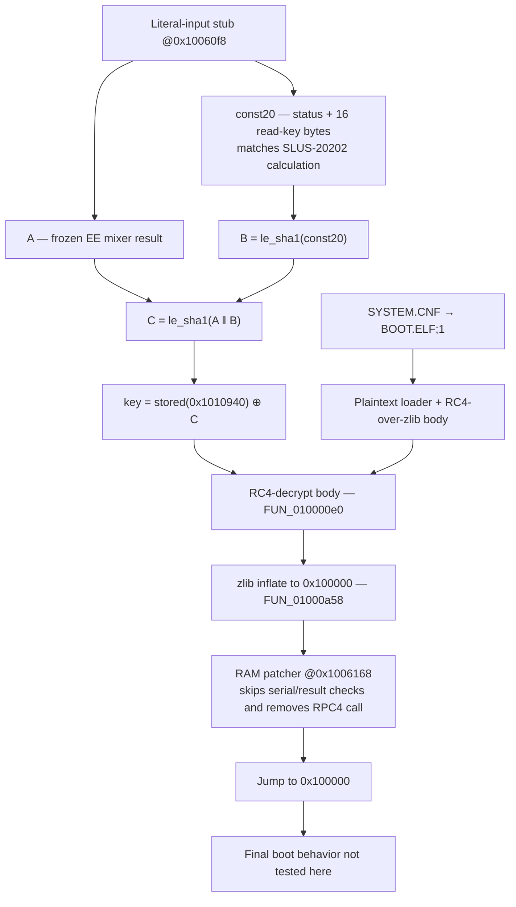

# CodeBreaker v10

[Research index](REVERSING.md) · [v9.2](V9.md) · [v10](V10.md) · [Review and follow-up](REVIEW.md)

## 1. CodeBreaker v10 loader (2026-10-28, corrected 2026-10-30)

A second image, to compare against the modified v9.2. Its body is
RC4-encrypted over zlib, behind a schedule that mixes an EE floating-point
result and a read-key reply (§1.5). The supplied **loader is modified**: a
stub hardcodes both schedule inputs and a RAM patcher skips payload checks
and an RPC call (§1.8). `tools/cbv10_unpack.py` reconstructs the key and
unpacks this image fully offline. Boot behavior on an unmodified console or
in PCSX2 was not tested.

The extracted payload identifies itself as `VERSION CodeBreaker PS2 V10.0`.
Its inspected signature verdict consumes the comparison result (§1.9), and
the loader's three RAM-patch locations contain the original calls in the
extraction. Those local observations do not establish pristine retail
provenance for the whole payload (§1.6).

> **Correction history.** The 2026-10-28 first pass misread the mixer and RPC
> as decoys. The 2026-10-29 pass located the hardcoded-input stub and RAM
> patcher. The 2026-10-30 review further established that the read-key bytes
> match a serial-derived software calculation, narrowed the payload-check
> description, and withdrew whole-image retail and impossible-emulation
> claims. The recovered key and payload bytes are unchanged.

### 1.1 Provenance and image

| | |
|---|---|
| Disc | `Code Breaker Version 10.iso`, UDF 1.5 volume `SMS25R4`, 2,122,383,360 bytes |
| `SYSTEM.CNF` | `BOOT2 = cdrom0:\BOOT.ELF;1`, `VER = 1.00`, `VMODE = PAL/NTSC` (plus a 2 GB `DUMMY.BIN` pad) |
| `BOOT.ELF` | 3,688,628 bytes, SHA-256 `aafabd9b9ef8b74349ee6aa4272e4efa3fc1fd9838ceed78a23afff2521f3f04` |
| Format | ELF32 LE MIPS-III (R5900 `e_flags 0x20924001`), one flat `PT_LOAD` at vaddr `0x1000000` (file `0x1000`), entry `0x1000008`, 9 section headers, no ps2-packer/N2E magic |
| Layout | plaintext loader `0x1000000`–`0x1012ab0` (entropy ≈5.5); RC4+zlib body after (≈8.0), no readable strings |

Corpus: `elf/CBv10.BOOT.ELF` and the decrypted `elf/CBv10.unpacked.bin`
(9,370,970 bytes, SHA-256 `9cb83c7f…`) remain gitignored. The text files
`elf/CBv10.SYSTEM.CNF` and loader decompilation
`elf/cbv10-loader-decomp.txt` are tracked. The `va→file` map is
`off = 0x1000 + (vaddr - 0x1000000)`.

### 1.2 Tooling

REA opens the file but can't analyze it ([v9.2 §3](V9.md#3-tooling)), so this used `analyzeHeadless`
12.1.4 `-processor MIPS:LE:64:64-32addr` with `DecompAt.java`, plus rizin for
instruction-level checks where Ghidra's lifter failed.

### 1.3 Unpack flow (`entry` → `FUN_010003a8`)

`entry` (`0x1000008`) is ordinary crt0: clear BSS `0x1383680..0x1385710`,
SetupThread/SetupHeap syscalls, then the unpack driver `FUN_010003a8`:

1. `FUN_01000248()` — derive the RC4 key (§1.5).
2. `FUN_010000e0(0x1012ab0, *0x1383580)` — RC4-decrypt the body in place,
   length `0xe9754`.
3. `FUN_01008f2c(0x80000, 0, 0x1c00)` — memset the zlib window.
4. `FUN_01000a58(0x100000, ..., 0x1012ab8, *0x1012ab4)` — zlib-inflate the
   decrypted body (input at `0x1012ab8`, length at `0x1012ab4`) to `0x100000`.
5. `FUN_01008e80(dst, src, len)` ×5 — memcpy inflated slices to their runtime
   addresses `0x1d00000`, `0x1d64000`, `0x1d7d000`, `0x1de1000`, `0x1500010`.

So the body is zlib-compressed, then RC4-encrypted; recovery is RC4-decrypt
then inflate — once the key is known.

### 1.4 Primitives

| Role | Function(s) | Notes |
|---|---|---|
| RC4 KSA | `FUN_01003dc0` | S-box + two index bytes at `+0x100/+0x101` |
| RC4 PRGA | `FUN_01003e58` | keystream `S[(S[i]+S[j])&0xff]`, XORed into data |
| RC4 wrapper | `FUN_010000e0(data,len)` | S-box `0x1012980`, key `0x1010940` len `0x14` |
| zlib inflate | `FUN_01000a58` | `inflateInit_(strm,"1.1.4",0x48)` `FUN_01000d40`, `inflate(strm,4)` `FUN_01000d68`, `inflateEnd` `FUN_01000b88` — zlib 1.1.4 |
| SHA-1 | init `FUN_01003ff0` / update `FUN_01004038` / final `FUN_010040f8` | IV `67452301 efcdab89 98badcfe 10325476 c3d2e1f0`, 20-byte digest |
| memcpy / memset | `FUN_01008e80` / `FUN_01008f2c` | 16-byte-aligned fast path + byte tail |
| cache flush | `FUN_010009b0` | `syscall` |

Stored RC4 key bytes at `0x1010940`:
`ce67d054 669226d4 65cadff9 d9c3245c 18ffdde8` — but this is not the key used;
it is XORed with a runtime value (§1.5).

### 1.5 Key schedule (`FUN_01000248`): solved

The RC4 key is `stored(0x1010940) ⊕ C`, where `C` is the last of three chained
SHA-1 hashes. The retained key-derivation code supplies two inputs:

* Four `FUN_010009c0(constA, constB)` calls build a 32-byte seed at `0x1010980`
  with a 10-round EE single-precision float bit-mixer (`madd.s`/`msub.s`, keeping
  low result bits). The first SHA-1 hashes that seed to `A` at `0x1012a88`.
  Reproducing the unmodified mixer requires the relevant EE arithmetic
  results; it has not been independently reproduced here. No console-unique
  identity input or cycle-accuracy requirement was established.
* `FUN_01000150` performs a SIF-RPC to the IOP (`0x8000059x`) and supplies a
  20-byte reply as `const20` at `0x1010980`. In this image the frozen reply is
  a status word followed by 16 read-key bytes. Applying
  [PCSX2's `cdvdReadKey` calculation](https://github.com/PCSX2/pcsx2/blob/33127ad0df121e5b831494c389068ed9f9f3ad4b/pcsx2/CDVD/CDVD.cpp#L583-L620)
  to `SLUS-20202` gives `9369953955000000000000000000bc05`, exactly matching
  the stub's key bytes. With status 1, the full reply matches all five
  `const20` words. It is reproducible in software, not an inaccessible secret.
  Original-console optical authentication remains untested.
* The firmware's SHA-1 writes its five state words EE-native little-endian,
  rather than the standard big-endian digest, so every hash is byte-swapped
  per word.

**This image is cracked** (§1.8): a stub at `0x10060f8` hardcodes *both*
runtime inputs. It writes `const20` and `A` as literal immediates, so the
key no longer depends on the live RPC reply or mixer result and is fully
static. With `le_sha1(x)` = per-word byte-swap of a standard SHA-1 digest, and
the stub's two blocks (verified in §1.8):

```
const20 = {1, 0x39956993, 0x55, 0, 0x05bc0000}            @ 0x1010980
A       = {938ca6bf,e620cc81,137a84c2,78ae9796,889dca10}  @ 0x1012a88
B       = le_sha1(const20)                                # 2nd SHA1 -> 0x1010980
C       = le_sha1(A ‖ B)                                  # 3rd SHA1 -> 0x1010980
key     = stored(0x1010940) ⊕ C
        = 29f32f09 0c66b07d c5b12c51 695e432e b1d8ea10
```

In the file both `0x1010980` and `0x1012a88` are zero-filled buffers; the stub
supplies the constants at runtime. The SHA-1 endianness was the wall.
`tools/cbv10_unpack.py` derives this key, RC4-decrypts the body and inflates it
to `elf/CBv10.unpacked.bin` (9,370,970 bytes, SHA-256 `9cb83c7f…`), which is
full of plaintext CodeBreaker UI strings — decrypted entirely offline, no
hardware or PCSX2 run.

The unpacker returns status 2 for invalid keys, truncated or inconsistent body
lengths, invalid or incomplete zlib streams, and inflated-size mismatches. It
validates the payload before opening the output file, so invalid input leaves
an existing output unchanged. Status 0 means a complete, size-checked payload
was written.

### 1.6 Modified loader, extracted v10 payload

The decrypted image says `VERSION CodeBreaker PS2 V10.0`, credits Pelican
Accessories and `www.codebreaker.com`, and loads `pelican.bin`, with no
`PS2TG`/`misfire`/`RSA Patch`/`Anti-Modchip` markers found. Its signature tail
uses the comparison result (§1.9). The three locations later changed by the
RAM patcher (§1.8) are intact in the extraction: `0x115b14` is
`jal 0x1310f8; nop`, and `0x1142c0` is `jal 0x130e18`.

These observations establish the inspected paths, not whole-image
unmodified status. No clean reference or authenticated vendor digest was
compared. Use this as the identified v10 artifact for comparison with v9.2,
without assuming every other byte or release is stock. The surrounding
loader's hardcoded inputs and RAM patcher are independently located changes.

### 1.7 Cross-check on hardware

The static key can be confirmed dynamically: in PCSX2's R5900 debugger, set an
EE execution breakpoint at `0x010000E0` (`FUN_010000e0`, the RC4 wrapper, run
just after key derivation) and read `0x14` bytes at `0x01010940` — it should be
`29f32f09…b1d8ea10`. Or breakpoint after the inflate and dump EE RAM from
`0x00100000` for the inflated length to get the image directly, with the §1.3
memcpy targets (`0x1d00000`, …) holding the runtime layout. Not run here; the
offline unpack already produced the image.

### 1.8 The key schedule and the located modifications

The retained schedule mixes the EE arithmetic result `A` and read-key reply
`const20` as `key = stored ⊕ le_sha1(A ‖ le_sha1(const20))` (§1.5). The supplied
loader freezes both inputs. The read-key bytes are serial-derived; the
unmodified FPU computation and original-console authentication behavior have
not been independently reproduced here.

The following modifications are verified against `BOOT.ELF` (loader
`va→file = 0x1000 + (va − 0x1000000)`):

1. **`sceSifCallRpc` is stubbed.** `0x10060f0` is `jr ra; nop`. The stub right
   after it (`0x10060f8`) writes the two schedule inputs as literal immediates
   (`lui`/`ori`/`sw`, base `0x1010000`):
   * `const20` → `0x1010980`: `{1, 0x39956993, 0x55, 0, 0x05bc0000}`
   * `A` → `0x1012a88`: `{938ca6bf, e620cc81, 137a84c2, 78ae9796, 889dca10}`

   Both buffers are zero in the file. The writes make the key independent of
   live results, which is why the unpack can run offline with the same key.
2. **A RAM patcher changes payload initialization.** The unpack driver exits
   through `0x10004c0` (`lui at,0x10; j 0x1006168`) into a patcher at
   `0x1006168`. It overwrites three words of the inflated payload:
   `0x115b14 ← sw zero,-0x5e98(s0)`, `0x115b18 ← b 0x115b34`
   (originally `jal 0x1310f8; nop`), and `0x1142c0 ← nop`
   (originally `jal 0x130e18`), then jumps to `0x100000`.

   The first two writes clear failure state `0x9ea168` and skip both the
   serial check at `0x1310f8` and a separate result check at `0x131050`, called
   at `0x115b30`. The former decodes a read-key reply and checks `SLUS` and
   decimal `20202`, then opens `SYSTEM.CNF`; the latter tests a byte of another
   RPC result against `0x20`. Failure handling at `0x114a50` marks error flags;
   it does not itself halt. The third write removes a function-4 call to
   custom RPC server `0xfa6a007e`. Its server-side meaning remains unresolved,
   and the caller at `0x1142c0` does not test its return value.

The writes apply in RAM only; the extraction still contains those original
calls (§1.6). All three sites lie outside the inspected code-crypto and
signature functions. This permits comparison of those functions, but does
not authenticate the whole payload or establish the final boot/failure
outcome. The little-endian SHA-1 is a schedule detail, not an extra secret.

The 2026-10-28 first pass mistook frozen results for discarded decoys. The
located modification freezes inputs that the retained schedule actually
hashes; it does not show those inputs are inherently impossible to emulate.

### 1.9 Spot check: v10's signature verdict is intact

The extracted v10 payload consumes the final signature comparison, unlike
the inspected v9.2 image ([v9.2 §8](V9.md#8-caveats)). This is a local verifier observation, not proof
of whole-image retail status or signature-scheme security. v10's `memcmp` is
at `0x144740`, byte-identical to v9.2's `FUN_0014611c`, and its RSA verify —
the v10 analog of `FUN_00132ed8`, same stack frame — ends (base `0x100000`):

```
0x1316a8  jal   0x144740         ; memcmp(expected, recovered)
0x1316ac  addiu a2, zero, 0x100  ; 256 bytes
0x1316b0  ld    ra, 0x340(sp)
0x1316b4  sltiu v0, v0, 1         ; v0 = (memcmp == 0): 1 iff the blocks match
0x1316c8  jr    ra
```

The verdict is the compare result, and all three `memcmp` callers in v10
consume it (the other two branch on it). The corresponding v9.2 location
returns constant success instead:

| | address | instruction | word |
|---|---|---|---|
| inspected v10 | `0x1316b4` | `sltiu v0, v0, 1` | `2c420001` |
| v9.2 PS2TG | `0x132fec` | `addiu v0, zero, 1` | `24020001` |

The full instruction words differ: `0x2c420001` is `sltiu v0,v0,1`, whereas
`0x24020001` is `addiu v0,zero,1`. Both the opcode and source-register field
change; changing only `2c` to `24` would give `addiu v0,v0,1`. Replacing the
whole word is a one-instruction way to turn the comparison verdict into
constant success. Comparison across these two releases locates that behavior
and agrees with the v9.2 patch marker, but does not identify the exact
pre-patch v9.2 word or every historical patch. Anchors: v10 base `0x100000`,
`memcmp` `0x144740`, verify tail `0x1316a8`.

### 1.10 Key reconstruction and RAM patches at a glance

The schedule combines two inputs, but this is not evidence of two inaccessible
secrets. The supplied image has literal values for both; the read-key bytes
also match the software calculation described in §1.5. The local visual
explainer is `docs/disc-lock.html`. The earlier privately published snapshot
(`https://claude.ai/artifact/Hht3YyqSzyNPXyXtbgSuZS`) may predate these corrections.



The recovered key is `29f32f09 0c66b07d c5b12c51 695e432e b1d8ea10`, and the
body decrypts and inflates offline. A wrong key normally produces unusable
compressed data, but that alone does not establish copy protection or a
particular failure path. The unmodified mixer, optical-media authentication,
IOP service semantics, and final boot behavior remain separate questions.

The RAM writes in §1.8 have three distinct effects: clear failure state and
branch past the serial/result checks, remove a separate custom RPC call, and
then enter the payload. The inspected v10 signature tail still uses its
comparison result; that limited observation should not be expanded into a
claim that the extracted payload is wholly untouched retail firmware.

## 2. v10 vs v9.2: the full code-crypto diff (2026-10-29)

The extracted v10 payload (§1) permits an artifact-to-artifact comparison
with the modified v9.2 image. The inspected code-crypto primitive layer
matches modulo verified relocations, while four V7 state-machine functions
differ. This result applies to these identified images; v7/v8 images and
whole-image retail provenance remain unverified.

### 2.1 Method

`tools/cbcrypt_diff.py` compares explicitly bounded function ranges and
normalizes call/data addresses only through verified mappings. Unknown
addresses retain their identity and unresolved mappings cannot justify an
“identical” verdict. Function ends are supplied from the inspected ranges,
not guessed from the first return instruction. The earlier implementation
could hide changed targets and truncate memcpy
([review F2](REVIEW.md#f2-the-relocation-normalizer-can-hide-real-changes-and-omit-function-tails)).

The script is a static comparison aid, not proof of behavioral equivalence.
For the complete 896-word bignum core, an independent raw-word check found
only call-target changes: internal targets move by `−0x1938`, and external
calls map to the identified primitive counterparts. The full 106-word memcpy
span is byte-identical. v9.2 uses `va→file = va−0x100000+0x1000`; v10 is raw at
base `0x100000`.

```
cd research && python3 -I tools/cbcrypt_diff.py
```

The default status is 1 when functions differ and 2 for invalid input.
`--allow-differences` permits a version survey containing changed functions,
but cannot turn an unresolved equality into success. It does not assert that
the changed functions are expected or behaviorally equivalent. The identified
images report 12 identical ranges, four changed functions, and no unresolved
equalities; the details remain in the printed listing.

The static diff is cross-checked by emulation. `tools/ghidra/EmuP.java` is
`Emu.java` with a per-image address table (`v92`/`v10` argument), so the real
v10 functions run on real inputs; `tools/fwmodel10.py` is an executable v10
model, written as a diff-subclass of `fwmodel.py` (the changed functions in
§2.3 as code). `tools/emudiff10.py` compares the v10 emulation with the crate
and model; `tools/cmpout.py` compares the two images' emulations line by line;
`tools/attrib.py` puts each change behind a flag and confirms all flags off
reproduces the v9.2 emulation and all on reproduces v10. Its five flags
separate reset/init behavior, non-init rekey derivation, outer reinitialization,
forced-line handling, and the misplaced key word. The attribution applies to
the checked corpora, not every possible state history. `tools/runemu.sh`
drives the headless runs, and `tools/wrap.py` makes the Ghidra-loadable v10
ELF from the raw `.bin`.

The runner waits for every worker and returns nonzero if any fails. Each run
clears its old `.out`/`.cov` files and requires fresh nonempty results plus
EmuP's completion marker in the log; the headless process's exit status alone
does not establish script completion. Image and corpus names are validated
before launching workers, including rejection of duplicate corpus names.

### 2.2 Verdict

| Function | v9.2 | v10 | insns | Verdict |
|---|---|---|---|---|
| `num_code_lines` | `0x1033c0` | `0x104470` | 20 | identical (reloc) |
| V1 decrypt | `0x103410` | `0x1044c0` | 51 | identical |
| `mod_inverse` | `0x1034e0` | `0x104590` | 39 | identical |
| `mul_decrypt` | `0x103580` | `0x104630` | 11 | identical |
| RC4 init / crypt | `0x132c98` / `0x132d30` | `0x131360` / `0x1313f8` | 37 / 33 | identical |
| bignum / RSA core | `0x133220`–`0x134020` | `0x1318e8`–`0x1326e8` | 896 | identical |
| RSA modpow wrapper | `0x134020` | `0x1326e8` | 9 | identical |
| memcpy / memset | `0x1461b0` / `0x146358` | `0x1447d4` / `0x14497c` | 106 / 43 | identical |
| `__udivdi3` / `__umoddi3` | `0x14cbd8` / `0x14d1a8` | `0x14b230` / `0x14b800` | 372 / 336 | identical |
| **reset** | `0x104548` | `0x1052a8` | 5 → 33 | **changed** |
| **rekey** | `0x1035b0` | `0x104660` | 620 → 439 | **changed** |
| **V7 decrypt** | `0x103f60` | `0x104d40` | 212 | **changed (1 insn)** |
| **auto decrypt** | `0x1042b0` | `0x105090` | 165 → 133 | **changed** |

Counts exclude alignment padding after the final return/tail-jump delay slot.
The bignum row is the complete aggregate code range, not a single function.

The whole crypto primitive layer — V1, RC4, the bignum/RSA core (including the
[v9.2 §9.4](V9.md#94-difference-the-firmwares-rsa-is-wrong-near-the-modulus-kept-105d376) reduction defect, so **v10 has the same RSA bug**),
inverse/multiply, memcpy/memset and the libgcc division — is identical modulo
relocation. Only the four V7 state functions changed.

### 2.3 The four changed functions

**V7 decrypt (`0x104d40`): one instruction.** The 212-instruction body is
identical except the key-from-line store: v9.2 `sw v0,0x10(s3)` (`0x10427c`,
`key[4]`) vs v10 `sw v0,0x14(s3)` (`0x10505c`, `beefcodf`), both after the same
`(a−v)^kc4`. (The diff also flags the `opt` read at `0x104218`/`0x104ff8`, but
both reach `opt`; that one is a relocation, not a change.) A bit-17 key line
stores the derived word into `beefcodf` in v10. If it is nonzero, the next V7
line is taken as a `BEEFC0DF` extra-seed line; zero leaves that behavior unarmed.

**reset (`0x1052a8`): zeroes the default seeds.** v9.2 clears the mode word and
`code_lines` in 5 instructions. v10 adds a stack frame and five
`memset(defV7seeds + 0x100·i, 0, 256)` calls (i=0..4), zeroing the default V7
seed table on every list.

**rekey (`0x104660`): init ignores `val`.** Recompiled (620 → 439 insns: v9.2
emits per-table aligned+unaligned `ldl/ldr/swl/swr` seed copies — the dead
unaligned paths of [v9.2 §9.8](V9.md#98-coverage) — where v10 uses tighter `ld/sd` loops). The behaviour
change: v10's `init≠0` path overwrites `a1` (the `val` argument) with the
default-seed pointer at `0x104698` and copies from there. After reset zeroes
those defaults, the initialized state equals v9.2's `rekey(1, 0)` for any
`val`: a fresh beefcode starts from zeroed seeds.

The non-init path also changed: `rekey(0,val)` derives key byte `j` from seed
index `(val + j) & 255`, instead of byte `j` of `val`, and no longer clears
seeds for `val == 0`. This is visible at `0x104a98` onward and implemented in
`fwmodel10.py`. The outer reinitialization normally overwrites this
intermediate work, but it is a real function-level difference (direct-call
vectors are in
[review F4](REVIEW.md#f4-the-v10-summary-incorrectly-removes-all-options-and-omits-a-rekey-change)).

**auto decrypt (`0x105090`): no forced V7 line, always rekey(1).** The V7 test
uses mode bit 16 only: no `opt==2` force (`movz`) and no
`if (opt==2) { opt=0; return; }`. The outer beefcode always does
`mode|=V7; rekey(1,val)` (`li a0,1` at `0x105254`), where v9.2 uses
`rekey(0,val)` when V7 is already on.

The remaining option handling is retained: `FFFFFFFF` recognition, mode/count
storage, restoration of the saved mode, bit-17 state, and the key-from-line
path. See `0x1051a8–0x1051f4` and `0x105204–0x105228`. For example,
`FFFFFFFF 00000001` still turns V7 off until one counted decrypted line
restores it
([review F4](REVIEW.md#f4-the-v10-summary-incorrectly-removes-all-options-and-omits-a-rekey-change)).

### 2.4 Net effect and consequence

* Every decrypted beefcode reaching the outer beefcode check reinitialises
  to the default state (zeroed seeds, default key, 5 RC4 rounds, `opt=0`,
  `code_lines=1`). `BEEFC0DE vvvvvvvv` behaves like
  `BEEFC0DE 00000000` — the value is ignored — and a second beefcode resets
  rather than rekeying twice.
* The line-derived word from a bit-17 key line lands in `beefcodf`, not
  `key[4]`; if nonzero, it makes the next V7 line an extra-seed line. Options
  remain recognized, but their forced-line behavior differs as described above.
* V1 decrypt, line counting, `BEEFC0DF`'s extra line and the RSA bug ([v9.2 §9.4](V9.md#94-difference-the-firmwares-rsa-is-wrong-near-the-modulus-kept-105d376)) are
  unchanged.

The crate follows the v9.2 state machine, with its intentional RSA/bit-17
differences ([v9.2 §9.2](V9.md#92-verdict-per-rust-function)). Sequences with nonzero or repeated beefcodes, counting that
reaches zero on a beefcode, or bit-17 options can therefore differ from v10.
A single default initial `BEEFC0DE 00000000`, followed by lines that do not
exercise differing transitions, reaches the same state on both images.

The 2026-10-29 emulation sweep reported that 87 of 120 plaintext lists
re-encrypted for v10 fail to round-trip under the v9.2-shaped crate. The
cb2util fixture sweep agrees on 50 of 53 lists; the remaining three are
synthetic `beef.enc` tests. These are corpus results, not a guarantee over all
published codes or firmware releases. [review §1](REVIEW.md#1-review-of-all-findings-2026-10-30) records the independent re-review
of the models, selected firmware vectors, and the raw primitive-core check.

The list→engine converter (`0x102e38` / `0x1034c8`) also changed, but it is
engine-side formatting, not crypto, and `src/` returns beefcodes to the caller
instead ([v9.2 §6.7](V9.md#67-list-converter)). `src/` targets v9.2 and the device as decompiled; no v10 support
is proposed. This is recorded so a future "support v10" task starts from the
right diff.

### 2.5 Compatibility on the checked corpus

`tools/fixdiff.py <cb2util code lists>` runs both firmware models over a code
corpus and reports differing games and the relevant beefcode/option forms.
On the checked cb2util fixtures (`593ea25`), it compares 53 lists and 6,234
lines. The 50 game lists agree; three synthetic `beef.enc` lists differ on
11 lines. The game lists do not exercise the nonzero/repeated beefcode or
option paths responsible for the observed version differences. This does not
establish that no distributed code ever used those paths.

There is also a conditional equivalence argument: with the same starting
state, one default initial beefcode, and no later differing state transition,
the matched primitives produce the same subsequent outputs. A single default
beefcode alone is not sufficient when later option handling differs. The
crate's deliberate RSA and bit-17 departures remain separate limitations.

Reproduce the small examples with `tools/compat_demo.py` from `research/`:

```
plain   BEEFC0DE 00000000: v9.2==v10 ? True
value   BEEFC0DE 0000002A: v9.2==v10 ? False   (line 1 on: 01234567 -> 2E432A2B ...)
second  BEEFC0DE 0 .. BEEFC0DE 0: v9.2==v10 ? False  (lines after the 2nd beefcode)
```

The nonzero and repeated-beefcode examples demonstrate incompatibility;
`tools/attrib.py` attributes divergent checked fuzz lists to individual state
changes. Together these explain the matching fixture result without extending
it to every published code or every v7+ device.
